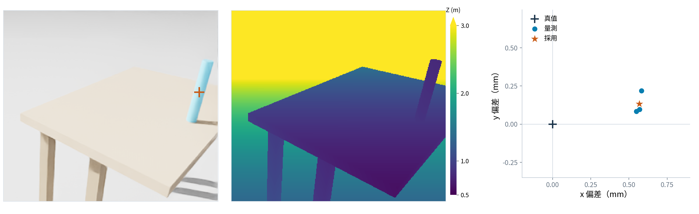

# 實驗兩頁定稿：視覺定位與在線移動抓放

兩頁使用同一趟 `bottle_rb1_1`，第一頁檢查視覺目標，第二頁播放完整任務。不要再把方法頁用過的任務切換截圖或曲線重放一次。圖片與影片保持精簡／無文字；解讀放在投影片文字，細節放講者備註。

## 第一頁｜實驗一：視覺定位與目標採用驗證

### 可直接貼到投影片的文字

**實驗目的**：在不向視覺定位器輸入瓶位真值與生成桌高的條件下，驗證相機量測能否形成新鮮、穩定且可交給控制器的抓取目標。

**一、資料來源與三維定位**

- 輸入為手腕 **RGB-D、相機內參與擷取時刻相機位姿**；Mask R-CNN 只從 RGB 取得瓶身遮罩。
- 將遮罩內有效深度反投影至環境座標，依直立瓶與**已知半徑 15 mm**擬合瓶心 xy；由瓶子周圍深度估計支撐高度。
- **量測與先驗分開**：瓶心與支撐高度來自量測；抓持帶 0.10 m 為任務先驗，抓取高度由 `z_grasp = z_support + 0.10 m` 產生，不是 CNN 直接預測抓取姿態。

**二、有效目標形成與採用條件**

- 最近連續 **至少 3 列**瓶心 xy 與支撐觀測均有效；中心 x／y 與支撐高度的跨幀標準差皆 **≤ 3 mm**，才形成穩定候選及快照。
- 完成快照檢查與抓取計畫後，承接時仍核對**觀測年齡 ≤ 0.50 s**，且目前合格觀測與計畫目標一致（偏差 ≤ 2 mm）；否則不直接採用。

**三、本趟結果**

| 評估項目 | 本趟結果 |
|---|---:|
| 採用目標的瓶心 xy 誤差 | **0.58 mm** |
| 量測支撐高度 | **約 0.580 m**，場景桌面設定 0.580 m |
| 生成抓取高度 | **約 0.680 m**，量測支撐加抓持帶先驗 |
| 計畫承接時觀測年齡 | **0.20 s**，小於 0.50 s 門檻 |

**結論**：本趟在 **12.15 s** 完成在線計畫承接，證實此案例的視覺估計已實際進入控制鏈，而不只是畫面辨識或旁路記錄。

### 圖片與版面

使用精簡圖，橫向全寬放在頁面中央，不再把標題、數字或結論燒進圖內：

- [PNG](圖表/視覺定位驗證_精簡版_20261103_v2.png)
- [SVG](圖表/視覺定位驗證_精簡版_20261103_v2.svg)

圖旁或圖下的一句說明：

> 左：RGB 與採用目標重投影；中：同影格深度；右：三列來源量測及採用快照相對模擬真值的水平偏差。

建議配置：上方一句目的；「資料來源與定位」和「有效目標條件」以兩欄排版；中央放精簡圖；下方放結果與一句結論。若同頁空間不足，方法區每點只留粗體關鍵字，完整說明放備註。結果表與並排數字擇一，不重複放。

### 頁底小字

Isaac 物理模擬、同型瓶、單趟示例；中心使用已知半徑與直立模型，抓持帶為先驗。橘色叉號是採用目標重投影，非模型遮罩；真值僅供評估，不提供視覺目標。

### 講稿（依選講細節約 60–90 秒）

「這一頁驗證的不只是能不能辨識瓶子，而是相機量測能不能形成控制器真正採用的抓取目標。模型先從 RGB 取得瓶身遮罩，再結合有效深度、相機內參與擷取時刻位姿，把瓶身表面轉到環境座標。瓶心擬合保留已知半徑先驗，支撐高度則從瓶子周圍的深度估計，沒有把生成桌高填入視覺定位。也就是說，瓶心和支撐是量測，半徑與抓持帶是先驗，兩者要分開報告。抓取高度由支撐加上 0.10 公尺抓持帶產生，不是網路直接輸出一個完整抓取姿態。候選至少需要連續三列有效，中心與支撐的跨幀標準差在 3 mm 內。即使後續檢查與規劃已完成，承接當下仍確認量測年齡小於 0.5 秒，並與計畫目標一致。圖中本趟採用目標的水平誤差為 0.58 mm，支撐約 0.580 m，因此抓取高度約 0.680 m；12.15 秒承接時，觀測年齡為 0.20 秒。這表示本案例的視覺資料有通過有效性與新鮮度檢查，真正進入控制鏈；不是用單趟資料宣稱普遍定位精度。」

## 第二頁｜實驗二：全身協調與任務參考切換驗證

### 可直接貼到投影片的文字

**實驗目的**：驗證同一個全身 GMPC 能依操作階段與接觸狀態，從「對準環境中的目標」切換為「依底盤相對參考移動」，完成視覺引導的移動抓放。

**一、切換前：環境參考追蹤（抓取與初段抬升）**

- TCP 對準視覺建立的環境操作目標；底盤前進時，手臂配合補償，完成閉爪與初段抬升。

**二、切換時機：依抓持與離桌狀態判斷**

- 抓持成立、桌面卸載且瓶底間隙達門檻後，於本趟任務 **21.44 s** 切換參考；不是只到固定時間就切換。

**三、切換後：底盤相對參考追蹤（後段抬升與運送）**

- 以切換當下的實際末端位姿建立底盤相對參考，讓 TCP 繼續相對抬升並隨底盤移動，不再要求維持原本的環境水平位置。
- 全程沿用同一個 GMPC；改變的是追蹤參考，不是更換控制器。到第二桌後再依放置階段的參考完成下放、鬆爪與退離。

**本趟結果：完成 48.40 s｜放置偏差 1.59 mm｜最大滑移 4.38 mm。**

**結論**：本趟以同一個全身 GMPC 完成「對準環境目標 → 切換底盤相對參考 → 運送與放置」的任務流程。

### 影片與版面

- [無文字三視角、兩倍速 MP4](影片/20261103_RB1_雙相機模型框與跟車_兩倍速_無文字_v3.mp4)
- [影片數據與來源 JSON](影片/20261103_RB1_雙相機模型框與跟車_兩倍速_無文字_v3.json)
- [無文字預覽](圖表/RB1_雙相機模型框與跟車_兩倍速_無文字_預覽_20261103.png)

影片放大為本頁主體，保留目前無文字版本：左為跟車、右上為手腕、右下為底盤相機，綠框為模型偵測框。文字用「切換前／切換條件／切換後」三個區塊放在影片旁邊或下方，不疊到影片上，不再新增切換示意圖或曲線。

影片規格：1920×960、H.264、50 fps、2 倍速、25.22 秒。**48.40 秒是原任務時間，不是加速播放後的片長**；抓取時維持移動，後段停車是為了放置。

### 頁底小字

Isaac 模擬實錄重播，n＝1，影片 2 倍速。兩路相機使用原始存檔，標註框為同權重離線重算；抓取目標仍來自原趟線上手腕快照。

抓持／離桌切換的接觸力與瓶底間隙仍取自模擬器；實機感測／估測及切換驗證尚未完成，屬實機移轉的關鍵缺口。

### 播放時指出三個關鍵事件

| 指出什麼 | 原任務時間 | 兩倍速影片位置 |
|---|---:|---:|
| 視覺目標與抓取計畫已承接 | 12.15 s | 約 6.08 s |
| 任務參考切換 | 21.44 s | 約 10.72 s |
| 任務完成 | 48.40 s | 約 24.20 s |

時間表放講者備註，不必整張放上投影片。12.15 s 是「計畫承接」，不是首次看到瓶子的時間。

### 講稿（配合約 25 秒影片）

「這頁重點是任務參考如何切換，不只是展示抓放成功。前段夾爪必須對準環境中的瓶子，因此底盤往前走時，手臂要配合補償。抓持成立、桌面卸載且瓶底間隙達門檻後，在影片約 10.72 秒、原任務 21.44 秒處，改成底盤相對參考。這時不能再要求夾爪停在原本的環境水平位置，而是要讓它繼續抬升、隨車運送。改變的是追蹤參考，仍使用同一個全身 GMPC；到第二桌再接續放置。本趟原任務時間 48.4 秒，放置偏差 1.59 mm，最大滑移 4.38 mm。」

## 只放備註，不塞進主頁的資料界線

1. **同一趟的兩種檢查，不是兩趟獨立試驗。** 第一頁定位與第二頁任務皆取自 R-B1，同型瓶、已知任務區域與放置桌先驗，n＝1。
2. **視覺不是直接輸出完整抓取姿態。** 量測是中心 xy 與支撐高度，抓取高度由量測支撐加抓持帶先驗 0.10 m 產生；中心擬合含半徑 15 mm 先驗。
3. **精度只限此模擬資料。** 未把支撐高度約 2 微米的理想模擬差異當成實機精度；本頁支撐高度顯示到 0.580 m 即可。
4. **影片框不是線上採用證據。** 框以同凍結模型對兩路保存 RGB 離線重算，不使用真值或深度挑框，無偵測不補框；當趟控制使用哪張快照與何時採用，依原始線上紀錄。
5. **不是雙相機融合抓取。** 底盤相機框是展示，本趟抓取目標仍來自手腕 known_type 快照。
6. **無文字影片的存檔節奏不變。** 相機存檔間隔約 0.20–1.05 秒，以當下或更早的影格保持到下一張，不補未來影格或插值；跟車使用原有 25 Hz 姿態重播，未重新啟動模擬。
7. **參考切換不等於更換控制器。** 21.44 秒為初段抬升的參考切換；後續完整離桌判定在 23.08 秒，兩個事件不要混稱。
8. **「同一 GMPC」不等於所有東西都在同一 QP。** 感知、候選檢查、在線規劃與參考排程在 GMPC 外部；底盤與手臂的控制決策由全身耦合求解。
9. **通過條件不推成普遍保證。** 本趟完成且抓持品質合格，不代表不同物品、任意位置、任意桌高或所有動態會遇皆可靠。
10. **接觸狀態尚未實機化，不只是精度限制。** 抓持、初段離桌參考切換及放置鬆爪的部分准入依賴模擬接觸力與瓶位姿／桌面幾何；現有 RGB-D 目標不等於能在夾爪遮擋下可靠觀測瓶底間隙。後續須驗證實機感測／估測、來源時間戳、延遲與缺測處置，不能直接搬用模擬門檻或用過期狀態／真值回填。詳見 [實機感測要求](../reviews/20261103_howard_contact_sensing_sim2real.md)。

## 來源

- `evaluation/runs/bottle_rb1_1/s1_report.json`
- `evaluation/runs/bottle_rb1_1/candidates.jsonl`
- `evaluation/runs/bottle_rb1_1/s1_steps.npz`
- `evaluation/runs/bottle_rb1_1/v1_frames.npz`、`w1_frames.npz`
- `第七次進度報告素材/規格/瓶子區域任務RB1_新區域.md`
- `第七次進度報告素材/圖表/視覺定位驗證_RGBD與實際採用目標_20261103_v1.json`
- `第七次進度報告素材/影片/20261103_RB1_雙相機模型框與跟車_兩倍速_無文字_v3.json`
