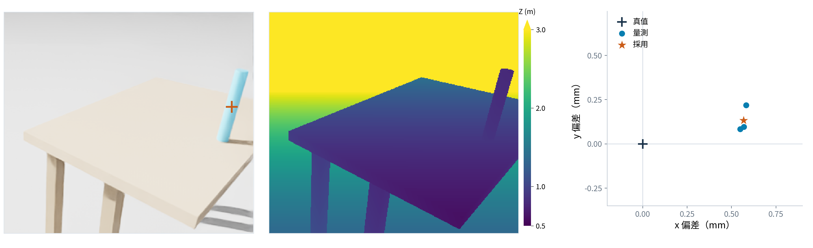
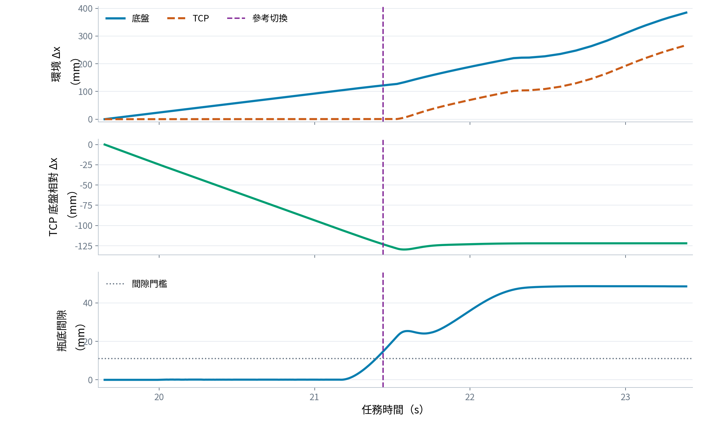

# 實驗頁：視覺定位與任務參考切換驗證

兩頁皆使用 `bottle_rb1_1` 的既有 Isaac 物理模擬紀錄，n＝1。最新投影片安排為「視覺定位驗證圖＋三視角兩倍速實驗影片」。下方曲線保留為備用，不再重複放方法頁的執行截圖。靜態圖未做新推論；影片標註框由原凍結模型對保存 RGB 離線重算。未啟動新模擬、訓練或修改控制。

## 第 1 頁｜視覺定位與目標採用驗證

### 投影片文字

**實驗目的**：驗證視覺量測能否形成有效抓取目標，並在線交給控制器。

- 手腕 RGB-D 結合相機內參與擷取時刻位姿，估計瓶心 xy 與支撐高度。
- 連續 3 列有效且穩定的量測形成快照，完成檢查後生成在線抓取計畫。
- 本趟採用目標的瓶心 xy 誤差 **0.58 mm**；計畫承接時觀測年齡 **0.20 s**。
- 量測支撐高度 **0.580002 m**（場景桌面設定 0.580 m）；在線計畫於 **12.15 s** 承接。

**本頁結論**：本趟完成「視覺量測 → 有效目標 → 在線計畫承接」，瓶子生成座標不作為控制目標。

### 圖片

- [PNG](圖表/視覺定位驗證_精簡版_20261103_v2.png)
- [SVG](圖表/視覺定位驗證_精簡版_20261103_v2.svg)
- [來源與精簡版說明](圖表/視覺定位驗證_精簡版_20261103_v2.json)
- [原始製圖數據](圖表/視覺定位驗證_RGBD與實際採用目標_20261103_v1.json)

**圖說放投影片文字，不嵌入圖內**：左為手腕 RGB 與採用抓取目標重投影；中為同影格光軸深度；右為快照三列量測與採用結果相對模擬真值的水平偏差。影格為 11.54 s，快照來源時間為 11.54–11.95 s。圖例「真值」僅供評估，橘色叉號不是模型遮罩。

### 小字註記

Isaac 物理模擬，單趟示例。中心估計使用已知半徑 15 mm，抓持帶 +0.10 m 為先驗；模擬真值僅供評估與既有安全網，不提供視覺估計目標。圖中叉號為採用目標重投影，非模型遮罩。此例不是獨立模型準確率、實機精度或跨物體泛化證據。

### 講稿

「這一頁先確認控制器收到的目標真的來自視覺。左邊與中間是同一張保存的手腕 RGB 與深度，左邊叉號把實際採用的抓取目標投回影像，方便看出目標位於瓶身哪裡。右邊是這張快照的三列來源量測，與承接時的模擬真值比較。採用目標的水平誤差約 0.58 mm，量測支撐高度為 0.580002 m，場景桌面設定是 0.580 m；抓取高度再由量測支撐加上已知抓持帶 0.10 m 產生。快照來源時間是 11.54 到 11.95 秒，12.15 秒承接計畫，當時觀測年齡為 0.20 秒。這裡驗證的是本趟資料與控制鏈有接起來，不是用單一案例宣稱整體定位精度。」

### 補充數據與口徑

| 項目 | 值 | 說明 |
|---|---:|---|
| 快照來源擷取時間 | 11.54–11.95 s | 3 列；相機僅約每秒存一張 RGB-D，所以圖示首幀 |
| 首次合格目標／計畫請求 | 12.05 s | 完成快照檢查後 |
| 計畫承接 | 12.15 s | 觀測年齡 0.20 s |
| 合格目標到承接 | 0.10 s 模擬時間；約 0.176 s 牆鐘 | 不稱為整條感知延遲 |
| 計畫計算 | 約 142 ms 牆鐘 | 背景工作者，不阻塞控制拍 |
| 瓶心 xy 誤差 | 0.58269 mm | 對承接時同趟讀回真值，投影片文字顯示 0.58 mm |
| 量測支撐高度 | 0.580002043 m | 場景桌面設定 0.580 m；理想模擬條件，不推論實機微米精度 |
| 抓取高度 | 0.680002043 m | 量測支撐 + 抓持帶先驗 0.10 m；不是瓶頂高度量測 |

## 第 2 頁｜視覺目標驅動的全身協調移動抓放（實驗影片）

### 影片

- [三視角、兩倍速 MP4](影片/20261103_RB1_雙相機模型框與跟車_兩倍速_v2.mp4)
- [影片數據與來源](影片/20261103_RB1_雙相機模型框與跟車_兩倍速_v2.json)
- [預覽](圖表/RB1_雙相機模型框與跟車_兩倍速_預覽_20261103.png)

版面：左側為跟車姿態重播，右上為手腕原始 RGB，右下為底盤原始 RGB。兩路相機各加瓶子模型偵測框與信心分數；無模型偵測時不補框。影片 H.264／1920×1080／50 fps，保留來源 25 Hz 的全部 1261 張跟車影格，以兩倍速播放，片長 **25.22 s**。

### 投影片文字

- **視覺供目標**：由手腕量測瓶心與支撐高度，在線生成抓取計畫。
- **移動中抓取**：底盤持續前進，手臂配合補償，完成閉爪與抬升。
- **任務參考切換**：抓持、卸載與間隙條件成立後，改為底盤相對追蹤，接續運送與放置。

**頁底結論**：本趟由視覺取得目標，經全身協調完成移動抓放。

### 播放重點

| 事件 | 任務時間 | 兩倍速影片時間 |
|---|---:|---:|
| 抓取計畫與目標承接 | 12.15 s | 約 6.08 s |
| 環境參考 → 底盤相對參考 | 21.44 s | 約 10.72 s |
| 完成任務 | 48.40 s | 約 24.20 s |

### 必要圖說與資料界線

- Isaac 物理模擬，n＝1；跟車是同趟量測姿態重播，不是即時錄影。
- 兩路相機是原趟保存的 RGB，存檔間隔約 0.20–1.05 s；只顯示當下或更早的保存影格，影格間保持，不插值、不拿未來影格補畫面。畫面標出各自擷取時間。
- 框由凍結的 Mask R-CNN、checkpoint SHA-256 `e5077fb8…` 對 RGB 離線重算，分數門檻 0.5，沒有用真值或深度挑框；不是當趟保存的線上偵測框，也不作為當趟採用目標的證據。
- 手腕與底盤畫框是展示，不代表融合兩台相機供抓取目標；本趟控制採用的仍是手腕 known_type 快照。原始線上採用時刻與結果來自報告。
- 編碼草稿 v1 曾把布林完成旗標當時間使用，僅影響階段字幕，已移到製片快取中標記，不作報告影片；v2 改讀 `mission_done` 事件的 48.40 s。推論快取沿用，未因此重跑實驗。

## 備用｜任務參考切換的連續量測驗證

### 投影片文字

**實驗目的**：驗證同一個全身 GMPC 能依操作階段，呈現不同的底盤—手臂協調行為。

- **環境參考**：閉爪期間，底盤 x 前進 **95.1 mm**，TCP 環境 x 僅改變 **0.37 mm**。
- **底盤相對參考**：切換後至收近前，底盤與 TCP 的環境 x 位移分別為 **262.7／266.2 mm**。
- 兩階段沿用同一個 GMPC；改變的是任務參考與對應追蹤項，不是更換控制器。
- 參考於 **21.44 s** 切換，條件為抓持成立、桌面卸載及瓶底間隙達門檻。

**本頁結論**：本趟呈現「對準環境目標」到「依底盤相對參考移動」的任務行為切換。

### 圖片

不再重複方法頁使用過的執行截圖，改用同一時間軸的三段量測曲線：

- [PNG](圖表/任務參考切換_連續量測曲線_20261103_v1.png)
- [SVG](圖表/任務參考切換_連續量測曲線_20261103_v1.svg)
- [數據與來源](圖表/任務參考切換_連續量測曲線_20261103_v1.json)

**圖說放投影片文字，不嵌入圖內**：上圖為底盤與 TCP 的環境 x 位移；中圖為 TCP 相對底盤的 x 位移；下圖為瓶底對第一桌的間隙與切換門檻。三圖共用 19.65–23.39 s 的連續任務時間，紫色虛線表示 21.44 s 的參考切換。兩種 x 位移皆以 19.65 s 為零點，切換時不重新歸零。

### 小字註記

Isaac 物理模擬，單趟資料；由同趟底盤、量測關節 FK 與瓶底讀回重算。圖為位移與離桌狀態，不是追蹤誤差。切換後仍包含相對抬升，並非整個 TCP 相對位姿完全不變。此圖不單獨驗證切換瞬間的參考／命令連續性，也不是切換機制的因果消融。

### 講稿

「方法頁已經看過執行畫面，這裡改看同一趟的連續量測。上圖可以看到閉爪期間底盤前進，而 TCP 的環境 x 幾乎保持不變。中圖顯示，這段期間 TCP 相對底盤的 x 持續改變，對應手臂補償底盤的運動。下圖則是瓶底間隙；抓持成立、桌面卸載且間隙達門檻後，在紫色虛線 21.44 秒切成底盤相對參考。切換後上圖的 TCP 開始跟隨底盤前進，中圖的相對 x 則大致維持，但仍有可量測的變動。這裡驗證的是兩種參考下的實際運動行為，而不是只用座標轉換公式或兩張照片說明。全段皆使用同一個 GMPC，也沒有在切換時把曲線重新歸零。」

### 補充數據

| 段落 | 事件時間窗 | 底盤環境 Δx | TCP 環境 Δx | TCP 相對底盤 x |
|---|---|---:|---:|---:|
| 環境參考 | 完整 CLOSE，19.65–21.04 s | +95.1 mm | +0.37 mm | 淨改變 −96.3 mm |
| 底盤相對參考 | 切換至收近前，21.44–23.39 s | +262.7 mm | +266.2 mm | 淨改變 +1.1 mm，峰峰值 7.7 mm |

切換 21.44 s 是初段抬升的參考切換；不等於後續完整離桌判定 `t_lift_ok`。圖中也沒有把單一座標轉換公式當成完整的切換條件或安全證明。

## 建議版面

每頁先放一句實驗目的，圖佔主要面積，標題、數值解讀、結論與資料界線放在投影片文字或備註，不嵌入圖片。精簡圖只保留座標、單位和必要圖例；圖片下方或旁邊至少保留「左／中／右」的簡短圖說。完整補充表不必全部塞回投影片。

## 來源

- `evaluation/runs/bottle_rb1_1/w1_frames.npz`
- `evaluation/runs/bottle_rb1_1/candidates.jsonl`
- `evaluation/runs/bottle_rb1_1/s1_report.json`
- `evaluation/runs/bottle_rb1_1/s1_steps.npz`
- `evaluation/bottle_vision_validation_slide.py`
- `evaluation/bottle_task_reference_motion_figure.py`
- `evaluation/bottle_validation_minimal_figures.py`
- `evaluation/bottle_reference_switch_timeline.py`
- `evaluation/bottle_rb1_threeview_2x.py`
