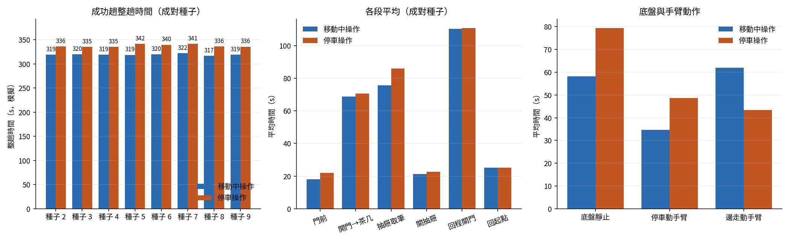

# 種子批次：移動中操作 vs 停車操作（r1，2026-11-25 早上）

Howard 11/25 凌晨：「好，請一路做到早上，多測試隨機種子」「可以多跑，多趟看能分析什麼數據，比較停車操作或其他 baseline」。

本文件是第 142–159 趟的整理；批次仍在跑（補跑種子 4、5、6、3 移動中與種子 2 重複），r2 會補上。

圖與下表的數字都由 [產生程式/seed_batch_analyze.py](../產生程式/seed_batch_analyze.py) 從 `evaluation/runs/m8house_d2_unified_<N>/` 的紀錄算出，逐趟結果在 [資料/種子批次_移動中vs停車操作.json](../資料/種子批次_移動中vs停車操作.json)。時間都是模擬時間。

## 設定

| 項目 | 兩組相同 |
|---|---|
| 場景 | 住宅 r2w3、無行人（`D2_WALKERS=0`）、茶几圓柱西側邊緣帶隨機（`CYL_SEED` 2–9） |
| 視覺 | Mask R-CNN（run3 權重）＋機身相機（第 123 趟做法；第 124–141 趟漏帶，見下） |
| 車頭 | 穿門後維持車頭，目標在後方 >100° 且 >1.5 m 時改導航 heading（不倒車） |
| 速度 | RTF 目標 0.7；開門段 0.35、取物接近 0.6 |

| 組別 | 差異 |
|---|---|
| 移動中操作（M） | 現行：茶几照導航移動中夾取（側向拉近）、抽屜把手照導航移動中抓、開門前車到 TCP 到 |
| 停車操作（P） | `PICK_FLOW=0 PICK_PATH=0 DR_PATH=0 B_APP_SYNC=0 D2_BG_CONT=0`：茶几與抽屜把手先停在抓取位再伸手；開門前到位停住再伸手 |

開門本身、拉抽屜、關抽屜、回程關門兩組都是同一套全身控制（這些動作本來就要底盤動）。

## 成對比較（種子 2、7、8，兩組都成功）

| 指標 | 移動中 | 停車 | 差（M−P），三對範圍 |
|---|---|---|---|
| 整趟時間 | 319.3 s | 337.6 s | **−18.3 s**（−16.7 ~ −19.3） |
| 底盤靜止 | 58.9 s | 79.6 s | −20.7 s（−19.4 ~ −21.4） |
| 停車動手臂 | 34.9 s | 49.2 s | −14.3 s |
| 邊走邊動手臂 | 61.5 s | 42.9 s | +18.7 s |
| 倒車時間 | 23.5 s | 25.8 s | −2.3 s |
| 底盤總轉動 | 14.6 rad | 14.5 rad | ≈0 |
| 側向／偏航指令翻轉 | 28.7／15.0 次 | 25.3／10.3 次 | 移動中多 3／5 次 |
| 平移急動 p95 | 3.78 m/s³ | 3.53 m/s³ | 移動中高約 7% |

| 段 | 移動中 | 停車 |
|---|---|---|
| 門前（交權→綁定門把） | 18.0 s | 22.0 s |
| 開門、穿門、到茶几放盒 | 69.0 s | 71.2 s |
| 抽屜：抓把手拉開、取筆放盒 | 75.3 s | 85.8 s |
| 關抽屜 | 21.8 s | 22.7 s |
| 回程推門穿過並關門 | 110.2 s | 110.9 s |
| 回起點 | 25.0 s | 25.1 s |

讀法：

- 省下的 18 s 主要在抽屜段（約 10.5 s，把手邊走邊抓）與門前（約 4 s，車到 TCP 到）；茶几段只差約 2 s，因為停車版的抓取位也在同一條導航路線上。
- 停車版整趟時間很穩：6 趟成功都在 335.4–341.6 s。
- 移動中版平順度略差（翻轉次數、急動較高），停車版在操作點附近是完整減速停住，加速度剖面較單純。
- 三對都是同一場景、同一流程，n=3，只能說「這三個種子都快 17–19 s」，不能當統計顯著。

## 成功率與失敗原因

| 組別 | 成功 | 失敗原因（趟次） |
|---|---|---|
| 移動中 | 4／10（142、152、156、158） | 開門求解 2（144 約束無解；143 是停車組）、開抽屜退出手指頂橫桿 2（146、148）、拉抽屜判脫手 1（150）、退出閘門逾時 1（154，我加的閘門造成） |
| 停車 | 6／9（145、147、149、151、153、157） | 開門求解 1（143）、回程一拍 121 ms 超期限 1（155）、穿門後控制拍外停頓 128 ms 1（159） |

移動中組的失敗集中在開抽屜（4 趟），都在邊走邊抓把手之後：第一次抓的證據較常不足（開抽屜重夾：移動中 3／5 趟、停車 0／3 趟）。

## 批次中途的修正（依趟次生效）

| 修正 | 起效趟 | 原因 |
|---|---|---|
| 開門「底盤後處理改動」備援 2 拍（`D2_OPEN_FB_TICKS`） | 146 | 132、143 一拍即停整趟（其他控制器早已有同規則） |
| 開抽屜重夾再深 6→2 mm（`DR_REGRASP_DZ_OPEN`；關抽屜維持 6 mm） | 149 | 146、148 橫桿卡進手指根部，退出時下指頂橫桿 42–49 N 鎖存 |
| 抽屜退出「退滿 3 cm 才抬」（`DR_RET_CLEAR`） | 148–155 開、156 起關 | 原以為能防頂桿；實測低位伸手時不先抬就退不動，152–155 每次退出多等約 3.6 s、154 逾時 |
| 把手持握開度容許 ±0.6→±0.8 mm、脫手連 3 拍才判 | 151 | 實際開度 1.2–1.45 mm 貼原下限，150 拉開中 1.17 mm 判脫手 |
| 會車層預測每拍時間預算 15 ms | 157 | 155 回程一拍 121 ms（成因未定，預算為保險） |
| 規劃程序改用 3,11 核（原 4,12 與控制伺服器重疊） | 161 | 136、155、159 控制拍外停頓 110–325 ms（計算本身 15 ms） |
| Mask R-CNN＋機身相機寫進預設 | 142 | 第 124–141 趟漏帶第 123 趟的指令列覆寫；140 關抽屜因此夾空（機身相機補量 142 起恢復：dq −9.17 mm） |

成對比較的三對：種子 2（142／147）都在開抽屜修正前、未觸發重夾；種子 7（152／153）兩趟都帶退出閘門（各多約 3.6 s×退出次數，對比公平）；種子 8（156／157）都是最終版。

## 未解

- 開門約束無解（144）：底盤速度上下限與「底盤–門扇保持距離」衝突（開門參考要求底盤約 0.31 m/s，貼近速度上限）。備援要在同一拍放慢開門進度，會牽動開門的停止判定，尚未動。
- 控制拍外停頓（136、155、159）：已改核心分配，161 起驗證。
- 本批無行人，「閃避時用全向輪側移」未驗證；下一批建議開行人。

## 不可主張

- n 小（成對 3 對），差值只能說這幾個種子的結果，不是母體估計。
- 批次中途改過程式，不同趟次的版本不同（見上表）；成功率是混合版本的結果。
- 無行人、單一起點、單一場景；RTF 0.7（開門 0.35、取物接近 0.6），非即時。
