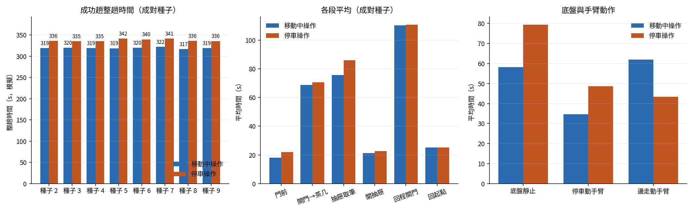

# 種子批次：移動中操作 vs 停車操作（r2，2026-11-25 10:20）

Howard 11/25 凌晨：「好，請一路做到早上，多測試隨機種子」「可以多跑，多趟看能分析什麼數據，比較停車操作或其他 baseline」。

r2 收第 142–168 趟（27 趟）。茶几圓柱 8 個隨機種子（2–9）兩組都至少成功一次，成對比較 8 對。r1（142–159、3 對）見 [r1](種子批次_移動中vs停車操作_r1.md)。

數字都由 [產生程式/seed_batch_analyze.py](../產生程式/seed_batch_analyze.py) 從 `evaluation/runs/m8house_d2_unified_<N>/` 的紀錄算出，逐趟結果在 [資料/種子批次_移動中vs停車操作.json](../資料/種子批次_移動中vs停車操作.json)。時間都是模擬時間；同種子同組多趟成功時取平均。

## 設定

| 項目 | 兩組相同 |
|---|---|
| 場景 | 住宅 r2w3、無行人、茶几圓柱西側邊緣帶隨機（`CYL_SEED` 2–9）、同一起點 |
| 視覺 | Mask R-CNN（run3）＋機身相機 |
| 車頭 | 穿門後維持車頭，目標在後方 >100° 且 >1.5 m 改導航 heading |
| 速度 | RTF 目標 0.7；開門段 0.35、取物接近 0.6 |

| 組別 | 差異 |
|---|---|
| 移動中操作（M） | 茶几照導航移動中夾取（側向拉近）、抽屜把手照導航移動中抓、開門前車到 TCP 到 |
| 停車操作（P） | `PICK_FLOW=0 PICK_PATH=0 DR_PATH=0 B_APP_SYNC=0 D2_BG_CONT=0`：先停在抓取位再伸手；開門前到位停住再伸手 |

開門、拉抽屜、關抽屜、回程關門兩組都是同一套全身控制。

## 成對比較（8 個種子）

| 指標 | 移動中 | 停車 | 差（M−P） | 8 對範圍 |
|---|---|---|---|---|
| 整趟時間 | 319.3 s | 337.5 s | **−18.3 s**（SD 2.5） | −15.8 ~ −22.9，8 對全負 |
| 底盤靜止 | 58.1 s | 79.4 s | −21.3 s | −19.0 ~ −25.7 |
| 停車動手臂 | 34.6 s | 48.6 s | −14.0 s | −13.0 ~ −15.7 |
| 邊走邊動手臂 | 61.9 s | 43.4 s | +18.5 s | +16.0 ~ +20.2 |
| 倒車時間 | 24.0 s | 25.9 s | −1.9 s | |
| 底盤總轉動 | 14.6 rad | 14.5 rad | ≈0 | |
| 側向／偏航指令翻轉 | 31.4／14.1 次 | 26.3／9.8 次 | +5.1／+4.3 次 | |
| 平移急動 p95 | 3.77 m/s³ | 3.55 m/s³ | +0.21（約 +6%） | |

整趟時間 8 對全部是移動中較快（Wilcoxon 符號等級，雙尾精確 p＝0.0078）。同組重複跑的差：種子 2 移動中 142／165 為 0.6 s，種子 4 停車 145／160 為 0.7 s，遠小於組間 18 s。

| 段 | 移動中 | 停車 | 差 |
|---|---|---|---|
| 門前（交權→綁定門把） | 18.0 s | 22.0 s | −4.0 |
| 開門、穿門、到茶几放盒 | 68.8 s | 70.7 s | −1.9 |
| 抽屜：抓把手拉開、取筆放盒 | 75.7 s | 86.0 s | −10.3 |
| 關抽屜 | 21.2 s | 22.8 s | −1.6 |
| 回程推門穿過並關門 | 110.3 s | 110.8 s | −0.5 |
| 回起點 | 25.1 s | 25.1 s | 0 |

讀法：

- 省下的 18 s 有 10 s 在抽屜段（把手邊走邊抓、不先停），4 s 在門前（車到 TCP 到）。茶几段只差 2 s：停車版的抓取位也在導航路線上，差在停與起步。回程關門與回起點兩組流程相同，時間也相同。
- 停車版底盤多停 21 s，其中 14 s 是「停著只動手臂」；移動中版把約 18 s 的手臂動作移到底盤行進中。
- 代價是平順度：移動中版指令翻轉多 4–5 次、急動 p95 高約 6%。

## 成功率

| 組別 | 全部 | 最終版（第 156 趟起） | 失敗原因 |
|---|---|---|---|
| 移動中 | 9／15 | 7／8 | 開門約束無解 144；開抽屜退出頂橫桿 146、148；拉抽屜判脫手 150；抽屜退出閘門逾時 154；起點交權停頓 162 |
| 停車 | 9／12 | 4／5 | 開門求解 143；回程一拍 121 ms 超期限 155；控制拍外停頓 159 |

- 移動中組在修正前（142–155）失敗集中在開抽屜：邊走邊抓把手，第一次抓的證據較常不足而重夾（移動中 3／5、停車 0／3），重夾 6 mm 太深卡桿。修正後（156 起）移動中 7／8，唯一失敗是起點交權時控制伺服器停頓 333 ms（跟操作方式無關）。
- 兩組最終版的失敗都只剩系統類（控制拍外停頓、期限），沒有操作類失敗。

## 批次中途的修正（依趟次生效）

| 修正 | 起效趟 | 原因 |
|---|---|---|
| Mask R-CNN＋機身相機寫進預設 | 142 | 第 124–141 趟漏帶第 123 趟的指令列覆寫；140 關抽屜因此夾空 |
| 開門「底盤後處理改動」備援 2 拍（`D2_OPEN_FB_TICKS`） | 146 | 132、143 一拍即停整趟 |
| 開抽屜重夾再深 6→2 mm（`DR_REGRASP_DZ_OPEN`；關抽屜維持 6 mm） | 149 | 146、148 橫桿卡進手指根部，退出時下指頂橫桿 42–49 N 鎖存 |
| 抽屜退出「退滿 3 cm 才抬」（`DR_RET_CLEAR`） | 148–155 開，156 起關 | 低位伸手不先抬就退不動，152–155 每次退出多等約 3.6 s、154 逾時 |
| 把手持握開度容許 ±0.8 mm、脫手連 3 拍才判 | 151 | 實際開度 1.2–1.45 mm 貼原下限，150 拉開中判脫手 |
| 會車層預測每拍時間預算 15 ms | 157 | 155 回程一拍 121 ms（成因未定） |
| 規劃程序改用 3,11 核（原 4,12 與控制伺服器重疊） | 161 | 136、155、159 控制拍外停頓；161 起 8 趟只有 162 一次（交權時） |

成對資料的版本：種子 7 的兩趟（152／153）都帶退出閘門（對比公平，兩趟各比同組平均多約 3–5 s）；其餘 7 個種子的成功趟都在閘門關閉的版本，或未觸發抽屜重夾。

## 未解

- 開門約束無解（144）：開門參考要求底盤約 0.31 m/s，貼近速度上限，與底盤–門扇保持距離衝突。備援要在同一拍放慢開門進度，尚未動。
- 控制伺服器偶發停頓（136、162 都在交權附近約 330 ms）：起點時機器人靜止，可以改成重新交權而不是整趟結束，要動交權狀態機。
- 無行人；「閃避時用全向輪側移」未驗證。下一批建議開行人。

## 不可主張

- 單一場景、單一起點、無行人、茶几圓柱只在西側邊緣帶隨機；8 對是這些條件下的結果。
- 批次中途改過程式（見上表）；成功率混合版本，最終版樣本小（移動中 8、停車 5）。
- RTF 0.7（開門 0.35、取物接近 0.6），非即時；時間是模擬時間。
