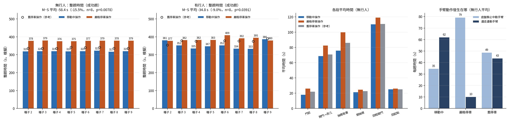

# 種子批次：移動中操作 vs 嚴格停車操作（r3，2026-11-26）

Howard 11/25 晚看完有行人批次：「我的停止操作比較像停車後再動手臂，現在有點移動中操作了」。他選了兩件事：開門、拉／推抽屜、回程關門這些接觸段維持全身控制；有行人與無行人兩種條件都重跑。

r2 的「停車操作」（以下稱**舊停車**）只關掉移動中抓取，每趟仍有約 43 s 是底盤邊走、手臂邊動（放盒後收臂、展開、穿門收臂、伸手）。r3 改用**嚴格停車操作**重跑：底盤到站停穩才動手臂，手臂停穩才開車。移動中操作沿用 r2 與有行人批次已跑的紀錄。

數字由 [產生程式/seed_batch_strict.py](../產生程式/seed_batch_strict.py)（逐趟指標沿用 seed_batch_analyze.py）從 `evaluation/runs/m8house_d2_unified_<N>/` 算出。逐趟結果在 [資料/種子批次_移動中vs嚴格停車操作.json](../資料/種子批次_移動中vs嚴格停車操作.json)。時間都是模擬時間；同種子同組有多趟成功時取平均。

## 三組的定義

| 組別 | 趟次 | 做法 |
|---|---|---|
| 移動中操作（M） | 無行人 142–168、有行人 169–185＋202–204 | 茶几照導航移動中夾取、抽屜把手移動中抓、開門前車到 TCP 到、邊走邊收臂、放盒時底盤繼續走 |
| 嚴格停車操作（S） | 205–221（221＝206 的補跑） | 舊停車旗標＋`PASS_STOW_MOVE=0 D2_BIN_MOVE=0 PARK_STRICT=1` |
| 舊停車操作（P，參考） | 無行人 142–168、有行人 169–185 | `PICK_FLOW=0 PICK_PATH=0 DR_PATH=0 B_APP_SYNC=0 D2_BG_CONT=0` |

嚴格停車的規則（`PARK_STRICT=1`）：

- 只動手臂的階段（伸手抓門把、茶几圓柱、筆、抽屜把手；展開；俯視）要等底盤離目標 3 cm／0.05 rad 內、指令與實測速度都很小並持續 0.3 s，才開始。等待時手臂保持不動，階段計時凍結。
- 底盤停穩後，手臂時程用監督封包公式在距離 0 的值（門把 5.0 s，接近移動中組的典型時程）。不故意放慢，避免停車組被拖慢。
- 只動手臂時，底盤速度上限設為 0.02 m/s、0.05 rad/s，避免控制器拿底盤幫手臂伸。
- 開車前，等手臂關節速度 ≤0.03 rad/s 並持續 0.3 s。
- 接觸段（開門到 85°、拉／推抽屜、回程推門與關門共轉）三組都用同一套全身控制。

量測「手臂動作發生在哪」：

| 每趟平均（無行人） | 移動中 | 嚴格停車 | 舊停車 |
|---|---|---|---|
| 邊走邊動手臂（底盤 >0.03 m/s 且關節 >0.05 rad/s） | 61.9 s | **10.0 s** | 43.5 s |
| 底盤靜止中動手臂 | 34.5 s | 79.0 s | 48.5 s |
| 底盤靜止總時間 | 58.0 s | 113.1 s | 79.2 s |

嚴格停車剩下的 10 s 是開門接觸段（約 4 s，全身），其餘是底盤行進時「保持不動」的手臂受底盤加減速帶動的小晃動（≤0.06 rad/s）。第 205 趟逐段核對過。

## 結果：無行人（8 個種子全部成對）

| 指標 | 移動中 | 嚴格停車 | 差（M−S） |
|---|---|---|---|
| 整趟時間 | 319.2 s | 377.6 s | **−58.4 s（−15.5%）**，SD 1.8，8 對全負 |
| 嚴格停車 − 舊停車 | | | +40.1 s（+11.9%），SD 3.5，8 對全正 |

Wilcoxon 符號等級（雙尾精確）：M−S p＝0.0078，S−P p＝0.0078（n＝8 全同號時的最小 p 值）。同組重複跑的差小於 1 s（r2：種子 2 移動中 142／165 差 0.6 s），遠小於組間差。

| 段 | 移動中 | 嚴格停車 | 舊停車 | M−S |
|---|---|---|---|---|
| 門前（交權→綁定門把） | 18.0 | 25.9 | 22.0 | −7.9 |
| 開門、穿門、到茶几放盒 | 68.7 | 82.4 | 70.7 | −13.7 |
| 抽屜：抓把手拉開、取筆放盒 | 75.8 | 99.8 | 86.0 | −24.0 |
| 關抽屜 | 21.2 | 24.7 | 22.7 | −3.5 |
| 回程推門穿過並關門 | 110.4 | 119.0 | 110.8 | −8.6 |
| 回起點 | 25.1 | 26.0 | 25.1 | −0.9 |

讀法：

- 抽屜段差最多（24 s）。嚴格停車要停穩才伸手抓把手，取筆放盒後也要收好臂才開車；三次「先停再伸手」加上兩次「收好臂再走」。
- 開門到茶几差 14 s：穿門後收臂、茶几夾取、放盒收臂都改成停著做。
- 回程關門差 9 s：嚴格停車停穩後才從收臂姿勢展開，先到把手後方 8 cm，再沿接近軸進去抓（見下方「批次中的修正」）。
- 舊停車只比移動中慢 18 s，因為它仍有 43 s 邊走邊動手臂；r2 的 18 s 低估了「停車後再動手臂」的成本。
- 平順度：嚴格停車的平移急動 p95 是 3.35 m/s³，移動中 3.77，舊停車 3.55。停著動手臂、走的時候不動手臂，底盤指令變化較少。

## 結果：有行人（8 個種子全部成對）

| 指標 | 移動中 | 嚴格停車 | 差（M−S） |
|---|---|---|---|
| 整趟時間（8 對） | 352.6 s | 387.4 s | **−34.8 s（−9.0%）**，SD 27.1，6 對負、2 對正，p＝0.039 |
| 嚴格停車 − 舊停車（7 對） | | | +13.1 s（+3.5%），SD 13.9，p＝0.078 |
| 與行人最小中心距離（平均） | 0.72 m | 0.82 m | |
| 行人在 1.5 m 內的時間 | 60.3 s | 32.2 s | |

| 段（平均） | 移動中 | 嚴格停車 | M−S |
|---|---|---|---|
| 門前 | 18.2 | 26.9 | −8.7 |
| 開門、穿門、到茶几放盒 | 83.5 | 82.4 | +1.1 |
| 抽屜取筆放盒 | 84.0 | 99.7 | −15.7 |
| 關抽屜 | 20.9 | 24.7 | −3.8 |
| 回程關門 | 117.9 | 125.5 | −7.6 |
| 回起點 | 28.0 | 28.2 | −0.2 |

有行人時差距變小、變動變大，原因是行人路線與時刻固定：

- 回程關門段是否遇到行人，取決於什麼時候到門口。移動中組有兩趟（185 種子 2、183 種子 9）剛好遇到，回程關門段多 25–33 s；這兩個種子嚴格停車反而快 3.4 s、6.9 s，就是那 2 對正值。
- 開門到茶几段在有行人時兩組差不多（+1.1 s）：移動中組在這段遇到行人並讓路的時間較多（行人 1.5 m 內 60 s，嚴格停車 32 s）。
- 嚴格停車到門口較晚（交權後約 232–236 s，移動中約 192–219 s），遇到行人的趟次不同（214、216、218 回程關門 133–135 s；其餘 118–124 s）。
- 所以有行人時的時間差，混了「誰剛好碰到行人」的時機效應，不全是操作方式的差別。無行人的 −58.4 s 才是操作方式本身的差。

## 成功率

| 組別 | 無行人 | 有行人 | 失敗 |
|---|---|---|---|
| 移動中 | 9／15 | 8／12 | 見 r2 與有行人批次；多數在中途修正前 |
| 嚴格停車（205 起） | **8／8** | 8／9 | 206：開門 2.4 s 控制器結果沒趕上拍界（not_ready，與 159／162／176 同型系統類）；同種子補跑 221 成功 |
| 舊停車 | 9／12 | 7／8 | 見 r2 與有行人批次 |

成功率不能跨組直接比：移動中與舊停車的失敗多發生在中途修正前的版本，嚴格停車全部跑在目前版本。

## 批次中的修正（依趟次生效）

| 修正 | 起效趟 | 原因 |
|---|---|---|
| 嚴格停車規則 `PARK_STRICT`（b80bcaa39） | 186 | Howard 11/25 指正舊停車不嚴格 |
| 嚴格停車回程關門：停穩後展開到抓取線後退 8 cm 的預抓構型，再走抓取線（b72f876a2） | 205 | 186–201 共 15 趟全部停在回程關門閉爪：停穩後關節空間直接展開到抓持構型，夾爪在抓取深度橫掃 1–2 cm，把門從 85° 推到約 75°，閉爪落空。移動中組展開時底盤還在轉，掃掠路徑不同，所以沒碰到。替身沒有手臂—門碰撞模型，測不到 |
| 關抽屜視覺開度晚到也採用（`DR_VIS_LATE`） | 173 | 171 夾空 |
| 開門控制器期限 120→140 ms | 177 | 169、175 開門一拍超時 |
| 開門期限 190 ms＋開門配速 0.25 | 181 | 179 開門首拍拍外停頓 94 ms |

186–201 在回程關門之前都是嚴格停車，那段的時間（交權→關抽屜完成約 232 s）與 205–220 相同（231–236 s），可當重複性參考；不列入整趟統計。

## 未解

- 控制器結果偶發沒趕上拍界（206 開門、176 抽屜、162 交權）：開門段計算有長尾（206 最大 103 ms），成因未定位。
- 有行人條件的時機效應：要比較「操作方式」的純差別，需要讓行人相對機器人進度觸發，或把回程關門段分開報。

## 不可主張

- 單一住宅場景、單一起點、茶几圓柱只在西側邊緣帶隨機；8 對是這些條件下的結果。
- 移動中組與舊停車組的紀錄跨越多個中途修正；嚴格停車在 205 起的版本。三組的控制程式不是同一凍結版本（11/26 純模擬重建規劃要求的凍結比較尚未做）。
- 嚴格停車是本研究自己定義的「住宅序列策略」（接近前停車，接觸段允許底盤配合），不是完全固定底盤的局部嚴格停駐。
- RTF 0.7（開門 0.25、取物接近 0.6），非即時；時間是模擬時間。
- 抓持與綁定為理想連接（FixedJoint）。
