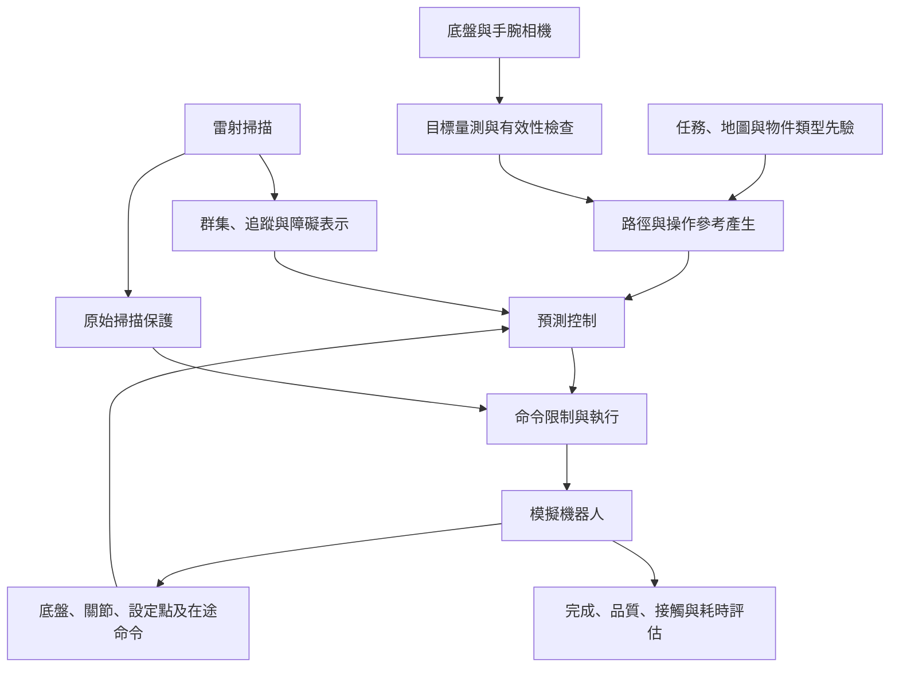

# 第二章　研究系統介紹（Research System Description）

> v0.2：說明平台、模組、資訊流與整合方式。硬體欄位包含模擬模型及執行主機；實機使用狀態與未核對規格另外標示。方法公式與實驗個別參數分別於第三、四章說明。

## 2.1 研究系統概述（System Overview）

### 2.1.1 研究系統之組成（System Components）

研究系統由四輪全向底盤、六軸手臂與夾爪模型、雷射與相機感測、預測控制、命令執行及獨立評估模組組成。底盤提供平面移動，手臂與夾爪負責接近、抓持及物件操作；各研究階段依批次啟用對應感測與控制鏈。

### 2.1.2 系統功能與需求（System Functions and Requirements）

| 功能 | 系統需求 | 驗證對應 |
|---|---|---|
| 動態導航 | 接收路徑、更新障礙、限制可執行命令 | 共同路線比較與導航消融 |
| 全身協調 | 同時考量底盤、手臂及設定點狀態 | 抽屜與全身控制比較 |
| 視覺導引 | 保留量測來源時間、有效性及座標 | 量測後規劃與接近案例 |
| 任務切換 | 檢查狀態與接觸條件，記錄等待及停止 | 流程與失敗分析 |
| 結果評估 | 分開判定完成、品質、接觸與耗時 | 第四章各批固定判準 |

住宅取物作為整合目標，目前能力完成程度依證據索引判定，不能由功能需求表推定整段任務已完成。

### 2.1.3 系統整體架構（Overall System Architecture）

研究系統包含環境感知、參考產生、預測控制、命令執行與結果評估。雷射資料形成導航障礙資訊；相機提供指定物件的量測。參考產生模組依任務區域、目標量測與機器人狀態建立路徑或末端目標，預測控制器再產生底盤與手臂命令。

圖 2-1 為功能關係示意。掃描保護與命令限制的實際順序、全身幾何限制及真值監看的啟用情形，依各實驗版本登錄。此圖不表示每個歷史批次都包含所有模組。

## 2.2 研究平台與設備（Research Platform and Equipment）

### 2.2.1 研究平台介紹（Research Platform）

導航階段以四輪全向底盤 omni_bot 為平台；全身階段結合 UFACTORY Lite 6 六軸手臂模型與夾爪，形成三個底盤自由度與六個手臂關節的運動系統。設定點是執行內部狀態，不增加致動自由度。

專案分別具有模擬模型與求解用運動學模型。例如，`omni_bot_wholebody.urdf.xacro` 以三個虛擬平面關節將底盤與手臂表示為同一運動鏈；該檔不是具有完整感測器與控制插件的模擬器模型。兩者的用途與幾何一致性需要分開核對。[模擬模型](../src/my_omnibot_description/urdf/omni_bot.urdf.xacro)、[全身運動學模型](../src/my_omnibot_description/urdf/omni_bot_wholebody.urdf.xacro)

### 2.2.2 硬體設備與規格（Hardware and Specifications）

| 項目 | 已有依據的規格或設定 | 適用範圍 |
|---|---|---|
| 底盤輪系 | 四全向輪；有效輪半徑 0.05 m、幾何參數 L＝0.245 m | 第一階段輪級模型與對照上限 |
| 輪速／輪加速度上限 | 5.55 rad/s／125 rad/s² | 導航批次登錄值，非所有任務的實測峰值 |
| 手臂 | Lite 6 六軸模型 | 關節、設定點與運動學來源依各凍結版本 |
| 執行主機 | 門把手局部案例：Ryzen 7 9800X3D、RTX 5070 | 僅對應該桌機批次；其他主機規格待補 |
| 夾爪 | 雙指夾爪模型 | 碰撞幾何、指力及開度依各批資產設定 |

輪系規格見[第一階段總結](../第一階段實作總結.md)，桌機資訊見[門把手案例](../第八次進度報告素材/規格/住宅場景_門把手非接觸接近_r1.md)。目前論文成果以模擬為主；不以模型名稱或模擬參數宣稱實機硬體已完成驗證。

### 2.2.3 感測與執行設備（Sensing and Actuation）

雷射掃描支援導航障礙表示及原始回波保護；底盤與手腕相機分別支援導引與近距觀測。底盤、關節與設定點回授用於建立控制狀態，夾爪開度及接觸資訊則參與特定版本的操作判定。

Gazebo 相機描述檔採 RealSense D435 系列幾何與 RGB-D 模擬設定，但這不代表後續 Isaac 雙相機案例使用完全相同的內外參、解析度或更新率；正式設備表須依實驗登錄補齊。[Gazebo 相機模型](../src/my_omnibot_description/urdf/camera.xacro)

部分抓持、離桌、支撐及監看目前使用模擬接觸力或真值幾何，屬流程使用的資訊。實機接觸感測及估測仍為缺口；這些量與獨立評分端真值分別列示。[E06–E08](證據索引與待補清單.md)

## 2.3 軟體與開發環境（Software and Development Environment）

### 2.3.1 作業系統與開發工具（Operating System and Development Tools）

系統以 ROS 2 Jazzy 與 Python 為主要開發環境，使用 NumPy、SciPy、YAML 及 QP 求解模組處理模型與最佳化。ROS 套件依賴可由 `package.xml` 追查，但宣告依賴不等於所有批次的精確安裝版本。[控制套件](../src/ammr_wholebody_mpc/package.xml)、[啟動套件](../src/ammr_bringup/package.xml)

作業系統、Python 與套件確切版本應由各批次環境紀錄補入；本章不由 ROS 發行版推定作業系統版本。程式版本、資產、感知權重與分析器也須共同列入重現資訊。

### 2.3.2 模擬與測試平台（Simulation and Test Platforms）

第一階段主要使用 Gazebo Harmonic，後續含接觸的全身與視覺任務使用 Isaac Sim。離線重放與簡化模型測試用於檢查公式、介面及候選條件，含接觸物理模擬則檢查實際模型中的執行；兩類結果分開報告。不同平台、主機及模擬倍率的耗時不直接合併比較。

### 2.3.3 軟體模組與通訊介面（Software Modules and Communication Interfaces）

| 模組／訊息 | 作用 | 使用時需確認 |
|---|---|---|
| `/scan`、`/scan_filtered` | 原始及前處理雷射資料 | 保護層是否直接讀原始回波 |
| `scan_obstacle_tracker` | 群集、追蹤及動靜分流 | 是否將有效障礙發布至控制端 |
| `/gmpc/obstacles`、`/gmpc/static_obstacles` | 控制器的障礙表示 | 座標、時間與表示方式 |
| `/plan`、`/odom`、TF、`/joint_states` | 參考路徑及機器人狀態 | 資料來源與更新時間 |
| `/cmd_vel_nav`、`/cmd_vel_pre_shield`、`/cmd_vel` | 導航命令鏈各階段 | 最終套用值與修正紀錄 |
| `/bottle/target_guide` 與視覺候選介面 | 雙相機導引及目標交接 | 來源影格、時戳及一致性 |

上述導航介面依第一階段架構列示；瓶子及門把手執行器另有其直接介面，不推定所有階段共用相同 topic。[導航資料流](../第一階段實作總結.md)、[雙相機候選節點](../evaluation/bottle_seg3d_candidates_dual_node.py)

## 2.4 系統架構設計（System Architecture Design）

### 2.4.1 系統模組配置（System Module Configuration）

模組依功能配置為感知與狀態取得、參考產生、預測求解、命令處理、任務監看及獨立評估。模組存在於程式庫不代表某批實驗已啟用；每次實驗以啟動參數及凍結清單記錄實際配置。導航追蹤、掃描保護與全身幾何限制的數學內容留至第三章說明。

### 2.4.2 模組間資訊傳遞（Information Flow Between Modules）

感知與狀態訊息保留來源時間及座標；計畫記錄建立時的目標、機器人狀態與版本。控制端接受計畫時，檢查目標有效性與當前狀態的接續條件，再輸出命令。命令鏈的限幅、輪級修正及保護可能改變候選輸出，因此需分別記錄候選、實際套用命令與實測運動。

### 2.4.3 系統整合架構（System Integration Architecture）

為正確對應第四章結果，本研究區分三類控制實作。

| 代號 | 用途及實作 | 模型與求解重點 | 對應結果 |
|---|---|---|---|
| A：導航 GMPC | `gmpc.py` 與導航鏈 | SE(2) 底盤誤差、預測障礙、CBF、外部掃描保護 | 導航比較與消融 |
| B：既有抽屜 W-GMPC | `wgmpc_core_sp.py` 與抽屜節點 | 九維構型加六維設定點；非線性 rollout、序列 QP | 嚴格停車／MotM、H1／H5 |
| C：導航擴充全身 GMPC | `gmpc_wb.py` 與瓶子／門把手控制鏈 | 保留底盤幾何預測，加入手臂設定點與共同 TCP 成本 | 近期視覺抓放與局部接近 |

B、C 共用部分執行模型概念，但底盤狀態、任務線性化及求解流程不同。B 的實驗不能直接證明 C 的每項設計有效。抽屜正式批次也沒有啟用後續所有全身碰撞限制。

## 2.5 系統運作流程（System Operation Workflow）

系統首先接收地點、家具或區域及物件類型等任務輸入，再更新環境與機器人狀態。導航接近時依路徑與障礙資訊更新控制；進入觀察與操作區後，利用量測建立操作參考，並依可用狀態持續協調底盤與手臂。抓持、運送、放置及退離由觀測及各批判準推進；條件不足時則等待、拒絕或停止。

此處描述系統層級的階段關係，第三章說明每個控制週期如何建模與求解。已驗證的抽屜、瓶子與門把手局部流程各自保留其範圍；完整住宅的開門、通行、開抽屜、取粗馬克筆代理物與返回，仍是整合目標。[E03–E09](證據索引與待補清單.md)
