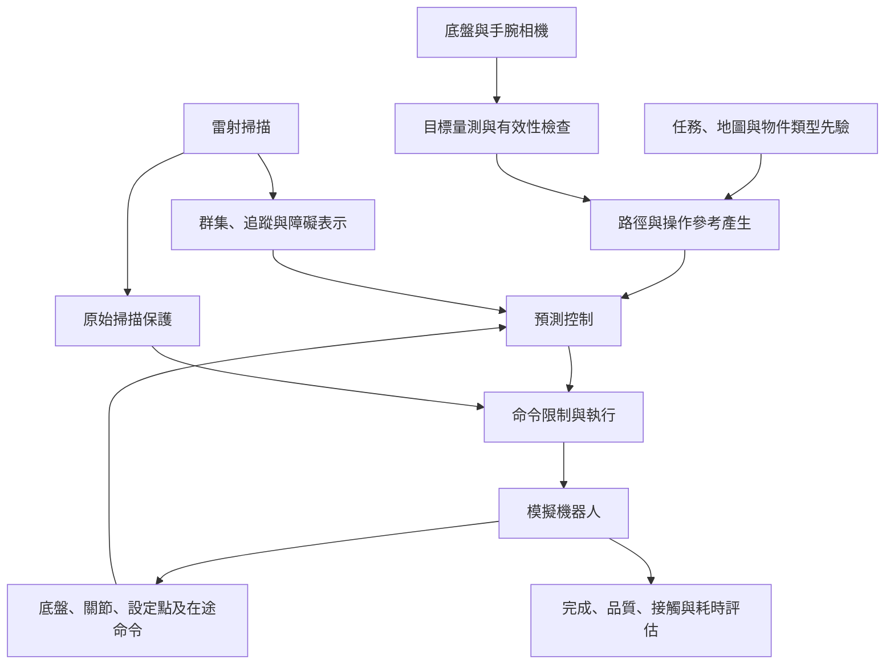

# 第三章　研究方法與系統設計（Research Methodology and System Design）

> v0.1：核心方法草稿。數學式以現有實作及文件為依據；完整參數、各版本啟用項目、座標微分及推導仍須補齊。E05 記錄程式來源。

## 3.1 研究系統整體架構（Overall System Architecture）

研究系統包含環境感知、參考產生、預測控制、命令執行與結果評估。雷射資料形成導航障礙資訊；相機提供指定物件的量測。參考產生模組依任務區域、目標量測與機器人狀態建立路徑或末端目標，預測控制器再產生底盤與手臂命令。

圖 3-1 為功能關係示意。掃描保護與命令限制的實際順序、全身幾何限制及真值監看的啟用情形，依各實驗版本登錄。此圖不表示每個歷史批次都包含所有模組。

為正確對應第四章結果，本研究區分三類控制實作。

| 代號 | 用途及實作 | 模型與求解重點 | 對應結果 |
|---|---|---|---|
| A：導航 GMPC | `gmpc.py` 與導航鏈 | SE(2) 底盤誤差、預測障礙、CBF、外部掃描保護 | 導航比較與消融 |
| B：既有抽屜 W-GMPC | `wgmpc_core_sp.py` 與抽屜節點 | 九維構型加六維設定點；非線性 rollout、序列 QP | 嚴格停車／MotM、H1／H5 |
| C：導航擴充全身 GMPC | `gmpc_wb.py` 與瓶子／門把手控制鏈 | 保留底盤幾何預測，加入手臂設定點與共同 TCP 成本 | 近期視覺抓放與局部接近 |

B、C 共用部分執行模型概念，但底盤狀態、任務線性化及求解流程不同。B 的實驗不能直接證明 C 的每項設計有效。抽屜正式批次也沒有啟用後續所有全身碰撞限制。

## 3.2 系統模型與問題定義（System Modeling and Problem Formulation）

底盤位姿表示為

$$
X_B=\begin{bmatrix}R(\theta)&p_B\\0&1\end{bmatrix}\in SE(2),
\qquad \xi_B=[v_x^B,v_y^B,\omega]^\top.
\tag{3-1}
$$

上標 $B$ 代表本體座標，$p_B$ 為世界座標下的位置。手臂關節角為 $q_a\in\mathbb{R}^6$，位置設定點為 $s_a\in\mathbb{R}^6$，輸入為

$$
u=[\xi_B^\top,u_a^\top]^\top\in\mathbb{R}^9.
\tag{3-2}
$$

$u_a$ 為設定點積分速率，不能直接當作當下實測關節速度。C 類控制器以 $(X_B,q_a,s_a)$ 描述預測狀態，其局部座標維數為 15；B 類則以 $[x_B,y_B,\theta,q_a^\top,s_a^\top]^\top$ 作增廣向量。

末端位姿 $T_E=f(X_B,q_a)$ 由全身正向運動學求得。任務輸入包含底盤參考路徑、末端目標，以及觀測／接觸條件。控制目標是在可用預測模型與限制下，降低導航及末端誤差、命令變動與不必要等待。

抽屜平移開度及門扇旋轉角度可用來形成操作參考與判定任務進度。目前既有抽屜核心並未將物件關節、接觸力及抓取閉鏈完整納入同一預測狀態與硬約束；不能只因目標沿滑軌移動，就描述成已建立完整機器人—物件耦合動力學。

## 3.3 研究方法與演算法設計（Proposed Methodology）

導航控制沿參考軌跡建立幾何誤差預測，使用障礙位置及速度形成未來限制。原始掃描保護層另處理未經分類的回波，檢查候選底盤命令的局部接近條件。保護層使用既有迭代修正與退化分支，不能描述為已精確求得某個全域最優安全命令。

全身控制將手臂設定點追蹤模型與末端任務加入預測。世界座標末端目標同時受到底盤與手臂影響，因此共同任務成本能形成兩者的耦合。持物運送若改用底盤相對目標，該末端成本對底盤的導數可為零；各階段仍需依導航成本與限制決定底盤運動。

視覺模組依相機影像、深度與類型先驗形成候選量測；控制端以來源時間與一致性檢查接受或拒絕。近期瓶子版本以底盤進度調整手臂相位，經位置、姿態及 TCP 速度銜接條件後進入預抓階段。此相位機制屬外層參考與准入設計，不等於相位已成為 QP 自由決策變數。[E06](證據索引與待補清單.md#e06)

## 3.4 數學模型與公式推導（Mathematical Modeling and Derivation）

### 3.4.1 底盤幾何誤差與凝聚預測

定義

$$
E=X_{\mathrm{ref}}^{-1}X_B,\qquad e=\log(E)^\vee.
$$

由 $\dot X_B=X_B\hat\xi_B$ 及參考運動學得

$$
\dot E=E\hat\xi_B-\hat\xi_{\mathrm{ref}}E.
$$

在小誤差附近一階展開，令 $\delta\xi=\xi_B-\xi_{\mathrm{ref}}$，則

$$
\dot e\approx-\operatorname{ad}(\xi_{\mathrm{ref}})e+\delta\xi,
\quad
e_{k+1}=A_k e_k+\Delta t\,\delta\xi_k,
\quad A_k=I-\Delta t\operatorname{ad}(\xi_{\mathrm{ref},k}).
\tag{3-3}
$$

堆疊 $N$ 步後，令 $Z_B=[\delta\xi_0^\top,\ldots,\delta\xi_{N-1}^\top]^\top$，得到

$$
\mathcal E=\Phi e_0+\Gamma Z_B.
\tag{3-4}
$$

$A_k$ 依預測步改變。式（3-3）為局部一階模型，並非任意誤差下的精確非線性動態；對數主值亦具有分支。[幾何控制與李群背景](參考文獻.md)

### 3.4.2 手臂設定點模型與控制步組合

每物理步長 $\Delta t_p$ 的逐軸模型為

$$
q_a^{j+1}=(1-\alpha)\odot q_a^j+\alpha\odot s_a^j+b,
\qquad s_a^{j+1}=s_a^j+\Delta t_p u_a.
\tag{3-5}
$$

$\odot$ 為逐元素乘積，$\alpha$ 為追蹤係數，$b$ 為每物理步偏置。若控制步 $\Delta t=m\Delta t_p$ 且控制步內 $u_a$ 保持固定，令 $\beta=1-\alpha$，反覆代入可得

$$
q_{a,k+1}=P\odot q_{a,k}+Q\odot s_{a,k}+G\odot u_{a,k}+h,
\qquad s_{a,k+1}=s_{a,k}+\Delta t u_{a,k},
\tag{3-6}
$$

其中

$$
P=\beta^m,\quad Q=1-\beta^m,\quad
G=\alpha\Delta t_p\odot\sum_{j=0}^{m-1}j\beta^{m-1-j},\quad
h=b\odot\frac{1-\beta^m}{\alpha}.
\tag{3-7}
$$

各冪次與除法皆逐軸計算。此組合沿用式（3-5）的更新順序：先由原設定點更新關節預測，再積分下一設定點。模型對給定 $\alpha,b$ 為仿射，但僅近似平台的執行行為，並非完整剛體或接觸動力學。

既有辨識範例使用 $\Delta t_p=0.01$ s、$\Delta t=0.05$ s 及 $\alpha\approx0.09501$；組合後 $G\approx0.00864$ s，與直接速度積分使用的 0.05 s 不同。這解釋了為何設定點必須出現在預測中。辨識參數來自單一資料集，仍需跨條件驗證。[E05](證據索引與待補清單.md#e05)

### 3.4.3 共同末端殘差與 QP 成本

對 C 類控制器，在選定的名目預測與座標慣例下，將末端位置及姿態殘差作局部近似：

$$
r_k\approx r_{0,k}-L_{B,k}Z_B-L_{A,k}U_A,
\qquad U_A=[u_{a,0}^\top,\ldots,u_{a,N-1}^\top]^\top.
\tag{3-8}
$$

$L_{B,k}$ 由底盤誤差預測、位姿映射微分及末端雅可比組合；$L_{A,k}$ 由手臂預測及末端雅可比組合。名目輸入造成的常數位移收在 $r_{0,k}$。底盤本體速度必須先依其模型映射，不能直接與世界座標雅可比相乘。

令 $L_k=[L_{B,k},L_{A,k}]$、$Z=[Z_B^\top,U_A^\top]^\top$，則

$$
J_E=\sum_k(r_{0,k}-L_kZ)^\top W_E(r_{0,k}-L_kZ),
$$

$$
P_E=2\sum_k L_k^\top W_E L_k,
\qquad q_E=-2\sum_k L_k^\top W_E r_{0,k}.
\tag{3-9}
$$

世界任務下，$P_E$ 可含 $2\sum_k L_{B,k}^\top W_E L_{A,k}$ 的底盤—手臂交叉區塊；這是共同末端成本的數學來源。底盤相對持物任務下，本實作令該成本的 $L_{B,k}=0$。共同求解並不代表每個任務階段都有非零交叉項。

導航追蹤、輸入大小、命令差分及啟用的協同項，再與 $J_E$ 相加。若包含屏障鬆弛變數，決策向量另擴充其欄位。最終局部子問題寫為

$$
\min_{Z_{\mathrm{QP}}}\ \frac12Z_{\mathrm{QP}}^\top P Z_{\mathrm{QP}}+q^\top Z_{\mathrm{QP}},
\qquad l\leq A Z_{\mathrm{QP}}\leq u.
\tag{3-10}
$$

B 類控制器另有非線性 rollout、序列 QP 與信賴域接受流程；C 類不可僅因共用 QP 即描述為同一 SQP。姿態殘差及其精確微分，亦須依兩模組各自的世界／本體座標定義補齊。

### 3.4.4 執行與幾何限制

本平台四輪全向底盤的輪級速度可行條件可寫為

$$
-r\omega_{\max}\mathbf1\leq W\xi_B\leq r\omega_{\max}\mathbf1,
\quad
W=\begin{bmatrix}
0&1&L\\-1&0&L\\0&-1&L\\1&0&L
\end{bmatrix},
\tag{3-11}
$$

其中 $r$ 為輪半徑，$L$ 為此輪系幾何參數。輪加速度條件為

$$
-r\alpha_{w,\max}\Delta t\mathbf1
\leq W(\xi_{B,k}-\xi_{B,k-1})
\leq r\alpha_{w,\max}\Delta t\mathbf1.
\tag{3-12}
$$

手臂除命令與命令變化率外，同時限制預測關節角及設定點：

$$
q_{\min}+\mu\leq q_{a,k},s_{a,k}\leq q_{\max}-\mu.
\tag{3-13}
$$

式（3-13）對 $q_{a,k}$ 與 $s_{a,k}$ 各自成立。含偏置時，兩者的限位不能任意互相取代。輪級命令可行也不等於實測輪速、接觸或整機幾何一定可行，仍需獨立評估。

### 3.4.5 預測障礙與掃描保護

對具有位置 $o_i$ 與速度 $v_i$ 的障礙，簡化預測為

$$
o_i(k)=o_i(0)+k\Delta t\,v_i,\qquad
h_i(k)=\|p_B(k)-o_i(k)\|^2-r_{\mathrm{eff},i}^2,
\tag{3-14}
$$

$r_{\mathrm{eff},i}$ 依實際障礙表示收集幾何與安全距離。本研究在選定預測點建立速度型屏障條件，其基本形式為

$$
2(p_B-o_i)^\top(R(\theta)v_B-v_i)+\alpha_h h_i\geq-\varepsilon.
\tag{3-15}
$$

逐步限制的線性化點、剪枝、當下及未來鬆弛政策依版本設定。此式與離散時間的 $h(x_{k+1})-h(x_k)\geq-\gamma h(x_k)$ 不能未經推導就視為同一條件；本研究不直接沿用離散 CBF 文獻的保證。

掃描保護直接使用原始回波建立接近限制，降低對動靜分類的依賴。然而感測盲區、離散更新、命令執行落後及退化分支仍限制其適用範圍。底盤的圓盤近似與二維回波，也不足以描述伸展手臂及持物的完整三維空間。

## 3.5 系統整合與實作（System Integration and Implementation）

感知、規劃、控制與評估之間，須保留來源時間與座標資訊。視覺候選包含影格來源、擷取時刻、物件幾何及有效性；計畫則需對應建立時的狀態及控制端接受時的狀態。手臂設定點及在途命令，用於避免把尚未生效的命令當成已完成運動。

既有導航使用 ROS 2 Jazzy 與 Gazebo Harmonic；後續全身接觸及視覺案例以 Isaac Sim 驗證。依不同控制鏈，底盤命令可能經過平滑、輪級修正、掃描保護或其他檢查；手臂設定點則由執行端積分。實作表應以各批次凍結清單與啟動參數填寫，不能僅因某模組存在於程式庫就宣稱該實驗已啟用。

部分抓持、離桌、支撐及監看條件目前使用模擬接觸力或真值幾何。這些量會影響流程切換，屬控制使用的資訊；應與獨立評分端的真值另列。移轉實機時必須設計可取得的感測或估測方法。

## 3.6 方法流程與運作機制（Algorithm Workflow）

1. 接收任務區域、物件類型、地圖及初始條件。
2. 更新底盤、關節、設定點、在途命令與障礙觀測。
3. 依當前任務取得路徑或物件量測，檢查時間與有效性。
4. 以可接受的量測及狀態建立或更新接近、末端及運送參考。
5. 建立本輪預測、成本與啟用的限制，求解底盤／手臂命令。
6. 經對應命令鏈執行首段輸入，記錄修正與實際套用值。
7. 根據觀測及任務條件繼續、切換、等待或停止。
8. 由固定評估規則分別判定流程完成、品質、接觸與計算表現。

此為共同流程概述。研究目標中的全住宅任務尚未完成，不能將此流程圖當成完整取物已驗證的證據。

## 3.7 本章小結（Chapter Summary）

本章由底盤幾何預測、手臂設定點動態及共同末端成本，說明導航至操作的控制設計。核心是讓預測對應命令執行、讓底盤與手臂在需要時共同承擔末端任務，並交代感知與保護所依賴的條件。下一章依各控制版本的實際啟用模組呈現實驗，檢查這些設計對導航、品質與效率的影響。
