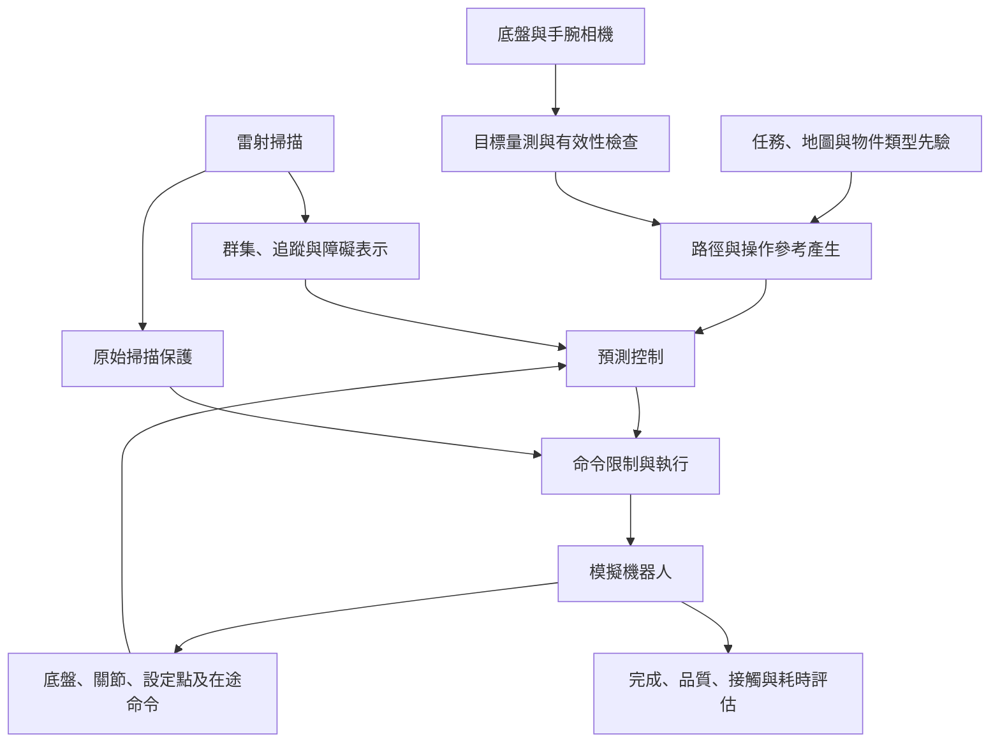

# 動態環境下移動機械臂預測導航與受約束操作

Predictive Navigation and Constrained Manipulation of Mobile Manipulators in Dynamic Environments

預口試論文工作稿 v0.1｜資料基準：2026-11-12（Asia/Taipei）

本檔由分章工作稿合併，供連續閱讀；修改請以各分章檔為準。這是內容初稿，尚未套用學校正式論文格式。第一章已有完整段落，第二章仍須補全文比對，第三章須補完整推導及版本條件，第四章須補正式圖表與重現，第五章為階段性結論。

[工作目錄與各章完成程度](README.md)｜[主張、原始資料與待補工作](證據索引與待補清單.md)

# 摘要

> 預口試暫稿 v0.1。摘要隨第三、四章修訂，不將待完成住宅整合任務寫成成果。

移動機械臂結合移動底盤與機械手臂，能擴大操作範圍，適用於室內搬運及關節式物件操作。然而，在存在動態障礙的環境中，導航避障、操作可達性與手臂執行落後會共同影響任務表現；若導航與操作缺少協調，亦可能產生額外停等與追蹤誤差。本研究以動態環境下的預測導航與受約束操作為主題，建立由底盤導航延伸至全身協調的控制與評估流程。

導航部分採用以 SE(2) 誤差描述的幾何模型預測控制，結合預測式控制屏障條件與直接讀取原始雷射掃描的保護層。操作部分將手臂位置設定點及其追蹤動態納入預測模型，在共同最佳化問題中決定底盤與手臂命令，並逐步納入視覺量測所形成的接近與抓取參考。

既有模擬結果顯示，在三方法共同可評估的 83 條導航路線中，所建方法全部到達且有一條發生接觸；在三對抽屜完整策略比較中，移動中協同操作相對嚴格停車策略縮短任務時間 13.38–14.05%。另一批三對預測步數比較顯示，五步預測的整控制窗 TCP 位置誤差與手臂命令反轉率低於單步預測。近期視覺導引單瓶案例已取得指定條件下的移動抓放成果，但含行人案例仍有抓持滑移超標，門把手驗證亦僅達局部非接觸接近。以上結果支持既定條件下的階段性可行性與比較發現；完整住宅取物、全身動態避障及實機即時部署仍待驗證。[E01、E03–E08](證據索引與待補清單.md)

**關鍵字：** 移動機械臂、幾何模型預測控制、控制屏障函數、全身協調、移動中操作、視覺導引。

# Abstract

Mobile manipulators extend robotic workspaces by combining mobility and dexterity. In dynamic indoor environments, however, obstacle avoidance, manipulation reachability, and actuator tracking lag jointly affect task performance. This thesis investigates predictive navigation and constrained manipulation through a progression from mobile-base navigation to coordinated whole-body control.

The navigation system combines geometric model predictive control using SE(2) tracking errors, predictive barrier constraints, and a protection layer driven by raw laser scans. For manipulation, arm position setpoints and their tracking dynamics are included in prediction, allowing base and arm commands to be optimized jointly. Visual measurements are subsequently used to generate approach and grasp references.

In existing simulation experiments, the navigation method reached the goal on all 83 commonly evaluated routes, with contact on one route. Three paired drawer experiments showed task-time reductions of 13.38–14.05% relative to a strict stationary-base strategy. A separate three-pair study found lower whole-window tool-center-point position errors and fewer arm-command reversals with five-step prediction than with one-step prediction. Recent visual bottle trials demonstrate moving pick-and-place in specified conditions, while excessive grasp slip remains in a pedestrian-interaction case. Door-handle validation is currently limited to local, non-contact approach. Complete residential retrieval, dynamic whole-body avoidance, and real-time hardware deployment remain future work.

**Keywords:** mobile manipulation, geometric model predictive control, control barrier functions, whole-body coordination, manipulation on the move, visual guidance.

---

# 第一章　緒論（Introduction）

> v0.1：依現有研究文件撰寫的完整段落初稿；待指導教授確認研究問題、範圍及題名。

## 1.1 研究背景（Research Background）

室內服務機器人的任務，往往同時包含空間移動與物件操作。例如，機器人接獲至指定房間取物的指令後，必須前往目標區域、避開通行中的人員與障礙，並依序完成開門、接近家具、開啟抽屜與取物等動作。移動底盤提供空間移動能力，機械手臂提供局部操作能力；兩者結合雖能擴大工作範圍，也使機器人的可行運動同時受到環境幾何、關節限制及執行動態影響。

導航過程需要根據環境變化調整路徑與速度，操作過程則需要維持末端位置、姿態及抓持品質。當底盤與手臂同時運動時，底盤位姿變化會改變手臂的可達範圍與末端世界座標位置；手臂構型也會改變整機占用空間。因此，單獨達成底盤到位或末端到位，仍不足以說明整體任務能否連續、安全且有效率地完成。

模型預測控制（Model Predictive Control, MPC）提供將未來運動、追蹤成本及執行限制共同納入最佳化的方式。幾何模型預測控制（Geometric MPC, GMPC）進一步利用機器人位姿所在的幾何結構描述誤差；相關研究已將其應用於輪式機器人的軌跡追蹤。全身 MPC 與移動中操作（Manipulation on the Move, MotM）研究，亦已探討底盤與手臂的共同控制及操作期間保持移動的可能性。[Tang 等人的 GMPC](https://arxiv.org/abs/2403.07317)、[Minniti 等人的全身 MPC](https://arxiv.org/abs/1902.10415)、[Burgess-Limerick 等人的 MotM 架構](https://arxiv.org/abs/2212.06991)

本研究以室內移動機械臂為對象，從已建立的動態導航方法出發，逐步納入手臂執行模型、末端任務及視覺觀測，研究預測導航與受約束操作之間的協調關係。住宅取物情境用於連結各項能力；其完整整合仍是後續驗證目標。

## 1.2 研究動機（Research Motivation）

本研究的第一項動機，來自導航感知與避障約束之間的落差。雷射掃描中的障礙回波，必須經過過濾、群集、追蹤及動靜分類，才可能形成預測控制器使用的障礙資訊。若其中任何步驟排除了有效障礙，即使後端最佳化正確求解，也可能缺少應有的避障限制。因此，本研究除了使用追蹤結果預測障礙運動，也加入直接讀取原始掃描的保護層，檢驗兩種資訊處理途徑的互補效果。[E01、E02](證據索引與待補清單.md)

第二項動機，是導航與操作之間的停等與協調問題。先導航、停車、再操作的策略容易定義階段邊界，但在部分任務中也增加入場收斂與等待時間。若能在適當條件下由底盤與手臂共同運動，便可能減少這些時間；同時也必須檢查是否增加末端誤差、抓持漂移或執行負擔。本研究以嚴格停車策略與移動中操作策略進行配對比較，量測完整任務時間及操作品質，而不僅比較單一控制區段。[E03](證據索引與待補清單.md#e03)

第三項動機，是預測模型與實際命令鏈的一致性。在本平台中，手臂命令先積分為關節位置設定點，再由位置控制器追蹤。將命令直接視為立即達成的關節速度，會忽略設定點累積與追蹤落後，進而影響對未來末端位置及限制的判斷。本研究因此將設定點納入預測狀態，建立與執行介面對應的模型。[E05](證據索引與待補清單.md#e05)

第四項動機，是將操作參考逐步連結到當次觀測。固定的目標位置與流程可用於建立基線，但難以說明系統能否因應目標位置與接近條件變化。本研究逐步由視覺量測建立接近與抓取參考，並保留已知區域、物件類型及地圖等任務先驗，使觀測、規劃與執行之間的關係可以檢查。[E06–E08](證據索引與待補清單.md)

## 1.3 研究問題與挑戰（Research Problems and Challenges）

本研究的總體問題為：**如何在動態室內環境中，以考量感知與執行限制的預測控制方法，協調移動機械臂的導航、接近及受約束操作，並量化安全、追蹤品質與任務效率之間的取捨？**

為使此問題能對應具體實驗，細分為下列研究問題。

| 編號 | 研究問題 | 主要挑戰 | 驗證依據 |
|---|---|---|---|
| RQ1 | 如何降低動態導航中因追蹤與分類漏失產生的接觸風險？ | 障礙估測不完整、反應延遲、速度與輪級限制 | 共同路線比較、CBF／Shield 消融與失效分析 |
| RQ2 | 納入手臂設定點及多步預測，能否改善協同操作的追蹤與命令品質？ | 執行落後、多取樣率模型、底盤與手臂的耦合 | 模型預測誤差、單步與五步比較 |
| RQ3 | 移動中協同操作能否在達成原任務判準的條件下縮短完整任務時間？ | 入場收斂、操作可達性、抓持漂移及段間銜接 | 嚴格停車與 MotM 的完整策略比較 |
| RQ4 | 如何讓當次視覺量測形成可執行的接近與操作參考？ | 觀測有效期、雙相機一致性、狀態承接與動態干擾 | 量測後規劃紀錄、抓放與門把手局部接近案例 |

這四個問題具有連續關係。RQ1 建立動態接近的導航基礎；RQ2 處理全身命令的預測；RQ3 檢驗協調策略是否產生任務效益；RQ4 則使操作參考逐步由當次觀測決定。現有實驗對各問題的支持程度不同，第四章分別呈現，避免用單一展示取代所有問題的驗證。

此外，研究必須區分命令與實測運動、底盤安全與展臂安全，以及模擬中的接觸證據與實機可取得的感測量。這些差異直接影響安全及效率結論的適用範圍。

## 1.4 研究目的（Research Objectives）

本研究設定以下研究目的。

1. 建立結合幾何預測追蹤、預測式避障及原始掃描保護的導航方法，並透過共同路線比較與消融實驗評估其表現。
2. 建立包含手臂設定點追蹤動態的預測模型，在共同最佳化問題中協調底盤與手臂，並考量關節、速度、加速度及輪級限制。
3. 以抽屜操作等具明確機構約束的任務，檢驗多步預測與移動中協同策略對追蹤、抓持品質及完整任務時間的影響。
4. 將視覺量測轉換為接近及抓取參考，檢查觀測來源、有效性與狀態承接，逐步延伸至住宅中的門與抽屜取物情境。
5. 建立可追溯的評估流程，同時呈現完成狀態、品質判準、接觸、計算耗時及失敗案例，以支持後續方法修正。

目前成果以模擬驗證為主。既有抽屜正式批次使用其登錄的目標及控制架構；近期瓶子與門把手案例逐步納入視覺，但仍保留類型、區域、幾何先驗及部分模擬真值判定。全身動態避障、任意物件泛化、完整住宅取物及實機即時執行，均列為待驗證範圍。

## 1.5 研究方法概述（Overview of Research Methodology）

研究方法分為導航、全身協調、視覺整合與實驗評估四個部分。

導航部分以 SE(2) 表示底盤位姿，沿參考軌跡建立局部誤差預測，並將障礙運動預測與屏障條件納入控制求解。雷射追蹤提供可預測的障礙表示，原始掃描保護層則檢查不依賴動靜分類的局部接近風險。各層的作用由獨立批次與消融結果說明。

全身協調部分納入底盤、手臂關節及位置設定點，建立與命令執行一致的預測模型。透過末端任務成本與執行限制，同時求解底盤與手臂命令。既有抽屜 W-GMPC 與後續由導航 GMPC 擴充的全身控制器，採不同的模型及求解流程；第三章分別說明其關係，第四章依實際版本引用結果。

視覺整合部分使用底盤與手腕相機的量測，逐步形成目標導引、接近站位與抓取參考。控制端檢查觀測時間、目標一致性與計畫接續條件；當量測失效或條件不足時，保留拒絕、等待或停止的結果。物件位置由當次量測決定的部分，與地圖、目標區域、物件類型等先驗分別揭露。

實驗評估部分依序檢查導航、模型與控制、完整操作策略及視覺整合。既有正式配對批次用於支持比較發現；近期單趟案例用於說明機制可行性與失效模式。時間、接觸、TCP 誤差、滑移及求解耗時共同呈現，並保留不利結果。

## 1.6 論文架構（Thesis Organization）

本論文共分為五章。第一章說明研究背景、動機、問題與目的，並界定驗證範圍。第二章回顧幾何預測控制、控制屏障函數、全身協調、移動中操作及關節式物件操作，建立理論基礎與比較架構。第三章介紹系統模型、預測方法、數學表示、限制及實作流程。第四章說明實驗環境、情境與評估指標，呈現既有比較、消融及近期整合案例，並分析限制。第五章總結目前成果與可支持的研究貢獻，提出後續研究方向。

---

# 第二章　文獻回顧與理論基礎（Literature Review and Theoretical Background）

> v0.1：核心文獻與比較架構初稿。已查核下列原始文獻的題名、作者、版本及研究概述；尚未完成所有全文公式與實驗條件的逐項比對。本章不作完整領域調查或新穎性定論。

## 2.1 相關研究發展（Related Research）

與本研究直接相關的工作，可以依其處理問題分為幾何導航、最佳化避障、全身控制，以及感知導引的移動操作。這些方向彼此交集，但其模型、感測假設與驗證平台不同，不能只根據方法名稱判斷優劣。

幾何導航方面，Tang 等人將輪式機器人的位姿與運動限制納入 GMPC，以李群及李代數之間的關係建立追蹤控制問題。本研究以其作為幾何預測追蹤的相關基礎，進一步關注障礙資訊形成限制的過程與原始掃描保護。[GMPC 原文](https://arxiv.org/abs/2403.07317)

安全控制方面，Ames 等人整理 CBF 的理論與最佳化控制應用；Zeng 等人則研究離散時間 CBF 與 MPC 的結合，分析其安全、穩定性與可行性條件。本研究的逐預測步速度型屏障限制，以及掃描保護的離散實作，須依自身模型與取樣條件檢驗。[CBF 綜述](https://arxiv.org/abs/1903.11199)、[離散時間 CBF–MPC](https://arxiv.org/abs/2007.11718)

全身控制方面，Minniti 等人以同一最佳化問題處理移動機械臂的操作、平衡與互動，並於具動態平衡需求的平台驗證。本研究採全向底盤及手臂設定點追蹤模型，與其完整動態及平衡問題有所差異。[Whole-Body MPC 原文](https://arxiv.org/abs/1902.10415)

移動中操作方面，Burgess-Limerick 等人提出反應式 MotM 架構，並進一步研究動態環境中的反應式底盤控制。Mittal 等人結合 RGB-D 物件規劃與全身最佳控制，處理未知場景中的關節式物件互動。這些工作說明，移動中抓放與感知導引關節物件操作已有先行研究；本研究必須以具體模型、限制及實驗對照界定差異。[MotM 架構](https://arxiv.org/abs/2212.06991)、[動態環境 MotM](https://arxiv.org/abs/2309.09393)、[關節式物件操作](https://arxiv.org/abs/2103.10534)

## 2.2 現有研究方法（Existing Methodologies）

| 方法類別 | 主要處理方式 | 本研究比較時需核對的條件 |
|---|---|---|
| 幾何預測追蹤 | 在位姿幾何結構上定義誤差並預測控制 | 誤差定義、線性化點、運動限制與障礙處理 |
| MPC 結合屏障條件 | 在最佳化中加入與安全集合有關的限制 | 連續／離散條件、鬆弛、取樣、可行性及感知假設 |
| 全身 MPC | 聯合決定底盤與手臂的未來動作 | 運動學／動力學、致動模型、接觸、平衡與求解負擔 |
| 反應式 MotM | 依當前狀態持續調整底盤與手臂 | 是否有未來預測、障礙如何進入控制、失敗如何處理 |
| 物件導向規劃＋全身控制 | 由感知推估物件操作序列，再產生機器人運動 | 物件幾何與機構是否已知、抓取點、觀測品質與動態障礙 |

本研究的 MPPI、RPP 對照，以及單步、五步、嚴格停車與 MotM 比較，回答不同層次的問題。第三、四章應依實際控制版本解釋，不把自建的單步基線直接命名為某篇文獻的重現。

## 2.3 核心理論基礎（Theoretical Background）

### 2.3.1 位姿幾何與誤差表示

底盤平面位姿可表示為 $X\in SE(2)$，旋轉與平移共同構成剛體變換。利用對數映射，可將參考位姿與實際位姿之間的局部差異表示為三維誤差向量；手臂末端姿態亦可利用 $SO(3)$ 的對數描述。Solà 等人整理這些群、擾動及雅可比的常用工具。[Micro Lie theory](https://arxiv.org/abs/1812.01537)

對數映射的主值具有分支，局部線性化也有適用範圍。因此，採用李群表示不等於全域誤差連續，亦不直接導出全域穩定性。

### 2.3.2 有限時域與滾動最佳化

MPC 根據當前狀態預測有限時域內的運動，求得控制序列後只執行首段，下一控制週期再以更新狀態求解。本研究同時關注追蹤誤差、輸入大小、命令變化與執行限制。預測步數、模型及終端成本共同影響閉迴路行為；增加預測步數所產生的差異，需要實驗分離。

### 2.3.3 屏障條件與安全集合

以 $h(x)\geq0$ 描述允許集合時，CBF 將集合維持問題轉換為控制條件。實際能否成立，仍取決於模型、觀測、可行輸入與取樣。若障礙未被觀測、未被加入限制，或實際致動與預測不同，不能直接套用理想模型下的保證。[CBF 理論與應用](https://arxiv.org/abs/1903.11199)

### 2.3.4 致動狀態增廣與取樣組合

命令與實際關節運動之間若包含設定點積分及追蹤落後，預測狀態應表示對未來運動有影響的內部量。本研究將手臂設定點納入模型，再由物理取樣步組合為控制取樣步。這是本平台的具體模型設計；狀態增廣本身不作為首創主張。公式與實作對應於第三章 3.4.2 及 [E05](證據索引與待補清單.md#e05)。

## 2.4 相關演算法與技術（Related Algorithms and Technologies）

雷射資料經過群集、追蹤與動靜分流後，形成預測導航使用的障礙表示。這些模組的門檻影響資訊是否進入控制，因此除追蹤誤差外，也需要評估漏發及分類失效。原始掃描保護層提供另一條直接使用回波的處理途徑。

控制求解使用二次規劃表示局部成本與限制。OSQP 提供凸 QP 的數值求解方法，適合表達本研究的部分控制子問題；完整控制拍仍包含感知、模型建立、限制組裝與執行處理，其耗時不能由求解器名稱推定。[OSQP 原文](https://arxiv.org/abs/1711.08013)

視覺部分以實例分割、深度量測及座標轉換取得指定物件的幾何資訊。底盤與手腕相機在遠近觀測上具有不同用途；目前系統以來源時間及目標一致性檢查支援交接。此模組是控制參考的取得途徑，尚不代表任意物件辨識或一般抓取策略已完成。

實作部分使用 ROS 2 訊息與控制介面串接各模組，並在 Gazebo 與 Isaac Sim 的不同階段驗證。兩平台的歷史結果分開引用，後續以版本、參數、原始紀錄及評估程式建立重現條件。

## 2.5 現有方法之限制（Limitations of Existing Methods）

本節聚焦本研究選定問題的限制，並不認定所有既有方法都有相同缺陷。

首先，以追蹤結果建立避障限制時，需要檢查從回波到控制限制的資訊完整性。即使幾何控制器使用了預測，前端漏失仍可能使預測對象不完整。其次，全身控制的模型選擇必須對應平台的命令介面；直接速度控制、位置設定點追蹤與含完整動力學的控制問題，不宜視為等價。

再者，移動中操作的時間收益與抓持品質應共同評估。減少停等可能縮短流程，也可能增加狀態接續誤差與持物擾動。最後，視覺導引與關節式物件操作，須揭露物件、地圖及機構先驗，以及接觸狀態由何種感測取得。這些限制構成本研究比較表與實驗設計的檢查項目，而非對文獻性能的未經驗證否定。

## 2.6 本研究與既有研究之差異（Research Gap and Contributions）

| 原始工作 | 已處理的問題 | 本研究關注的差異 | 本研究證據與界線 |
|---|---|---|---|
| [Tang 等人，2024](https://arxiv.org/abs/2403.07317) | 輪式機器人幾何追蹤 | 追蹤／分類漏失與原始掃描保護的配合 | E01、E02；不稱 GMPC 為本研究首創 |
| [Zeng 等人，2021 修訂版](https://arxiv.org/abs/2007.11718) | 離散 CBF 與 MPC | 逐預測步速度型條件及掃描保護的工程實作 | 不直接沿用其安全、穩定性或可行性結論 |
| [Minniti 等人，2019](https://arxiv.org/abs/1902.10415) | 含平衡與互動的全身 MPC | 本平台設定點追蹤模型與命令鏈一致性 | E05；本模型未涵蓋其完整動態與接觸力 |
| [Burgess-Limerick 等人，2022／2023](https://arxiv.org/abs/2212.06991)、[動態延伸](https://arxiv.org/abs/2309.09393) | 反應式 MotM 與動態環境底盤控制 | 執行模型、多步預測、品質與完整任務時間的同時量測 | E03、E04、E06；無跨平台時間優勢結論 |
| [Mittal 等人，2022](https://arxiv.org/abs/2103.10534) | 感知導引的關節式物件與全身控制 | 由本平台既有導航延伸，逐步建立量測後操作參考 | E08、E09；完整住宅整合仍待完成 |

據此，本研究的工作重點可表述為：在指定平台上，建立並檢驗感知限制、導航保護與全身執行預測之間的對應關係，並以配對比較量化追蹤、品質及效率。正式貢獻須由第三章的具體設計與第四章的對照結果共同支持；文獻差異本身不足以證明方法較佳。

完整書目與閱讀版本見[參考文獻](參考文獻.md)。後續應補齊最接近工作的全文方法、感測假設與實驗規模，並加入 2024–2026 年相關工作後再收斂研究缺口。

---

# 第三章　研究方法與系統設計（Research Methodology and System Design）

> v0.1：核心方法草稿。數學式以現有實作及文件為依據；完整參數、各版本啟用項目、座標微分及推導仍須補齊。E05 記錄程式來源。

## 3.1 研究系統整體架構（Overall System Architecture）

研究系統包含環境感知、參考產生、預測控制、命令執行與結果評估。雷射資料形成導航障礙資訊；相機提供指定物件的量測。參考產生模組依任務區域、目標量測與機器人狀態建立路徑或末端目標，預測控制器再產生底盤與手臂命令。

圖 3-1 為功能關係示意。掃描保護與命令限制的實際順序、全身幾何限制及真值監看的啟用情形，依各實驗版本登錄。此圖不表示每個歷史批次都包含所有模組。

為正確對應第四章結果，本研究區分三類控制實作。

| 代號 | 用途及實作 | 模型與求解重點 | 對應結果 |
|---|---|---|---|
| A：導航 GMPC | `gmpc.py` 與導航鏈 | SE(2) 底盤誤差、預測障礙、CBF、外部掃描保護 | 導航比較與消融 |
| B：既有抽屜 W-GMPC | `wgmpc_core_sp.py` 與抽屜節點 | 九維構型加六維設定點；非線性 rollout、序列 QP | 嚴格停車／MotM、H1／H5 |
| C：導航擴充全身 GMPC | `gmpc_wb.py` 與瓶子／門把手控制鏈 | 保留底盤幾何預測，加入手臂設定點與共同 TCP 成本 | 近期視覺抓放與局部接近 |

B、C 共用部分執行模型概念，但底盤狀態、任務線性化及求解流程不同。B 的實驗不能直接證明 C 的每項設計有效。抽屜正式批次也沒有啟用後續所有全身碰撞限制。

## 3.2 系統模型與問題定義（System Modeling and Problem Formulation）

底盤位姿表示為

$$
X_B=\begin{bmatrix}R(\theta)&p_B\\0&1\end{bmatrix}\in SE(2),
\qquad \xi_B=[v_x^B,v_y^B,\omega]^\top.
\tag{3-1}
$$

上標 $B$ 代表本體座標，$p_B$ 為世界座標下的位置。手臂關節角為 $q_a\in\mathbb{R}^6$，位置設定點為 $s_a\in\mathbb{R}^6$，輸入為

$$
u=[\xi_B^\top,u_a^\top]^\top\in\mathbb{R}^9.
\tag{3-2}
$$

$u_a$ 為設定點積分速率，不能直接當作當下實測關節速度。C 類控制器以 $(X_B,q_a,s_a)$ 描述預測狀態，其局部座標維數為 15；B 類則以 $[x_B,y_B,\theta,q_a^\top,s_a^\top]^\top$ 作增廣向量。

末端位姿 $T_E=f(X_B,q_a)$ 由全身正向運動學求得。任務輸入包含底盤參考路徑、末端目標，以及觀測／接觸條件。控制目標是在可用預測模型與限制下，降低導航及末端誤差、命令變動與不必要等待。

抽屜平移開度及門扇旋轉角度可用來形成操作參考與判定任務進度。目前既有抽屜核心並未將物件關節、接觸力及抓取閉鏈完整納入同一預測狀態與硬約束；不能只因目標沿滑軌移動，就描述成已建立完整機器人—物件耦合動力學。

## 3.3 研究方法與演算法設計（Proposed Methodology）

導航控制沿參考軌跡建立幾何誤差預測，使用障礙位置及速度形成未來限制。原始掃描保護層另處理未經分類的回波，檢查候選底盤命令的局部接近條件。保護層使用既有迭代修正與退化分支，不能描述為已精確求得某個全域最優安全命令。

全身控制將手臂設定點追蹤模型與末端任務加入預測。世界座標末端目標同時受到底盤與手臂影響，因此共同任務成本能形成兩者的耦合。持物運送若改用底盤相對目標，該末端成本對底盤的導數可為零；各階段仍需依導航成本與限制決定底盤運動。

視覺模組依相機影像、深度與類型先驗形成候選量測；控制端以來源時間與一致性檢查接受或拒絕。近期瓶子版本以底盤進度調整手臂相位，經位置、姿態及 TCP 速度銜接條件後進入預抓階段。此相位機制屬外層參考與准入設計，不等於相位已成為 QP 自由決策變數。[E06](證據索引與待補清單.md#e06)

## 3.4 數學模型與公式推導（Mathematical Modeling and Derivation）

### 3.4.1 底盤幾何誤差與凝聚預測

定義

$$
E=X_{\mathrm{ref}}^{-1}X_B,\qquad e=\log(E)^\vee.
$$

由 $\dot X_B=X_B\hat\xi_B$ 及參考運動學得

$$
\dot E=E\hat\xi_B-\hat\xi_{\mathrm{ref}}E.
$$

在小誤差附近一階展開，令 $\delta\xi=\xi_B-\xi_{\mathrm{ref}}$，則

$$
\dot e\approx-\operatorname{ad}(\xi_{\mathrm{ref}})e+\delta\xi,
\quad
e_{k+1}=A_k e_k+\Delta t\,\delta\xi_k,
\quad A_k=I-\Delta t\operatorname{ad}(\xi_{\mathrm{ref},k}).
\tag{3-3}
$$

堆疊 $N$ 步後，令 $Z_B=[\delta\xi_0^\top,\ldots,\delta\xi_{N-1}^\top]^\top$，得到

$$
\mathcal E=\Phi e_0+\Gamma Z_B.
\tag{3-4}
$$

$A_k$ 依預測步改變。式（3-3）為局部一階模型，並非任意誤差下的精確非線性動態；對數主值亦具有分支。[幾何控制與李群背景](參考文獻.md)

### 3.4.2 手臂設定點模型與控制步組合

每物理步長 $\Delta t_p$ 的逐軸模型為

$$
q_a^{j+1}=(1-\alpha)\odot q_a^j+\alpha\odot s_a^j+b,
\qquad s_a^{j+1}=s_a^j+\Delta t_p u_a.
\tag{3-5}
$$

$\odot$ 為逐元素乘積，$\alpha$ 為追蹤係數，$b$ 為每物理步偏置。若控制步 $\Delta t=m\Delta t_p$ 且控制步內 $u_a$ 保持固定，令 $\beta=1-\alpha$，反覆代入可得

$$
q_{a,k+1}=P\odot q_{a,k}+Q\odot s_{a,k}+G\odot u_{a,k}+h,
\qquad s_{a,k+1}=s_{a,k}+\Delta t u_{a,k},
\tag{3-6}
$$

其中

$$
P=\beta^m,\quad Q=1-\beta^m,\quad
G=\alpha\Delta t_p\odot\sum_{j=0}^{m-1}j\beta^{m-1-j},\quad
h=b\odot\frac{1-\beta^m}{\alpha}.
\tag{3-7}
$$

各冪次與除法皆逐軸計算。此組合沿用式（3-5）的更新順序：先由原設定點更新關節預測，再積分下一設定點。模型對給定 $\alpha,b$ 為仿射，但僅近似平台的執行行為，並非完整剛體或接觸動力學。

既有辨識範例使用 $\Delta t_p=0.01$ s、$\Delta t=0.05$ s 及 $\alpha\approx0.09501$；組合後 $G\approx0.00864$ s，與直接速度積分使用的 0.05 s 不同。這解釋了為何設定點必須出現在預測中。辨識參數來自單一資料集，仍需跨條件驗證。[E05](證據索引與待補清單.md#e05)

### 3.4.3 共同末端殘差與 QP 成本

對 C 類控制器，在選定的名目預測與座標慣例下，將末端位置及姿態殘差作局部近似：

$$
r_k\approx r_{0,k}-L_{B,k}Z_B-L_{A,k}U_A,
\qquad U_A=[u_{a,0}^\top,\ldots,u_{a,N-1}^\top]^\top.
\tag{3-8}
$$

$L_{B,k}$ 由底盤誤差預測、位姿映射微分及末端雅可比組合；$L_{A,k}$ 由手臂預測及末端雅可比組合。名目輸入造成的常數位移收在 $r_{0,k}$。底盤本體速度必須先依其模型映射，不能直接與世界座標雅可比相乘。

令 $L_k=[L_{B,k},L_{A,k}]$、$Z=[Z_B^\top,U_A^\top]^\top$，則

$$
J_E=\sum_k(r_{0,k}-L_kZ)^\top W_E(r_{0,k}-L_kZ),
$$

$$
P_E=2\sum_k L_k^\top W_E L_k,
\qquad q_E=-2\sum_k L_k^\top W_E r_{0,k}.
\tag{3-9}
$$

世界任務下，$P_E$ 可含 $2\sum_k L_{B,k}^\top W_E L_{A,k}$ 的底盤—手臂交叉區塊；這是共同末端成本的數學來源。底盤相對持物任務下，本實作令該成本的 $L_{B,k}=0$。共同求解並不代表每個任務階段都有非零交叉項。

導航追蹤、輸入大小、命令差分及啟用的協同項，再與 $J_E$ 相加。若包含屏障鬆弛變數，決策向量另擴充其欄位。最終局部子問題寫為

$$
\min_{Z_{\mathrm{QP}}}\ \frac12Z_{\mathrm{QP}}^\top P Z_{\mathrm{QP}}+q^\top Z_{\mathrm{QP}},
\qquad l\leq A Z_{\mathrm{QP}}\leq u.
\tag{3-10}
$$

B 類控制器另有非線性 rollout、序列 QP 與信賴域接受流程；C 類不可僅因共用 QP 即描述為同一 SQP。姿態殘差及其精確微分，亦須依兩模組各自的世界／本體座標定義補齊。

### 3.4.4 執行與幾何限制

本平台四輪全向底盤的輪級速度可行條件可寫為

$$
-r\omega_{\max}\mathbf1\leq W\xi_B\leq r\omega_{\max}\mathbf1,
\quad
W=\begin{bmatrix}
0&1&L\\-1&0&L\\0&-1&L\\1&0&L
\end{bmatrix},
\tag{3-11}
$$

其中 $r$ 為輪半徑，$L$ 為此輪系幾何參數。輪加速度條件為

$$
-r\alpha_{w,\max}\Delta t\mathbf1
\leq W(\xi_{B,k}-\xi_{B,k-1})
\leq r\alpha_{w,\max}\Delta t\mathbf1.
\tag{3-12}
$$

手臂除命令與命令變化率外，同時限制預測關節角及設定點：

$$
q_{\min}+\mu\leq q_{a,k},s_{a,k}\leq q_{\max}-\mu.
\tag{3-13}
$$

式（3-13）對 $q_{a,k}$ 與 $s_{a,k}$ 各自成立。含偏置時，兩者的限位不能任意互相取代。輪級命令可行也不等於實測輪速、接觸或整機幾何一定可行，仍需獨立評估。

### 3.4.5 預測障礙與掃描保護

對具有位置 $o_i$ 與速度 $v_i$ 的障礙，簡化預測為

$$
o_i(k)=o_i(0)+k\Delta t\,v_i,\qquad
h_i(k)=\|p_B(k)-o_i(k)\|^2-r_{\mathrm{eff},i}^2,
\tag{3-14}
$$

$r_{\mathrm{eff},i}$ 依實際障礙表示收集幾何與安全距離。本研究在選定預測點建立速度型屏障條件，其基本形式為

$$
2(p_B-o_i)^\top(R(\theta)v_B-v_i)+\alpha_h h_i\geq-\varepsilon.
\tag{3-15}
$$

逐步限制的線性化點、剪枝、當下及未來鬆弛政策依版本設定。此式與離散時間的 $h(x_{k+1})-h(x_k)\geq-\gamma h(x_k)$ 不能未經推導就視為同一條件；本研究不直接沿用離散 CBF 文獻的保證。

掃描保護直接使用原始回波建立接近限制，降低對動靜分類的依賴。然而感測盲區、離散更新、命令執行落後及退化分支仍限制其適用範圍。底盤的圓盤近似與二維回波，也不足以描述伸展手臂及持物的完整三維空間。

## 3.5 系統整合與實作（System Integration and Implementation）

感知、規劃、控制與評估之間，須保留來源時間與座標資訊。視覺候選包含影格來源、擷取時刻、物件幾何及有效性；計畫則需對應建立時的狀態及控制端接受時的狀態。手臂設定點及在途命令，用於避免把尚未生效的命令當成已完成運動。

既有導航使用 ROS 2 Jazzy 與 Gazebo Harmonic；後續全身接觸及視覺案例以 Isaac Sim 驗證。依不同控制鏈，底盤命令可能經過平滑、輪級修正、掃描保護或其他檢查；手臂設定點則由執行端積分。實作表應以各批次凍結清單與啟動參數填寫，不能僅因某模組存在於程式庫就宣稱該實驗已啟用。

部分抓持、離桌、支撐及監看條件目前使用模擬接觸力或真值幾何。這些量會影響流程切換，屬控制使用的資訊；應與獨立評分端的真值另列。移轉實機時必須設計可取得的感測或估測方法。

## 3.6 方法流程與運作機制（Algorithm Workflow）

1. 接收任務區域、物件類型、地圖及初始條件。
2. 更新底盤、關節、設定點、在途命令與障礙觀測。
3. 依當前任務取得路徑或物件量測，檢查時間與有效性。
4. 以可接受的量測及狀態建立或更新接近、末端及運送參考。
5. 建立本輪預測、成本與啟用的限制，求解底盤／手臂命令。
6. 經對應命令鏈執行首段輸入，記錄修正與實際套用值。
7. 根據觀測及任務條件繼續、切換、等待或停止。
8. 由固定評估規則分別判定流程完成、品質、接觸與計算表現。

此為共同流程概述。研究目標中的全住宅任務尚未完成，不能將此流程圖當成完整取物已驗證的證據。

## 3.7 本章小結（Chapter Summary）

本章由底盤幾何預測、手臂設定點動態及共同末端成本，說明導航至操作的控制設計。核心是讓預測對應命令執行、讓底盤與手臂在需要時共同承擔末端任務，並交代感知與保護所依賴的條件。下一章依各控制版本的實際啟用模組呈現實驗，檢查這些設計對導航、品質與效率的影響。

---

# 第四章　實驗設計與結果分析（Experimental Setup and Results）

> v0.1：依已封存結果及近期開發案例整理。各批次有不同平台、控制器與計時窗口，不合併為單一成功率。表中近期 Isaac「物理」結果皆為含物理模擬的結果，不是實機。

## 4.1 實驗環境與設備（Experimental Environment and Setup）

| 批次 | 環境與平台 | 控制／評估條件 | 尚需補入正式論文的資料 |
|---|---|---|---|
| 動態導航 | ROS 2 Jazzy、Gazebo Harmonic、四輪全向底盤、bigarena | 共同運動上限；三方法共同可評估路線 | 作業系統、凍結 commit、完整參數及缺漏路線表 |
| 抽屜正式比較 | Isaac Sim、全向底盤＋六軸手臂 | 控制步 50 ms；嚴格停車／MotM、H1／H5 各自登錄 | 該批 Isaac 版本、機器規格、資產與分析器版本 |
| 雙相機單瓶 | Isaac Sim、底盤及手腕相機 | 指定單瓶與工作區；原品質判準；非即時部署 | 相機內外參、模型權重、CPU／GPU 及逐趟配置 |
| 門把手局部接近 | Isaac Sim；桌機 Ryzen 7 9800X3D／RTX 5070 | 已知局部環境，無行人，控制計算時模擬暫停 | 軟體版本、影像來源、所有運算階段耗時 |

導航比較統一每軸速度上限 0.2775 m/s、平移加速度上限 6.25 m/s²、偏航速度上限 1.1327 rad/s。RPP 的側向命令維持零，屬於本次基線設定及其控制方式的差異。相同上限不代表所有方法的輸入集合與運動方式完全相同。[E01](證據索引與待補清單.md#e01)

實驗時間須區分模擬時間與牆鐘時間。近期單瓶版本以降低模擬倍率等方式執行；門把手版本在計算時暫停模擬。因此，即使設定控制週期 50 ms，也不能據此宣稱已通過實機即時執行。

## 4.2 實驗情境與測試條件（Experimental Scenarios）

| 情境 | 對應問題 | 比較內容 | 證據層級 |
|---|---|---|---|
| S1 動態導航 | RQ1 | GMPC＋CBF＋Shield、MPPI、RPP；CBF／Shield 消融 | 已有共同路線結果與獨立消融批次 |
| S2 抽屜完整任務 | RQ3 | 移動中協同操作與嚴格停車 | 三對正式策略比較 |
| S3 抽屜預測步數 | RQ2 | 同一增廣核心下 H1 與 H5 | 三對正式比較 |
| S4 視覺移動抓放 | RQ4 | 左側名目、固定 A 行人交會、右側案例 | 開發版本各單趟，含失敗 |
| S5 接近提速原型 | RQ3、RQ4 | 同執行端下既有控制與原型整包 | 各 n＝1，原型品質未通過 |
| S6 門把手局部接近 | RQ2、RQ4 | 名目線性化對照、當次影格停位及重瞄 | 各 n＝1，非接觸、非即時 |
| S7 住宅整合目標 | 後續整合 | 開門、通行、開抽屜、取代理物、返回 | 場景已建立；完整任務待驗證 |

S4–S6 的結果用於說明特定機制及限制，不與 S1–S3 合併估計可靠性。S7 的場景幾何核對亦不列為任務成功。

## 4.3 評估指標（Evaluation Metrics）

| 面向 | 指標 | 定義與注意事項 |
|---|---|---|
| 任務 | 到達／流程完成／品質合格 | 三者分別判定；流程完成不等於抓持合格 |
| 時間 | 完整任務時間、控制窗、分段時間 | 列明起終事件；另記模擬時間與牆鐘 |
| 追蹤 | TCP 位置／姿態誤差、p95、最大值 | 區分目標追蹤與對真值定位誤差；列明統計相位 |
| 抓持 | 相對位姿漂移、滑移、保持及支撐 | 基準時刻固定；抽屜與瓶子使用各批原判準 |
| 安全 | 接觸、最小淨空、禁止接觸監看 | 分清真值、模型、取樣與感測門檻 |
| 命令品質 | 相鄰反轉率、命令差分或加速度 | 不直接等同實測運動平滑度 |
| 計算 | QP 耗時、整控制拍耗時、超時及失敗 | 單獨 QP 快速不代表完整流程即時 |

TCP 位置追蹤誤差可表示為 $e_p(t)=\|p_E^{\mathrm{ref}}(t)-p_E(t)\|_2$。對真值目標的終點誤差另計，避免把視覺偏差與控制追蹤混為一談。

瓶子滑移以抓持成立時的末端—物件相對位姿為基準，在原評估窗口量測變化；本版單瓶案例的平移滑移門檻為 5 mm。抽屜批次使用其原有 10 mm 漂移門檻與其他 S1–S6 判準，兩者不互換。歷史 `jerk_*` 欄位經查為命令速度一階差分的 p95，應稱「命令加速度 p95」，不可沿用錯誤名稱。[E10](證據索引與待補清單.md#e10)

## 4.4 實驗結果（Experimental Results）

### 4.4.1 動態導航共同路線

表 4-1 使用三方法皆有可評估資料的 83 條共同路線；原始規劃為 100 條。各方法全部可評估樣本分別為 96、92、91，因此不直接比較三個不同分母的比例。

| 方法 | 共同路線數 | 到達 | 發生接觸 |
|---|---:|---:|---:|
| GMPC＋CBF＋Shield | 83 | 83 | 1 |
| Nav2 MPPI | 83 | 64 | 6 |
| Nav2 RPP | 83 | 60 | 30 |

表 4-1　動態導航共同路線結果。來源：[E01](證據索引與待補清單.md#e01)。

在本批共同路線中，所建導航方法具有較多到達及較少接觸。接觸與到達分別評分，因此同一路線可以到達且發生接觸。結果支持此場景與設定下的比較發現；仍保留一條接觸，不能表述為保證零碰撞。到達時間若只計已到達路線，會受到未完成樣本影響，必須與到達數及中斷條件一起解釋。

### 4.4.2 視覺導引單瓶抓放

| RUN_ID | 條件 | 流程完成 | 原品質合格 | 完成時間（模擬 s） | 最大滑移（mm） |
|---|---|---|---|---:|---:|
| `bottle_motm_obs_nom_3` | 左側、無移動物 | 是 | 是 | 57.55 | 0.87 |
| `bottle_motm_obs_A_2` | 固定 A 行人交會 | 是 | 否 | 62.00 | 5.013 |
| `bottle_motm_right_nom_4` | 鏡射右側、無移動物 | 是 | 是 | 56.95 | 3.05 |

表 4-2　指定條件下的視覺抓放案例，各 n＝1。來源：[E06](證據索引與待補清單.md#e06)。

左側名目與右側案例通過原品質判準；固定 A 案例雖完成流程，滑移 5.013 mm 超過 5 mm，仍列品質不合格。行人交互發生於接近段，不能外推為閉爪或接觸中的動態閃避已驗證。右側案例事前給定右側工作區，不代表未知左右的自主搜尋。

上表列示完成案例以檢查品質，並非全部嘗試的成功率。整合版另保留 `obs_nom_1`、`obs_nom_2` 及 `obs_A_1` 的未抓取結果，原因分別涉及凍結期限、切換速度差拒絕及有效期政策接線缺口。右側另有環境無效、程式例外及目標核對拒絕各一趟。各趟間曾修正版本，不能以最後成功覆蓋先前失敗。[完整逐趟結果](../../../第八次進度報告素材/規格/整合版雙相機移動夾取_實跑結果_r1.md)、[右側逐趟結果](../../../第八次進度報告素材/規格/右側整合_實跑結果_r1.md)

### 4.4.3 門把手當次影格接近

`m8house_da_online_1` 在本趟起點取像後估計把手、選擇停位及重瞄姿態；到位後重新取像，再由固定底盤下的手臂接近至距抓取目標 30 mm 的預抓位置。終點 TCP 對真值預抓目標的誤差為 1.15 mm，重瞄後把手估計誤差為 0.90 mm，接近段最大追蹤誤差為 5.9 mm。各值來自同一 n＝1 局部物理模擬。[E08](證據索引與待補清單.md#e08)

起跑前選擇計算耗費 21.6 s 牆鐘，從請求第一格影像到結束為 69.0 s 牆鐘；計算時模擬暫停。本案例未包含行人、完整導航、插入、閉爪及開門。局部低終點誤差不足以說明完整任務即時性或成功率。

## 4.5 與既有方法之比較（Comparative Analysis）

既有抽屜正式策略比較包含三對 MotM 與嚴格停車實驗。計時自首次實際發布導航計畫的共同 GO 起算，至獨立終端完成，涵蓋入場、操作與返回。

| 指標 | 移動中協同操作 | 嚴格停車 |
|---|---:|---:|
| 任務判準通過 | 3／3 | 3／3 |
| 完整任務時間平均（s） | 80.72 | 93.62 |
| 各趟完整任務時間範圍（s） | 80.46–80.99 | 93.48–93.89 |
| 各趟最大夾持漂移範圍（mm） | 0.057–1.583 | 0.092–0.131 |

表 4-3　抽屜完整策略比較，n＝3 對。來源：[E03](證據索引與待補清單.md#e03)。

配對 A、B、C 中，MotM 分別縮短 12.51、13.19、13.02 s，相對縮短 13.38%、14.05%、13.93%。嚴格停車組均符合全保持窗線速度不超過 1 mm/s、錨點偏離不超過 1 mm 的判準，偏航另行核對。

這是兩套完整策略的比較。時間差主要與此配置的入場、收斂及交接有關，不能全部歸因於 QP 或多步預測；嚴格停車策略的入場亦有改善空間。漂移皆通過原門檻，但三對差值方向不一致，不支持 MotM 全面改善品質。三對樣本也不足以估計穩定成功率或跨任務優勢。

## 4.6 消融實驗與參數分析（Ablation Study and Parameter Analysis）

### 4.6.1 CBF 與 Shield

既有獨立 2×2 批次在 28 條配對路線上，分別關閉及啟用 CBF、Shield。彙整表所列碰撞數為：皆未開啟 22、僅 CBF 3、僅 Shield 2、兩者皆開啟 0；四組均記錄 28／28 到達。[E02](證據索引與待補清單.md#e02)

本批結果提供兩者互補的實驗線索，但兩者皆啟用的到達時間亦較長，不能據此主張效率改善。正式出圖前仍需逐趟回查碰撞計數單位、路線清單與排除規則；本版不以這組彙整計算碰撞機率或統計顯著性。

### 4.6.2 單步與五步預測

本批維持同一增廣模型及求解核心，控制步為 50 ms；H1 為一步、H5 為五步，每輪預測窗內使用同一 TCP 目標。

| 指標 | H1 | H5 |
|---|---:|---:|
| 任務判準通過 | 3／3 | 3／3 |
| 求解節點控制窗（s） | 37.41–59.43 | 30.10–35.58 |
| 整控制窗 TCP 位置誤差 p95（mm） | 10.78–16.64 | 7.27–9.75 |
| 手臂命令相鄰反轉率（次/s） | 26.01–28.42 | 1.12–2.33 |

表 4-4　預測步數比較，三對結果的最小–最大範圍。來源：[E04](證據索引與待補清單.md#e04)。

H5 在本批整控制窗指標較佳；個別相位存在例外。控制窗不等於完整任務時間；最小–最大範圍也不是信賴區間。改變步數同時改變終端加權位置及累計成本，加上固定先 H5 後 H1 的執行順序與熱狀態干擾，尚不能將差異全部歸因於純前瞻機制。

### 4.6.3 接近提速與品質取捨

| 指標 | 同執行端既有對照 | 晚降速與偏差前推原型 |
|---|---:|---:|
| 閉爪請求時刻（模擬 s） | 21.15 | 19.25 |
| 流程完成時間（模擬 s） | 57.00 | 55.00 |
| 最大滑移（mm） | 3.25 | 7.18 |
| 原品質判準 | 合格 | 不合格 |

表 4-5　指定左側名目場景，各 n＝1。來源：[E07](證據索引與待補清單.md#e07)。

原型閉爪早 1.90 s、完成早 2.00 s，但滑移超過原 5 mm 門檻，因此「同品質下更快」尚未成立。比較同時包含輪級可行剖面、晚降速及偏差前推整包，不能分離單一模組因果。既有接觸紀錄也不足以定位滑移成因。

### 4.6.4 門把手接近的線性化名目

在相同場景、參考時長、速度上限與判準下，將規劃關節軌跡作為線性化名目的對照，得到下表。

| 指標 | 基準 | 關節名目對照 |
|---|---:|---:|
| 接近段 TCP 誤差最大（mm） | 51.7 | 3.8 |
| 接近段 TCP 誤差 p95（mm） | 50.2 | 3.7 |
| 姿態誤差最大（°） | 4.95 | 0.52 |
| 手臂命令頂上限時間（s） | 1.55 | 0 |
| 重算至到位，含收斂（模擬 s） | 3.95 | 3.70 |

表 4-6　`m8house_da_approach_1` 與 `m8house_da_approach_jnom_1`，各 n＝1。來源：[E08](證據索引與待補清單.md#e08)。

此案例支持線性化名目會顯著影響途中追蹤的觀察，但未唯一確定近奇異構型是原因，也未驗證其他路徑。兩者仍為非即時、非接觸局部接近。

## 4.7 結果討論與限制分析（Discussion and Limitations）

| 研究問題 | 目前證據支持的發現 | 仍未回答的部分 |
|---|---|---|
| RQ1 | 共同路線中到達較多、接觸較少；消融提供互補線索 | 更廣泛場景、感測盲區、三維全身及連續時間安全 |
| RQ2 | 單資料集模型預測改善；H5 在指定指標較佳；局部名目對照有效 | 跨條件辨識、純前瞻因果、完整計算與執行負擔 |
| RQ3 | 三對抽屜策略比較皆縮時且通過原判準 | 改善後停車基線、重複可靠性、瓶子同品質提速 |
| RQ4 | 指定條件下量測可形成抓放與局部接近參考 | 接觸中動態避障、任意方位、完整住宅取物與實機 |

既有結果顯示，預測控制的實際效益須與命令鏈、感知與任務准入條件共同評估。模型正確不保證觀測完整，流程完成不保證持物品質，較短模擬時間也不保證較短牆鐘時間。

後續正式論文應補齊每批樣本的版本與排除原因，從原始資料重畫關鍵圖表，並依研究問題設計固定版本的重複比較。住宅任務則須分別驗證場景、局部操作、段間接續及整段往返；目前場景已建立及局部接近成功，仍不足以代表完整任務完成。[E09](證據索引與待補清單.md#e09)

---

# 第五章　結論與未來展望（Conclusions and Future Work）

> v0.1：預口試階段性結論，與第四章目前可用證據一致；後續實驗完成後更新。

## 5.1 研究成果總結（Summary of Research Results）

本研究以動態室內環境中的移動機械臂為對象，從預測導航延伸至受約束的全身協調操作。導航部分結合 SE(2) GMPC、預測式屏障條件與原始掃描保護；操作部分納入手臂設定點追蹤動態，並逐步由當次視覺量測形成接近及抓取參考。

在三方法共同可評估的 83 條導航路線中，所建方法全部到達，且一條發生接觸。在三對抽屜完整策略比較中，移動中協同操作與嚴格停車均通過原任務判準，前者縮短完整任務時間 13.38–14.05%。另一批三對實驗顯示，五步預測的整控制窗 TCP 位置誤差與手臂命令反轉率低於單步預測。這些結論均限於對應平台、批次及設定。[E01、E03、E04](證據索引與待補清單.md)

近期視覺整合在指定左側及鏡射右側單瓶場景取得移動抓放成果，並完成以當次影格選擇停位、重瞄及接近門把手的局部案例。固定 A 行人案例與接近提速原型仍有滑移超標；完整住宅取物及即時部署尚未完成。[E06–E09](證據索引與待補清單.md)

## 5.2 研究貢獻（Research Contributions）

依目前證據，可將研究貢獻整理為三個相互銜接的部分。

第一，建立並評估預測式導航與原始掃描保護的互補設計，將障礙資訊經過追蹤、分類後可能漏失的問題，連結到實際接觸與到達結果。比較與消融支持指定場景下的方法效益，同時保留失效及時間成本。

第二，針對本平台的手臂命令介面，建立設定點增廣及多取樣步組合模型，並將其用於底盤與手臂的共同預測控制。相關成果包含模型預測對照及多步控制實驗；狀態增廣、全身雅可比或 MPC 名稱本身並非本研究首創。

第三，以固定判準比較整機協同策略的效率與品質，並逐步檢驗視覺目標如何形成可執行參考。抽屜三對正式比較支持指定條件下的時間收益；近期抓放與接近案例則提供整合機制及限制的證據，其一般性仍待擴充。

## 5.3 研究限制（Research Limitations）

目前成果以模擬為主，尚未完成實機驗證。部分接觸、離桌、支撐及監看使用模擬真值，這些資訊在實機上需以感測或估測替代。部分近期案例計算時暫停模擬或降低倍率，尚不支持即時部署。

導航、抽屜及近期視覺版本的模型與安全處理不同，不能將各批最佳結果合併為同一完整架構的效能。導航的二維保護亦不能外推為伸展手臂與持物的全身安全保證。

操作比較的樣本數有限，部分近期條件僅 n＝1。模型辨識、接近方向、物件類型及環境先驗均有限制。瓶子抓持滑移尚有不合格案例，提速收益也未在相同品質下成立。住宅完整任務、偏航抽屜的物理操作及動態接觸仍需驗證。

## 5.4 未來研究方向（Future Work）

後續首先應固定研究問題、控制版本與評估窗口，補齊原始資料產圖及適當重複比較，檢查現有時間與追蹤差異是否超過趟間變動。

方法方面，將進一步處理全身構型、持物幾何與動態障礙的共同限制，並結合有效觀測、接近可達性與剩餘時間，改善停位、方向、速度與操作參考的協調。抓持品質則需增加接觸點、法向及切向力等診斷資訊，避免僅由合力大小推定滑移原因。

整合方面，將以已建立的住宅場景逐步驗證開門、通行、開抽屜、取粗馬克筆代理物與返回。各局部能力、銜接與完整任務分別評分；若展示使用代理物或顯示用狀態變更，須明確交代。

實機移轉方面，將建立可取得的抓持、支撐及操作狀態估測，隔離事後真值評分端，並量測完整感知、規劃、控制與通訊延遲。在達成原品質判準的前提下，再評估任務時間與實際運動的改善。

---

# 參考文獻（核心清單 v0.1）

查核日期：2026-11-12。以下連結為作者論文原始存放頁；年份及版本依所連頁面標示。本版先保留一致的數字編號，正式排版時再依系所規定轉為 BibTeX 或文獻管理格式。

查核範圍為題名、作者、版本與概述；核心公式的逐項全文比對仍列待辦。引用預印本不表示已確認所有正式出版卷期頁碼。

[1] J. Tang, S. Wu, B. Lan, Y. Dong, Y. Jin, G. Tian, W.-A. Zhang, and L. Shi, “GMPC: Geometric Model Predictive Control for Wheeled Mobile Robot Trajectory Tracking,” arXiv:2403.07317, 2024, v1. [原文](https://arxiv.org/abs/2403.07317)

用途：幾何預測追蹤背景；不作本研究避障及操作效果的證據。

[2] J. Solà, J. Deray, and D. Atchuthan, “A micro Lie theory for state estimation in robotics,” arXiv:1812.01537, 2018; v9 revised 2021. [原文](https://arxiv.org/abs/1812.01537)

用途：李群、對數映射、擾動及雅可比背景。

[3] A. D. Ames, S. Coogan, M. Egerstedt, G. Notomista, K. Sreenath, and P. Tabuada, “Control Barrier Functions: Theory and Applications,” arXiv:1903.11199, 2019. [原文](https://arxiv.org/abs/1903.11199)

用途：CBF 理論與最佳化控制背景；不能直接替本實作提供保證。

[4] J. Zeng, B. Zhang, and K. Sreenath, “Safety-Critical Model Predictive Control with Discrete-Time Control Barrier Function,” arXiv:2007.11718, 2020; v3 revised 2021. [原文](https://arxiv.org/abs/2007.11718)

用途：離散時間 CBF–MPC 的相關工作。與本系統逐預測步速度型限制的等價性未建立。

[5] M. V. Minniti, F. Farshidian, R. Grandia, and M. Hutter, “Whole-Body MPC for a Dynamically Stable Mobile Manipulator,” *IEEE Robotics and Automation Letters*, 2019. DOI: 10.1109/LRA.2019.2927955. [原文](https://arxiv.org/abs/1902.10415)

用途：含動態平衡及互動的全身 MPC；本研究設定點追蹤模型的涵蓋範圍不同。

[6] B. Burgess-Limerick, C. Lehnert, J. Leitner, and P. Corke, “An Architecture for Reactive Mobile Manipulation On-The-Move,” arXiv:2212.06991, 2022. [原文](https://arxiv.org/abs/2212.06991)

用途：反應式移動中操作架構與任務效率背景；本版引用預印本版本。

[7] B. Burgess-Limerick, J. Haviland, C. Lehnert, and P. Corke, “Reactive Base Control for On-The-Move Mobile Manipulation in Dynamic Environments,” arXiv:2309.09393, 2023. [原文](https://arxiv.org/abs/2309.09393)

用途：動態環境 MotM 相關工作；不進行不同平台的直接時間排名。

[8] M. Mittal, D. Hoeller, F. Farshidian, M. Hutter, and A. Garg, “Articulated Object Interaction in Unknown Scenes with Whole-Body Mobile Manipulation,” IROS, 2022. DOI: 10.1109/IROS47612.2022.9981779. [原文 v2](https://arxiv.org/abs/2103.10534v2)

用途：RGB-D 物件導向規劃與全身控制，作為門、抽屜操作的直接相關工作。

[9] B. Stellato, G. Banjac, P. Goulart, A. Bemporad, and S. Boyd, “OSQP: An Operator Splitting Solver for Quadratic Programs,” arXiv:1711.08013, v4, 2020. Related DOI: 10.1007/s12532-020-00179-2. [原文](https://arxiv.org/abs/1711.08013)

用途：凸 QP 求解器背景；求解器適用於控制問題不等於完整系統已達即時性。
