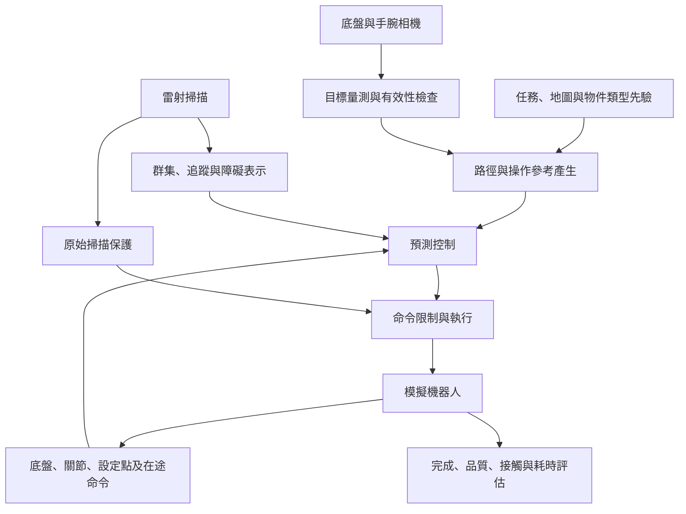

# 動態環境下移動機械臂預測導航與受約束操作

Predictive Navigation and Constrained Manipulation of Mobile Manipulators in Dynamic Environments

預口試論文工作稿 v0.4｜摘要與第一章更新：2026-11-17（Asia/Taipei）

本檔由分章檔合併，供連續閱讀；修改以分章檔為準。摘要、第一章與參考文獻已於 2026-11-17 更新；第二至第五章仍保留 2026-11-12 工作基準。本版依指定架構將文獻回顧移入第一章，第二章改為研究系統介紹，第三章集中方法與比較方法。章節齊備不代表內容或研究已完成，尚未套用學校正式格式。

[Overleaf 摘要專案](overleaf/main.tex)｜[第一章撰寫紀錄](第一章撰寫紀錄.md)｜[完整章節架構](論文章節架構.md)｜[工作目錄與撰寫程度](README.md)｜[證據與待補工作](證據索引與待補清單.md)

# 摘要

> 預口試摘要 v0.4｜更新日期：2026-11-17。中英文內容對應 [Overleaf 的 XeLaTeX 專案](overleaf/main.tex)；結果來源見[證據索引 E01–E11](證據索引與待補清單.md)。此說明不排入摘要頁。

移動機械臂結合移動底盤與機械手臂，能擴大操作範圍，適用於室內搬運及關節式物件操作。在動態環境中，障礙變化、操作可達性與手臂執行落後共同影響追蹤品質及任務效率。本研究探討移動機械臂的預測導航與受約束操作，建立導航、全身協調及視覺導引的控制與評估流程。

導航部分採用以 SE(2) 誤差描述的幾何模型預測控制，結合預測式控制屏障條件與直接讀取原始雷射掃描的保護層。協同控制部分將手臂位置設定點及其追蹤動態納入預測，以共同最佳化協調底盤與手臂，並利用視覺量測形成接近與抓取參考。

既有模擬結果顯示，在三種方法共同可評估的 83 條導航路線中，所建方法全部到達，其中 1 條路線發生接觸。在三對抽屜完整策略比較中，移動中協同操作相對嚴格停車策略縮短任務時間 13.38–14.05%，兩組均通過原任務判準。另一批三對實驗顯示，五步預測的整控制窗末端位置誤差與手臂命令反轉率低於單步預測。

視覺整合已在指定單瓶情境取得移動抓放成果，含行人案例仍有滑移超標；門操作則在理想抓持綁定及非即時計算條件下，完成一趟視覺接近、開門與退出的整合案例。上述成果支持指定模擬條件下的階段性可行性。完整住宅取物、全身動態避障及實機即時執行仍待驗證。

**關鍵字：** 移動機械臂、幾何模型預測控制、控制屏障函數、全身協調、移動中操作、視覺導引。

# Abstract

Mobile manipulators combine mobility and dexterity to extend robotic workspaces for indoor transport and articulated object manipulation. In dynamic environments, obstacle motion, manipulation reachability, and arm tracking lag jointly affect tracking quality and task efficiency. This thesis investigates predictive navigation and constrained manipulation through a control and evaluation pipeline incorporating navigation, whole-body coordination, and visual guidance.

The navigation system combines geometric model predictive control using SE(2) tracking errors, predictive barrier constraints, and a protection layer driven by raw laser scans. For coordinated control, arm position setpoints and their tracking dynamics are included in prediction, allowing base and arm commands to be optimized jointly. Visual measurements provide approach and grasp references.

In existing simulations, the navigation method reached the goal on all 83 routes jointly evaluated across three methods, with contact on one route. Three paired drawer experiments showed task-time reductions of 13.38–14.05% relative to a strict stationary-base strategy, with both strategies meeting the original task criteria. A separate three-pair study found lower end-effector position errors over the full control window and fewer arm-command reversals with five-step prediction than with one-step prediction.

Visual integration achieved moving pick-and-place in specified single-bottle scenarios, while excessive grasp slip remained in a pedestrian-interaction case. One integrated door trial completed visual approach, opening, and withdrawal under ideal grasp binding and non-real-time computation. These results support feasibility under the tested simulation conditions. Complete residential retrieval, dynamic whole-body avoidance, and real-time hardware execution remain to be validated.

**Keywords:** mobile manipulators, geometric model predictive control, control barrier functions, whole-body coordination, manipulation on the move, visual guidance.

---

# 第一章　緒論（Introduction）

> 第一章內容初稿 v0.3｜修訂日期：2026-11-17。依既定 1.1–1.4 架構撰寫；來源核對、進度依據與後續修訂項目見[第一章撰寫紀錄](第一章撰寫紀錄.md)。

## 1.1 前言（Background）

### 1.1.1 研究領域背景（Research Background）

室內服務機器人在執行取物與搬運任務時，需要在不同工作區域之間移動，並與周遭物件互動。例如，機器人接獲前往指定位置取物並返回的任務後，可能須沿途避開家具與行人、開啟關閉的門，再接近目標物件，完成抓取與運送。這類任務結合了路徑規劃、環境感知、運動控制與物件操作，也使導航與操作之間的協調成為研究重點。

移動機械臂（mobile manipulator）將移動底盤與機械手臂結合，使機器人能透過底盤改變工作位置，再以手臂完成末端對準、抓持及操作。底盤移動可擴大整體作業範圍，手臂則提供與環境互動所需的操作能力。當兩者共同運動時，底盤位置與朝向會影響手臂的可達範圍，手臂構型也會改變整機的空間占用。因此，整體動作需要同時考量機器人構型、環境幾何與任務需求。

室內環境中的門與抽屜具有特定的機構運動：門扇繞鉸鏈旋轉，抽屜沿滑軌平移。機器人建立抓持後，末端運動須配合物件的機構限制，並在操作過程中維持抓持與適當的機器人構型。這些任務提供了研究底盤、手臂與物件共同運動的具體情境，也使移動機械臂的研究由自由空間到位，延伸至與環境持續互動的操作問題。[8](參考文獻.md#r8)、[11](參考文獻.md#r11)

### 1.1.2 相關技術之發展現況（Development of Related Technologies）

移動操作的控制研究包含分階段執行與全身協調等不同方式。分階段策略先將底盤移至操作位置，再由手臂完成任務；全身協調則將底盤與手臂視為共同的運動系統，根據末端目標及系統限制安排動作。移動中操作（Manipulation on the Move, MotM）進一步考量操作期間的底盤移動，使當前操作與後續任務的進度能相互配合。[5](參考文獻.md#r5)、[6](參考文獻.md#r6)

模型預測控制（Model Predictive Control, MPC）利用當前狀態預測有限時間內的運動，將追蹤目標與執行限制納入最佳化，並隨狀態更新反覆求解。幾何模型預測控制（Geometric Model Predictive Control, GMPC）則依位姿的幾何結構描述旋轉與平移誤差，提供輪式機器人追蹤控制的建模方式。[1](參考文獻.md#r1)、[2](參考文獻.md#r2) 這類方法能在同一預測問題中表達追蹤需求與運動限制，因而成為本研究的控制基礎。

安全控制方面，控制屏障函數（Control Barrier Function, CBF）透過允許狀態集合建立控制條件，並可與 MPC 結合，將安全需求納入預測控制。[3](參考文獻.md#r3)、[4](參考文獻.md#r4) 在實際系統中，這些條件需要由障礙觀測、運動估測及執行模型提供支持，因此感知資訊如何進入控制，以及控制命令如何實際執行，均會影響避障效果。

感知導引的操作研究則利用影像與深度資料取得物件或把手資訊，再結合機器人狀態產生操作參考。[8](參考文獻.md#r8) 當底盤與手臂持續運動時，相機視角、目標相對位置與遮擋情況也隨之改變，因而需要將觀測更新與運動控制相互銜接。相關技術的發展，使移動操作逐步涵蓋從環境感知、參考產生到全身執行的連續流程。

### 1.1.3 研究議題的重要性（Significance of the Research Topic）

在動態室內環境中，導航與操作會相互影響。底盤為避讓障礙而減速或轉向時，手臂需要配合調整，才能維持末端對目標的追蹤；當手臂接近可達範圍或關節限制時，底盤也需要調整位置與移動進度。開門等持續接觸任務更要求機器人的運動與物件機構相容，使導航、手臂控制與物件操作成為相互關聯的問題。

協調方法的實際價值，需要從完整任務評估。減少停等可能縮短執行時間，但仍須維持抓持品質與適當淨空；較短的運動軌跡也須連同觀測、規劃及通訊耗時一起考量。因此，研究除了量測追蹤誤差與任務時間，也需要檢查接觸、抓持穩定性、動作連續性及計算負擔，才能判斷方法對整體流程的影響。

基於上述需求，本研究以預測導航為基礎，探討底盤、手臂與視覺資訊之間的協調，並以室內開門及取物情境作為研究脈絡。透過模型設計與實驗比較，分析移動機械臂在兼顧執行限制、操作品質與任務效率時所面臨的問題，作為後續研究動機、目的及方法設計的依據。

## 1.2 研究動機與目的（Research Motivation and Objectives）

### 1.2.1 研究動機（Research Motivation）

本研究首先關注感知結果與導航限制之間的落差。雷射回波經過過濾、群集、追蹤與動靜分類後，才形成控制器使用的障礙資訊。既有開發紀錄顯示，有效回波可能在這些處理中未被發布為控制限制；此時即使控制器正確求解，也缺少該障礙所對應的條件。這促使本研究結合追蹤式障礙預測與直接讀取原始掃描的保護層，檢查兩者在不同失效情況下的互補作用。[^nav]

第二項動機來自導航與操作的時間安排。先完成導航、停穩後才開始手臂操作，能建立清楚的階段條件，但也可能增加入場收斂與等待。移動中操作使底盤與手臂能重疊執行，相關研究已顯示其任務效益。[6](參考文獻.md#r6)、[7](參考文獻.md#r7) 對本平台而言，仍須檢查這種協調能否在既有抓持及接觸判準下縮短任務時間，並量測收益來自哪些階段。

第三項動機是預測與執行的一致性。本平台將手臂命令速率積分為關節位置設定點，再由位置控制器追蹤。若直接以理想速度積分預測關節運動，就會忽略設定點狀態與伺服落後。底盤命令也可能經平滑、輪級限制與保護層修正，使求解提案與實際生效輸入有所差異。本研究因此關注設定點、在途命令及實際放行值如何進入預測，以減少控制模型與執行過程之間的偏差。[^exec]

第四項動機是連續任務中的觀測與規劃。當機器人接近把手或抓取物件時，相機位姿、遮擋及量測品質都可能改變；取得目標後，計算與通訊又會使執行狀態持續前進。操作參考需要同時對應量測取得的時刻與接受計畫時的狀態。這促使本研究從固定目標的基線，逐步轉向由當次觀測產生與更新參考，並將規劃等待納入整體時間評估。

### 1.2.2 現有技術面臨之問題與挑戰（Problems and Challenges）

本研究的總體問題為：如何在動態室內環境中，透過考量觀測、執行與物件機構限制的預測控制，協調移動機械臂的導航、接近及操作，並兼顧任務完成、品質與效率？

第一項挑戰是障礙資訊的不完整與時變性。動態障礙的預測仰賴觀測及追蹤，前端漏失會影響可用限制，延遲也會改變實際避讓餘裕。第二項挑戰是不同致動介面的協調：底盤與手臂具有不同的命令處理與回授途徑，模型需要正確表示各自的執行效果。

第三項挑戰出現在抓持與物件操作。自由空間中的末端到位，無法單獨決定抓持建立後的可行運動；開門時還須維持機器人與門扇的相容關係。第四項挑戰則是觀測與計算的時效：計畫在產生後仍需能接續當前狀態，操作所需時間也須落在可達區間內。這些問題共同影響控制器能否連續執行，而不只是產生一條幾何上可行的參考。

為對應可檢驗的研究內容，將總體問題整理為下列四項研究問題。

| 編號 | 研究問題 | 主要挑戰 | 評估方式 |
|---|---|---|---|
| RQ1 | 預測式避障與原始掃描保護如何配合，以降低障礙追蹤及分類漏失的影響？ | 障礙估測、延遲及可用運動範圍 | 共同路線比較、模組消融與接觸分析 |
| RQ2 | 納入設定點及實際命令執行資訊後，能否改善全身操作的預測與追蹤？ | 伺服落後、多取樣率與底盤—手臂耦合 | 模型誤差、預測步數及命令一致性比較 |
| RQ3 | 底盤與手臂協同運動能否在符合原品質判準下，改善完整任務的時間及連續性？ | 入場收斂、抓持品質、機構限制與停等 | 嚴格停車對照、分段時間及品質評估 |
| RQ4 | 如何由當次視覺與執行狀態，形成可接續的接近、抓持及物件操作參考？ | 遮擋、量測時效、計算延遲及操作可達區間 | 量測到計畫的資料流、物理模擬及失敗分析 |

四項問題分別對應導航基礎、執行預測、策略效益與感知整合。既有實驗已提供部分證據，新增的命令一致性及連續整合問題仍需後續驗證。研究將依具體條件報告各問題的支持程度，並以實測運動及任務結果檢查控制命令的效果。

### 1.2.3 研究目的（Research Objectives）

本研究以四項相互銜接的目的回應上述問題。

1. 建立結合幾何追蹤、障礙運動預測及原始掃描保護的導航方法，透過共同路線與模組消融，評估到達、接觸及時間成本，分析其互補作用與限制。
2. 建立對應手臂設定點追蹤及命令執行的預測模型，在底盤與手臂共同控制中考量輪級、速度、加速度及關節限制，並量測模型及追蹤誤差。
3. 以抽屜協同操作及移動抓放等任務，檢驗預測步數與協同策略對品質、命令變動及完整任務時間的影響，尋找維持品質條件下的效率改善。
4. 將視覺量測、機器人狀態及物件機構關係連結到操作參考，逐步驗證移動接近、抓持與開門的接續，並朝開門取物返回的完整任務整合。

各項目的均以可追溯的實驗條件及固定判準評估。量測來源、控制版本、樣本數與計時窗口將與結果共同呈現，使設計效益及未完成問題能被具體檢查。

### 1.2.4 研究範圍與預期貢獻（Research Scope and Expected Contributions）

本研究以四輪全向底盤、六軸手臂及夾爪所構成的移動機械臂為對象，研究環境以室內平面移動及指定物件操作為主。地圖、任務區域、物件類型與部分機構資訊可作為明示先驗，操作目標則依對應實驗由既有設定或當次觀測取得。視覺模組主要支援任務參考，不將一般物件辨識、自然語言理解或未知機構推論列為本文的主要研究問題。

目前證據涵蓋動態導航、既有抽屜協同操作、指定單瓶視覺抓放，以及門把手接近與理想抓持條件下的開門工程案例。門操作已取得由本趟影像接近、開門及退出至指定位置的整合結果；其抓持使用理想固定關節綁定，部分手臂命令採閉鏈逆運動學追蹤，且計算時暫停模擬。這些條件界定該案例的支持範圍；導航、接近與開門共用控制核心及非阻塞執行，仍是推進中的整合方向。[^door]

整體應用情境依目前任務設定為：由起點出發，途經關閉的門，以視覺引導接近、抓持及開門，通過後夾取茶几上的圓柱體，再持物返回起點。抽屜操作保留為已有比較支持的關節式物件案例。完整往返的連續動作、觀測更新及運算時間仍需實際驗證；必要的保護停止也納入任務結果。[^task]

研究的預期貢獻包括三個層面。第一，針對感知處理與控制限制之間的落差，建立預測導航與原始掃描保護的互補設計及實驗分析。第二，針對本平台的命令介面，建立設定點與執行資訊相容的預測表示，支持底盤與手臂的協調。第三，以固定品質判準及完整時間評估，檢驗協同策略與視覺導引整合的實際效益。本文將以具體設計及對照支持這些貢獻，並依證據區分已完成成果與待驗證延伸。

## 1.3 文獻回顧（Literature Review）

本節依研究問題將相關工作分為預測導航與動態避障、全身協調與移動中操作，以及視覺導引與關節式物件操作。比較內容著重模型、控制決策、資訊需求及驗證情境，藉此說明本研究採用的基礎與待檢驗的問題。

### 1.3.1 預測導航與動態避障（Predictive Navigation and Dynamic Obstacle Avoidance）

Tang 等人針對輪式機器人提出 GMPC，利用李群與李代數關係推導追蹤誤差動態，將局部控制問題轉為可由二次規劃求解的形式，並以模擬及實體平台檢查追蹤與計算表現。[1](參考文獻.md#r1) 此研究提供本研究底盤幾何預測的相關基礎；動態障礙資訊如何取得及進入限制，則需要另行處理。

Ames 等人整理 CBF 與最佳化安全控制的理論及應用，說明如何以集合維持條件限制控制輸入。[3](參考文獻.md#r3) Zeng 等人進一步將離散時間 CBF 納入 MPC，分析其穩定性與可行性，並以數值案例驗證方法。[4](參考文獻.md#r4) 兩者使安全條件能與性能目標共同進入控制設計，也指出理論結論須對應模型與可行輸入條件。

對本研究而言，避障不僅涉及限制的數學形式，也涉及障礙是否被觀測與發布。本文因此檢查追蹤式預測與原始掃描保護的分工，並以接觸、到達與時間代價評估結果。實作所採逐預測步速度型屏障條件，與離散狀態差分形式具有不同表達，相關性及適用條件將在方法章說明。

### 1.3.2 全身協調控制與移動中操作（Whole-Body Coordination and Manipulation on the Move）

Minniti 等人將操作、平衡與互動納入同一全身最佳控制問題，利用 MPC 評估末端追蹤及接觸對平台動態平衡的影響，並在球式平衡移動機械臂上驗證。[5](參考文獻.md#r5) 此工作說明底盤與手臂共同預測的重要性，但其動態模型與本研究的全向底盤、設定點追蹤模型具有不同的涵蓋範圍。

Burgess-Limerick 等人提出反應式 MotM 架構，使底盤在進行操作時仍朝後續任務前進，並以移動抓取及搬運檢查效果；作者亦交代實驗主要使用較簡單物件與較少雜物的環境。[6](參考文獻.md#r6) 其後續工作納入底盤及手臂避障，展示動態環境中的操作，並將障礙運動預測、三維碰撞幾何與抓取失敗偵測列為延伸方向。[7](參考文獻.md#r7)

近期 Du 等人提出分層全身 MPC，以末端運動規劃引導全身關節軌跡，結合預測導納處理雙臂操作，並關注位置與速度混合控制平台的命令一致性；其方法已以模擬及實機實驗評估。[10](參考文獻.md#r10) 這顯示執行介面與全身預測之間的關係亦是現有研究內容，本文須以本平台的具體命令模型及實驗結果界定貢獻。

上述工作分別處理全身動態、反應式協調與分層預測。本文關注的比較問題，是在既有導航與命令鏈下，手臂設定點及多步預測如何影響追蹤，以及協同策略能否維持原品質並改善完整任務時間。方法名稱與平台差異本身不構成效能優勢，需以對應對照檢查。

### 1.3.3 視覺導引與關節式物件操作（Visual Guidance and Articulated Object Manipulation）

Mittal 等人將關節式物件操作分為物件導向與機器人導向兩層：先由 RGB-D 資料產生操作提案，再以全身 MPC 考量機器人及環境限制，並以不同操作與動態場景評估結果。[8](參考文獻.md#r8) 此架構將感知提出的動作與機器人實際能執行的運動連結，也提供本研究檢查視覺目標可執行性的比較方向。

Jiao 等人提出虛擬運動鏈（Virtual Kinematic Chain, VKC），共同表示底盤、手臂與受操作物件，將任務轉換為軌跡最佳化問題，並於模擬中比較共同規劃與分別處理的效果。[11](參考文獻.md#r11) 此工作強調物件機構可進入共同運動學表示；對開門任務而言，門角、把手與抓持變換的一致關係，因而是值得處理的模型內容。

本研究由指定物件及區域先驗出發，逐步使當次量測影響接近與操作參考。研究需要交代影格時刻、相機位姿、目標有效期與計畫承接，並依接觸狀態切換任務。物件感知、機構建模及命令執行在流程中具有不同作用，各項成果將依實際使用資訊及控制方式評估。

### 1.3.4 現有研究成果比較（Comparison of Existing Research）

| 相關工作 | 主要設計 | 驗證或研究重點 | 對本文的啟示 |
|---|---|---|---|
| Tang 等人 [1](參考文獻.md#r1) | 幾何誤差及局部凸控制 | 輪式機器人追蹤、計算表現 | 導航幾何模型基礎 |
| Ames 等人 [3](參考文獻.md#r3)、Zeng 等人 [4](參考文獻.md#r4) | CBF 及其與 MPC 的結合 | 集合條件、可行性與控制 | 依實際模型檢查安全條件 |
| Minniti 等人 [5](參考文獻.md#r5) | 動態全身 MPC | 平衡、末端追蹤及互動 | 共同考量底盤與手臂 |
| Burgess-Limerick 等人 [6](參考文獻.md#r6) | 反應式 MotM | 操作與後續任務進度 | 檢查協調的整體時間效益 |
| Burgess-Limerick 等人 [7](參考文獻.md#r7) | MotM 與避障 | 動態環境、感知及抓取限制 | 連結障礙估測與操作品質 |
| Mittal 等人 [8](參考文獻.md#r8) | 感知提案與全身 MPC | 關節物件、環境及可執行性 | 檢查量測後操作參考 |
| Du 等人 [10](參考文獻.md#r10) | 分層全身 MPC、預測導納 | 雙臂、混合控制及線上重規劃 | 比較執行模型與計算負擔 |
| Jiao 等人 [11](參考文獻.md#r11) | 底盤—手臂—物件共同運動鏈 | 關節物件協同規劃 | 表示抓持後的機構相容關係 |

表 1-1　相關研究之方法與本文關聯。

各文獻使用不同機器人、感測器、物件與時間窗口，其結果適合用於辨識方法處理的問題及驗證範圍。本文的性能比較將使用第三章定義的具體基線與第四章實驗條件；相關工作在本章提供研究定位的依據。

### 1.3.5 現有方法之限制與研究缺口（Limitations and Research Gaps）

上述研究已從導航、全身控制、移動中操作及物件建模等方向提供方法基礎。本文在此基礎上聚焦三項需要進一步對應實際平台的問題。

首先是感知資訊與控制限制的銜接。障礙運動預測需要可用的估測，而原始回波到控制限制之間存在多個處理步驟。本文以分類與追蹤漏失的具體案例為出發點，檢查預測式導航與原始掃描保護的作用及代價，將感知失效納入控制評估。

其次是預測、命令執行與物件機構之間的一致性。共同最佳化需要對應平台的設定點積分、伺服追蹤與實際放行命令；建立抓持後，還需維持物件機構允許的關係。本文從執行模型與共同末端任務開始，逐步檢驗向機構約束操作延伸的條件及限制。

第三是品質與完整任務時間的共同評估。流暢的連續操作需要協調觀測、規劃與運動，但較早抓取或較短參考軌跡，都可能伴隨品質下降或額外計算等待。本文因此在固定判準下，同時呈現追蹤、抓持、接觸、停等及時間結果，並保留失敗作為研究問題的證據。

這些問題構成本文的方法與實驗主線。研究將以同平台的模型、模組與策略對照，確認各設計在指定條件下的實際效果，據以收斂可支持的貢獻及後續工作。

## 1.4 本文架構（Thesis Organization）

本論文共分為五章，各章安排如下。

第一章為緒論，介紹室內移動操作的研究背景、動機與目的，界定研究範圍，並依預測導航、全身協調及感知導引操作回顧相關研究，形成本文的研究問題與比較方向。

第二章為研究系統介紹，說明移動機械臂的組成、平台與設備、軟體環境及通訊介面，整理感知、控制、執行與評估的資訊流，建立後續方法及實驗的系統依據。

第三章為研究方法與演算法設計，定義狀態、輸入與假設，建立底盤幾何預測及手臂執行模型，說明共同成本、限制、數值求解、參考銜接與演算法流程，並介紹比較方法。

第四章為實驗方法與結果分析，交代實驗設計、情境、參數與指標，呈現導航、協同操作及視覺整合的驗證，透過比較、消融與失敗分析討論品質、效率及適用限制。

第五章為結論與未來工作，依實驗證據總結研究成果與貢獻，說明目前限制，提出連續任務整合、全身安全處理及實機移轉等後續方向。

[^nav]: 感知漏失與導航設計依據見[第一階段實作總結](../第一階段實作總結.md)，相關比較與消融來源見[證據索引 E01、E02](證據索引與待補清單.md)。
[^exec]: 設定點模型見[證據索引 E05](證據索引與待補清單.md#e05)；近期實際放行命令與共同核心的整合狀態見[證據索引 E11](證據索引與待補清單.md#e11)。
[^door]: 門操作狀態依[理想抓持綁定三趟及整合結果摘要](../第八次進度報告素材/規格/門機構約束開門_理想綁定三趟結果摘要_r1.md)；近期共同核心仍在整合，詳[證據索引 E11](證據索引與待補清單.md#e11)。
[^task]: 應用情境依[2026-11-17 完整任務主線](../reviews/20261117_howard_full_task_mainline.md)。此為任務目標，完整往返驗證仍待完成。

---

# 第二章　研究系統介紹（Research System Description）

> v0.2：說明平台、模組、資訊流與整合方式。硬體欄位包含模擬模型及執行主機；實機使用狀態與未核對規格另外標示。方法公式與實驗個別參數分別於第三、四章說明。

## 2.1 研究系統概述（System Overview）

### 2.1.1 研究系統之組成（System Components）

研究系統由四輪全向底盤、六軸手臂與夾爪模型、雷射與相機感測、預測控制、命令執行及獨立評估模組組成。底盤提供平面移動，手臂與夾爪負責接近、抓持及物件操作；各研究階段依批次啟用對應感測與控制鏈。

### 2.1.2 系統功能與需求（System Functions and Requirements）

| 功能 | 系統需求 | 驗證對應 |
|---|---|---|
| 動態導航 | 接收路徑、更新障礙、限制可執行命令 | 共同路線比較與導航消融 |
| 全身協調 | 同時考量底盤、手臂及設定點狀態 | 抽屜與全身控制比較 |
| 視覺導引 | 保留量測來源時間、有效性及座標 | 量測後規劃與接近案例 |
| 任務切換 | 檢查狀態與接觸條件，記錄等待及停止 | 流程與失敗分析 |
| 結果評估 | 分開判定完成、品質、接觸與耗時 | 第四章各批固定判準 |

住宅取物作為整合目標，目前能力完成程度依證據索引判定，不能由功能需求表推定整段任務已完成。

### 2.1.3 系統整體架構（Overall System Architecture）

研究系統包含環境感知、參考產生、預測控制、命令執行與結果評估。雷射資料形成導航障礙資訊；相機提供指定物件的量測。參考產生模組依任務區域、目標量測與機器人狀態建立路徑或末端目標，預測控制器再產生底盤與手臂命令。

圖 2-1 為功能關係示意。掃描保護與命令限制的實際順序、全身幾何限制及真值監看的啟用情形，依各實驗版本登錄。此圖不表示每個歷史批次都包含所有模組。

## 2.2 研究平台與設備（Research Platform and Equipment）

### 2.2.1 研究平台介紹（Research Platform）

導航階段以四輪全向底盤 omni_bot 為平台；全身階段結合 UFACTORY Lite 6 六軸手臂模型與夾爪，形成三個底盤自由度與六個手臂關節的運動系統。設定點是執行內部狀態，不增加致動自由度。

專案分別具有模擬模型與求解用運動學模型。例如，`omni_bot_wholebody.urdf.xacro` 以三個虛擬平面關節將底盤與手臂表示為同一運動鏈；該檔不是具有完整感測器與控制插件的模擬器模型。兩者的用途與幾何一致性需要分開核對。[模擬模型](../src/my_omnibot_description/urdf/omni_bot.urdf.xacro)、[全身運動學模型](../src/my_omnibot_description/urdf/omni_bot_wholebody.urdf.xacro)

### 2.2.2 硬體設備與規格（Hardware and Specifications）

| 項目 | 已有依據的規格或設定 | 適用範圍 |
|---|---|---|
| 底盤輪系 | 四全向輪；有效輪半徑 0.05 m、幾何參數 L＝0.245 m | 第一階段輪級模型與對照上限 |
| 輪速／輪加速度上限 | 5.55 rad/s／125 rad/s² | 導航批次登錄值，非所有任務的實測峰值 |
| 手臂 | Lite 6 六軸模型 | 關節、設定點與運動學來源依各凍結版本 |
| 執行主機 | 門把手局部案例：Ryzen 7 9800X3D、RTX 5070 | 僅對應該桌機批次；其他主機規格待補 |
| 夾爪 | 雙指夾爪模型 | 碰撞幾何、指力及開度依各批資產設定 |

輪系規格見[第一階段總結](../第一階段實作總結.md)，桌機資訊見[門把手案例](../第八次進度報告素材/規格/住宅場景_門把手非接觸接近_r1.md)。目前論文成果以模擬為主；不以模型名稱或模擬參數宣稱實機硬體已完成驗證。

### 2.2.3 感測與執行設備（Sensing and Actuation）

雷射掃描支援導航障礙表示及原始回波保護；底盤與手腕相機分別支援導引與近距觀測。底盤、關節與設定點回授用於建立控制狀態，夾爪開度及接觸資訊則參與特定版本的操作判定。

Gazebo 相機描述檔採 RealSense D435 系列幾何與 RGB-D 模擬設定，但這不代表後續 Isaac 雙相機案例使用完全相同的內外參、解析度或更新率；正式設備表須依實驗登錄補齊。[Gazebo 相機模型](../src/my_omnibot_description/urdf/camera.xacro)

部分抓持、離桌、支撐及監看目前使用模擬接觸力或真值幾何，屬流程使用的資訊。實機接觸感測及估測仍為缺口；這些量與獨立評分端真值分別列示。[E06–E08](證據索引與待補清單.md)

## 2.3 軟體與開發環境（Software and Development Environment）

### 2.3.1 作業系統與開發工具（Operating System and Development Tools）

系統以 ROS 2 Jazzy 與 Python 為主要開發環境，使用 NumPy、SciPy、YAML 及 QP 求解模組處理模型與最佳化。ROS 套件依賴可由 `package.xml` 追查，但宣告依賴不等於所有批次的精確安裝版本。[控制套件](../src/ammr_wholebody_mpc/package.xml)、[啟動套件](../src/ammr_bringup/package.xml)

作業系統、Python 與套件確切版本應由各批次環境紀錄補入；本章不由 ROS 發行版推定作業系統版本。程式版本、資產、感知權重與分析器也須共同列入重現資訊。

### 2.3.2 模擬與測試平台（Simulation and Test Platforms）

第一階段主要使用 Gazebo Harmonic，後續含接觸的全身與視覺任務使用 Isaac Sim。離線重放與簡化模型測試用於檢查公式、介面及候選條件，含接觸物理模擬則檢查實際模型中的執行；兩類結果分開報告。不同平台、主機及模擬倍率的耗時不直接合併比較。

### 2.3.3 軟體模組與通訊介面（Software Modules and Communication Interfaces）

| 模組／訊息 | 作用 | 使用時需確認 |
|---|---|---|
| `/scan`、`/scan_filtered` | 原始及前處理雷射資料 | 保護層是否直接讀原始回波 |
| `scan_obstacle_tracker` | 群集、追蹤及動靜分流 | 是否將有效障礙發布至控制端 |
| `/gmpc/obstacles`、`/gmpc/static_obstacles` | 控制器的障礙表示 | 座標、時間與表示方式 |
| `/plan`、`/odom`、TF、`/joint_states` | 參考路徑及機器人狀態 | 資料來源與更新時間 |
| `/cmd_vel_nav`、`/cmd_vel_pre_shield`、`/cmd_vel` | 導航命令鏈各階段 | 最終套用值與修正紀錄 |
| `/bottle/target_guide` 與視覺候選介面 | 雙相機導引及目標交接 | 來源影格、時戳及一致性 |

上述導航介面依第一階段架構列示；瓶子及門把手執行器另有其直接介面，不推定所有階段共用相同 topic。[導航資料流](../第一階段實作總結.md)、[雙相機候選節點](../evaluation/bottle_seg3d_candidates_dual_node.py)

## 2.4 系統架構設計（System Architecture Design）

### 2.4.1 系統模組配置（System Module Configuration）

模組依功能配置為感知與狀態取得、參考產生、預測求解、命令處理、任務監看及獨立評估。模組存在於程式庫不代表某批實驗已啟用；每次實驗以啟動參數及凍結清單記錄實際配置。導航追蹤、掃描保護與全身幾何限制的數學內容留至第三章說明。

### 2.4.2 模組間資訊傳遞（Information Flow Between Modules）

感知與狀態訊息保留來源時間及座標；計畫記錄建立時的目標、機器人狀態與版本。控制端接受計畫時，檢查目標有效性與當前狀態的接續條件，再輸出命令。命令鏈的限幅、輪級修正及保護可能改變候選輸出，因此需分別記錄候選、實際套用命令與實測運動。

### 2.4.3 系統整合架構（System Integration Architecture）

為正確對應第四章結果，本研究區分三類控制實作。

| 代號 | 用途及實作 | 模型與求解重點 | 對應結果 |
|---|---|---|---|
| A：導航 GMPC | `gmpc.py` 與導航鏈 | SE(2) 底盤誤差、預測障礙、CBF、外部掃描保護 | 導航比較與消融 |
| B：既有抽屜 W-GMPC | `wgmpc_core_sp.py` 與抽屜節點 | 九維構型加六維設定點；非線性 rollout、序列 QP | 嚴格停車／MotM、H1／H5 |
| C：導航擴充全身 GMPC | `gmpc_wb.py` 與瓶子／門把手控制鏈 | 保留底盤幾何預測，加入手臂設定點與共同 TCP 成本 | 近期視覺抓放與局部接近 |

B、C 共用部分執行模型概念，但底盤狀態、任務線性化及求解流程不同。B 的實驗不能直接證明 C 的每項設計有效。抽屜正式批次也沒有啟用後續所有全身碰撞限制。

## 2.5 系統運作流程（System Operation Workflow）

系統首先接收地點、家具或區域及物件類型等任務輸入，再更新環境與機器人狀態。導航接近時依路徑與障礙資訊更新控制；進入觀察與操作區後，利用量測建立操作參考，並依可用狀態持續協調底盤與手臂。抓持、運送、放置及退離由觀測及各批判準推進；條件不足時則等待、拒絕或停止。

此處描述系統層級的階段關係，第三章說明每個控制週期如何建模與求解。已驗證的抽屜、瓶子與門把手局部流程各自保留其範圍；完整住宅的開門、通行、開抽屜、取粗馬克筆代理物與返回，仍是整合目標。[E03–E09](證據索引與待補清單.md)

---

# 第三章　研究方法與演算法設計（Research Methodology and Algorithm Design）

> v0.2：依指定架構分開問題、模型、理論、最佳化、方法及基線。保留既有核心公式，仍需補齊座標微分、批次啟用條件與完整參數；實作來源見 E05。

## 3.1 系統描述與問題定義（System Description and Problem Formulation）

### 3.1.1 研究問題定義（Research Problem Formulation）

延續第一章 RQ1–RQ4，本章研究如何由當前觀測、狀態與任務參考，產生符合執行限制的底盤及手臂命令。導航需處理障礙資訊不完整，協同操作需處理手臂執行落後，視覺整合則需將量測轉為可接續的運動參考。第二章 2.4.3 區分 A、B、C 三類實作，本章沿用該分類。

### 3.1.2 系統基本假設（Basic Assumptions）

| 假設 | 使用範圍及限制 |
|---|---|
| 底盤以平面位姿描述 | 導航幾何模型，未涵蓋所有地形與完整剛體動態 |
| 障礙採局部等速預測 | 依當前追蹤更新；突變與漏測會影響預測 |
| 手臂可用一階設定點模型近似 | 係數來自既有辨識範圍，跨條件需驗證 |
| 局部線性化有效 | 依名目軌跡與擾動範圍；非全域精確模型 |
| 任務先驗明示 | 地圖、區域、物件類型與部分機構已知 |
| 接觸與幾何資訊依批次可取得 | 部分目前使用模擬真值，不能直接視為實機感測 |

上述為建模條件，不是所有失效都已排除的保證；個別批次未符合的條件須在第四章交代。

### 3.1.3 系統狀態與輸入變數（System States and Inputs）

底盤位姿表示為

$$
X_B=\begin{bmatrix}R(\theta)&p_B\\0&1\end{bmatrix}\in SE(2),
\qquad \xi_B=[v_x^B,v_y^B,\omega]^\top.
\tag{3-1}
$$

上標 $B$ 代表本體座標，$p_B$ 為世界座標下的位置。手臂關節角為 $q_a\in\mathbb{R}^6$，位置設定點為 $s_a\in\mathbb{R}^6$，輸入為

$$
u=[\xi_B^\top,u_a^\top]^\top\in\mathbb{R}^9.
\tag{3-2}
$$

$u_a$ 為設定點積分速率，不能直接當作當下實測關節速度。C 類控制器以 $(X_B,q_a,s_a)$ 描述預測狀態，其局部座標維數為 15；B 類則以 $[x_B,y_B,\theta,q_a^\top,s_a^\top]^\top$ 作增廣向量。

### 3.1.4 研究目標與限制條件（Objectives and Constraints）

末端位姿 $T_E=f(X_B,q_a)$ 由全身正向運動學求得。任務輸入包含底盤參考路徑、末端目標，以及觀測／接觸條件。控制目標是在可用預測模型與限制下，降低導航及末端誤差、命令變動與不必要等待。

抽屜平移開度及門扇旋轉角度可用來形成操作參考與判定任務進度。目前既有抽屜核心並未將物件關節、接觸力及抓取閉鏈完整納入同一預測狀態與硬約束；不能只因目標沿滑軌移動，就描述成已建立完整機器人—物件耦合動力學。

控制同時考量路徑與末端追蹤、命令變化、輪級可行、關節與設定點限位，以及各版本實際啟用的幾何及觀測條件。正式限制與最佳化形式見 3.4；完成及品質判準則由第四章獨立評估。

## 3.2 數學模型建立（Mathematical Modeling）

### 3.2.1 系統數學模型（System Mathematical Model）

全身運動學以末端映射 $T_E=f(X_B,q_a)$ 表示底盤與手臂的共同影響。B 類使用九維構型與六維設定點的增廣向量；C 類保留底盤 SE(2) 誤差預測，另組合手臂設定點預測。兩者共用執行模型概念，但不是同一個底盤狀態方程。

對使用世界座標末端任務的相位，底盤與手臂都可能改變末端殘差；對底盤相對持物任務，末端相對構型可與底盤平移解耦。這項差異進入 3.4.1 的共同成本。

### 3.2.2 系統動態方程式（System Evolution Equations）

定義

$$
E=X_{\mathrm{ref}}^{-1}X_B,\qquad e=\log(E)^\vee.
$$

由 $\dot X_B=X_B\hat\xi_B$ 及參考運動學得

$$
\dot E=E\hat\xi_B-\hat\xi_{\mathrm{ref}}E.
$$

在小誤差附近一階展開，令 $\delta\xi=\xi_B-\xi_{\mathrm{ref}}$，則

$$
\dot e\approx-\operatorname{ad}(\xi_{\mathrm{ref}})e+\delta\xi,
\quad
e_{k+1}=A_k e_k+\Delta t\,\delta\xi_k,
\quad A_k=I-\Delta t\operatorname{ad}(\xi_{\mathrm{ref},k}).
\tag{3-3}
$$

堆疊 $N$ 步後，令 $Z_B=[\delta\xi_0^\top,\ldots,\delta\xi_{N-1}^\top]^\top$，得到

$$
\mathcal E=\Phi e_0+\Gamma Z_B.
\tag{3-4}
$$

$A_k$ 依預測步改變。式（3-3）為局部一階模型，並非任意誤差下的精確非線性動態；對數主值亦具有分支。[幾何控制與李群背景](參考文獻.md)

### 3.2.3 模型參數與變數定義（Model Parameters and Variables）

| 符號 | 意義 | 維度或單位 |
|---|---|---|
| $X_B$、$\xi_B$ | 底盤位姿及本體速度 | $SE(2)$；三維，m/s、rad/s |
| $q_a$、$s_a$、$u_a$ | 手臂關節角、設定點及設定點速率 | 各六維；rad、rad、rad/s |
| $e$、$Z_B$ | 底盤局部誤差及時域速度偏差序列 | 三維、$3N$ 維 |
| $U_A$ | 手臂時域輸入序列 | $6N$ 維 |
| $\Delta t_p$、$\Delta t$、$N$ | 物理步、控制步與預測步數 | s、s、無因次 |
| $\alpha$、$b$ | 每物理步手臂追蹤係數與偏置 | 六維；無因次、rad |
| $P,Q,G,h$ | 組合後手臂預測係數 | 逐軸對應；$G$ 含時間尺度 |
| $r,L,\omega_{\max},\alpha_{w,\max}$ | 輪半徑、輪系參數、輪速及輪加速度界 | m、m、rad/s、rad/s² |
| $\mu$ | 關節及設定點限位餘量 | rad |
| $\alpha_h,\varepsilon$ | 速度型屏障增益及鬆弛 | 依屏障尺度與版本定義 |

手臂追蹤係數 $\alpha$、輪加速度界 $\alpha_{w,\max}$ 與屏障增益 $\alpha_h$ 是不同量。模型符號亦可能與 QP Hessian 的 $P$ 重名，依式中上下文區分；正式定稿可再統一記號。

### 3.2.4 模型推導與分析（Model Derivation and Analysis）

命令與實際關節之間包含設定點積分及追蹤落後，因此將設定點納入預測狀態。以下推導將物理步模型組合為控制步模型；狀態增廣本身不作為首創主張。

每物理步長 $\Delta t_p$ 的逐軸模型為

$$
q_a^{j+1}=(1-\alpha)\odot q_a^j+\alpha\odot s_a^j+b,
\qquad s_a^{j+1}=s_a^j+\Delta t_p u_a.
\tag{3-5}
$$

$\odot$ 為逐元素乘積，$\alpha$ 為追蹤係數，$b$ 為每物理步偏置。若控制步 $\Delta t=m\Delta t_p$ 且控制步內 $u_a$ 保持固定，令 $\beta=1-\alpha$，反覆代入可得

$$
q_{a,k+1}=P\odot q_{a,k}+Q\odot s_{a,k}+G\odot u_{a,k}+h,
\qquad s_{a,k+1}=s_{a,k}+\Delta t u_{a,k},
\tag{3-6}
$$

其中

$$
P=\beta^m,\quad Q=1-\beta^m,\quad
G=\alpha\Delta t_p\odot\sum_{j=0}^{m-1}j\beta^{m-1-j},\quad
h=b\odot\frac{1-\beta^m}{\alpha}.
\tag{3-7}
$$

各冪次與除法皆逐軸計算。此組合沿用式（3-5）的更新順序：先由原設定點更新關節預測，再積分下一設定點。模型對給定 $\alpha,b$ 為仿射，但僅近似平台的執行行為，並非完整剛體或接觸動力學。

既有辨識範例使用 $\Delta t_p=0.01$ s、$\Delta t=0.05$ s 及 $\alpha\approx0.09501$；組合後 $G\approx0.00864$ s，與直接速度積分使用的 0.05 s 不同。這解釋了為何設定點必須出現在預測中。辨識參數來自單一資料集，仍需跨條件驗證。[E05](證據索引與待補清單.md#e05)

## 3.3 理論基礎與方法設計（Theoretical Foundation and Method Design）

### 3.3.1 核心理論介紹（Core Theory）

底盤平面位姿可表示為 $X\in SE(2)$，旋轉與平移共同構成剛體變換。利用對數映射，可將參考位姿與實際位姿之間的局部差異表示為三維誤差向量；手臂末端姿態亦可利用 $SO(3)$ 的對數描述。Solà 等人整理這些群、擾動及雅可比的常用工具。[Micro Lie theory](https://arxiv.org/abs/1812.01537)

對數映射的主值具有分支，局部線性化也有適用範圍。因此，採用李群表示不等於全域誤差連續，亦不直接導出全域穩定性。

MPC 根據當前狀態預測有限時域內的運動，求得控制序列後只執行首段，下一控制週期再以更新狀態求解。本研究同時關注追蹤誤差、輸入大小、命令變化與執行限制。預測步數、模型及終端成本共同影響閉迴路行為；增加預測步數所產生的差異，需要實驗分離。

以 $h(x)\geq0$ 描述允許集合時，CBF 將集合維持問題轉換為控制條件。實際能否成立，仍取決於模型、觀測、可行輸入與取樣。若障礙未被觀測、未被加入限制，或實際致動與預測不同，不能直接套用理想模型下的保證。[CBF 理論與應用](https://arxiv.org/abs/1903.11199)

### 3.3.2 演算法原理（Algorithm Principles）

每個控制週期先取得狀態，再沿參考或名目序列建立有限時域預測與局部限制，求得控制序列後只執行首段，下一週期重新求解。這使新觀測可以影響後續命令，但其反應仍受量測、計算及執行延遲限制。

B 類另以非線性 rollout 與序列 QP 更新名目解；C 類使用導航幾何預測與手臂仿射預測組成共同子問題。兩種流程的接受、停止與失敗條件須依實際程式說明，不因皆使用 QP 就視為相同演算法。

### 3.3.3 方法架構與設計（Method Architecture and Design）

方法依序連結可用觀測、與執行端一致的預測、共同任務成本，以及可執行命令限制。幾何表示處理底盤追蹤，設定點模型描述手臂命令效果；屏障與掃描保護處理導航接近風險，任務准入則處理目標失效及階段承接。

這些功能的配置見第二章，數學組裝見 3.4，實際改進機制與執行流程見 3.5。各項效果分別由第四章對照，不由整體架構圖推定。

## 3.4 最佳化問題與限制條件（Optimization and Constraints）

### 3.4.1 目標函數設計（Objective Function Design）

對 C 類控制器，在選定的名目預測與座標慣例下，將末端位置及姿態殘差作局部近似：

$$
r_k\approx r_{0,k}-L_{B,k}Z_B-L_{A,k}U_A,
\qquad U_A=[u_{a,0}^\top,\ldots,u_{a,N-1}^\top]^\top.
\tag{3-8}
$$

$L_{B,k}$ 由底盤誤差預測、位姿映射微分及末端雅可比組合；$L_{A,k}$ 由手臂預測及末端雅可比組合。名目輸入造成的常數位移收在 $r_{0,k}$。底盤本體速度必須先依其模型映射，不能直接與世界座標雅可比相乘。

令 $L_k=[L_{B,k},L_{A,k}]$、$Z=[Z_B^\top,U_A^\top]^\top$，則

$$
J_E=\sum_k(r_{0,k}-L_kZ)^\top W_E(r_{0,k}-L_kZ),
$$

$$
P_E=2\sum_k L_k^\top W_E L_k,
\qquad q_E=-2\sum_k L_k^\top W_E r_{0,k}.
\tag{3-9}
$$

世界任務下，$P_E$ 可含 $2\sum_k L_{B,k}^\top W_E L_{A,k}$ 的底盤—手臂交叉區塊；這是共同末端成本的數學來源。底盤相對持物任務下，本實作令該成本的 $L_{B,k}=0$。共同求解並不代表每個任務階段都有非零交叉項。

C 類完整成本可概括為

$$
J=J_B(Z_B)+J_E(Z_B,U_A)
+\sum_k u_{a,k}^{\top}R_a u_{a,k}
+\sum_k\Delta u_{a,k}^{\top}S_a\Delta u_{a,k}+J_{\mathrm{aux}}.
$$

$J_B$ 收集導航追蹤、底盤輸入及其變化成本；$J_{\mathrm{aux}}$ 僅代表該版本實際啟用的其他項目。第一步差分應對應前一實際命令，權重與終端配置依批次記錄；此式不表示所有歷史版本均啟用相同成本。

### 3.4.2 限制條件定義（Constraint Definition）

本平台四輪全向底盤的輪級速度可行條件可寫為

$$
-r\omega_{\max}\mathbf1\leq W\xi_B\leq r\omega_{\max}\mathbf1,
\quad
W=\begin{bmatrix}
0&1&L\\-1&0&L\\0&-1&L\\1&0&L
\end{bmatrix},
\tag{3-10}
$$

其中 $r$ 為輪半徑，$L$ 為此輪系幾何參數。輪加速度條件為

$$
-r\alpha_{w,\max}\Delta t\mathbf1
\leq W(\xi_{B,k}-\xi_{B,k-1})
\leq r\alpha_{w,\max}\Delta t\mathbf1.
\tag{3-11}
$$

手臂除命令與命令變化率外，同時限制預測關節角及設定點：

$$
q_{\min}+\mu\leq q_{a,k},s_{a,k}\leq q_{\max}-\mu.
\tag{3-12}
$$

式（3-12）對 $q_{a,k}$ 與 $s_{a,k}$ 各自成立。含偏置時，兩者的限位不能任意互相取代。輪級命令可行也不等於實測輪速、接觸或整機幾何一定可行，仍需獨立評估。

對具有位置 $o_i$ 與速度 $v_i$ 的障礙，簡化預測為

$$
o_i(k)=o_i(0)+k\Delta t\,v_i,\qquad
h_i(k)=\|p_B(k)-o_i(k)\|^2-r_{\mathrm{eff},i}^2,
\tag{3-13}
$$

$r_{\mathrm{eff},i}$ 依實際障礙表示收集幾何與安全距離。本研究在選定預測點建立速度型屏障條件，其基本形式為

$$
2(p_B-o_i)^\top(R(\theta)v_B-v_i)+\alpha_h h_i\geq-\varepsilon.
\tag{3-14}
$$

逐步限制的線性化點、剪枝、當下及未來鬆弛政策依版本設定。此式與離散時間的 $h(x_{k+1})-h(x_k)\geq-\gamma h(x_k)$ 不能未經推導就視為同一條件；本研究不直接沿用離散 CBF 文獻的保證。

掃描保護直接使用原始回波建立接近限制，降低對動靜分類的依賴。然而感測盲區、離散更新、命令執行落後及退化分支仍限制其適用範圍。底盤的圓盤近似與二維回波，也不足以描述伸展手臂及持物的完整三維空間。

### 3.4.3 最佳化問題建立（Optimization Problem Formulation）

導航追蹤、輸入大小、命令差分及啟用的協同項，再與 $J_E$ 相加。若包含屏障鬆弛變數，決策向量另擴充其欄位。最終局部子問題寫為

$$
\min_{Z_{\mathrm{QP}}}\ \frac12Z_{\mathrm{QP}}^\top P Z_{\mathrm{QP}}+q^\top Z_{\mathrm{QP}},
\qquad l\leq A Z_{\mathrm{QP}}\leq u.
\tag{3-15}
$$

### 3.4.4 數值求解方法（Numerical Solution Methods）

B 類控制器另有非線性 rollout、序列 QP 與信賴域接受流程；C 類不可僅因共用 QP 即描述為同一 SQP。姿態殘差及其精確微分，亦須依兩模組各自的世界／本體座標定義補齊。

二次規劃子問題由對應求解器處理，並記錄殘差、接受狀態與失敗。OSQP 作為凸 QP 數值方法的背景來源；求解器耗時、模型組裝及完整控制拍必須分開量測。[OSQP 原文](https://arxiv.org/abs/1711.08013)

關節限制等數值列若採等價正值縮放，應保留原單位殘差核對；不得將迭代上限、未收斂或不被接受的解改稱收斂。停止及退化分支亦須依執行鏈記錄。[E05](證據索引與待補清單.md#e05)

## 3.5 所提出之方法（Proposed Method）

### 3.5.1 方法整體架構（Overall Method Architecture）

本研究以預測導航作為動態接近基礎，將手臂設定點、末端任務與參考銜接逐步納入控制。系統架構見圖 2-1；方法上的關鍵連結是障礙資訊如何形成限制、命令鏈如何進入預測，以及底盤與手臂如何共同影響末端成本。

導航 A、抽屜 B 與後續全身 C 的關係見第二章 2.4.3。第四章依版本評估其不同設計；歷史抽屜策略成果與近期視覺整合成果各有其支持範圍。

### 3.5.2 核心演算法設計（Core Algorithm Design）

導航控制沿參考軌跡建立幾何誤差預測，使用障礙位置及速度形成未來限制。原始掃描保護層另處理未經分類的回波，檢查候選底盤命令的局部接近條件。保護層使用既有迭代修正與退化分支，不能描述為已精確求得某個全域最優安全命令。

全身控制將手臂設定點追蹤模型與末端任務加入預測。世界座標末端目標同時受到底盤與手臂影響，因此共同任務成本能形成兩者的耦合。持物運送若改用底盤相對目標，該末端成本對底盤的導數可為零；各階段仍需依導航成本與限制決定底盤運動。

### 3.5.3 方法整合與改進機制（Integration and Improvement Mechanisms）

視覺模組依相機影像、深度與類型先驗形成候選量測；控制端以來源時間與一致性檢查接受或拒絕。近期瓶子版本以底盤進度調整手臂相位，經位置、姿態及 TCP 速度銜接條件後進入預抓階段。此相位機制屬外層參考與准入設計，不等於相位已成為 QP 自由決策變數。[E06](證據索引與待補清單.md#e06)

計畫承接亦須考慮設定點與在途命令，避免將未生效輸入視為已完成運動。抓取、運送與放置使用的世界／底盤相對任務依相位切換；涉及模擬接觸及真值安全網的條件仍需揭露。近期提速原型與門把手名目修正的實驗效益，於第四章依品質與耗時共同評估。

### 3.5.4 演算法執行流程（Algorithm Execution Workflow）

1. 接收任務區域、物件類型、地圖及初始條件。
2. 更新底盤、關節、設定點、在途命令與障礙觀測。
3. 依當前任務取得路徑或物件量測，檢查時間與有效性。
4. 以可接受的量測及狀態建立或更新接近、末端及運送參考。
5. 建立本輪預測、成本與啟用的限制，求解底盤／手臂命令。
6. 經對應命令鏈執行首段輸入，記錄修正與實際套用值。
7. 根據觀測及任務條件繼續、切換、等待或停止。
8. 由固定評估規則分別判定流程完成、品質、接觸與計算表現。

此為共同流程概述。研究目標中的全住宅任務尚未完成，不能將此流程圖當成完整取物已驗證的證據。

本章由底盤幾何預測、手臂設定點動態及共同末端成本，說明導航至操作的控制設計。核心是讓預測對應命令執行、讓底盤與手臂在需要時共同承擔末端任務，並交代感知與保護所依賴的條件。下一章依各控制版本的實際啟用模組呈現實驗，檢查這些設計對導航、品質與效率的影響。

## 3.6 比較方法（Baseline Methods）

### 3.6.1 比較方法選擇（Baseline Selection）

| 比較組 | 選擇目的 | 對照來源 |
|---|---|---|
| Nav2 MPPI、RPP | 檢查同路線導航表現 | E01 |
| CBF／Shield 開關 | 分離預測與原始掃描保護 | E02 |
| 嚴格停車與 MotM | 比較完整操作策略的時間及品質 | E03 |
| H1 與 H5 | 檢查預測步數下的閉迴路差異 | E04 |
| 理想速度積分與設定點預測 | 檢查命令鏈模型的預測誤差 | E05 |
| 同執行端既有控制與提速原型 | 檢查原品質下的時間收益 | E07 |
| 門把手基準與關節名目對照 | 檢查線性化名目對追蹤的影響 | E08 |

這些對照回答不同問題，不構成同一批演算法排名。原始資料與限制見[證據索引](證據索引與待補清單.md)。

### 3.6.2 比較方法之基本原理（Baseline Principles）

MPPI 以候選控制序列及其成本形成控制更新；RPP 以純追蹤及速度調節進行路徑跟隨。本研究引用已封存導航設定，並將 RPP 無側向輸入的條件納入解釋。

嚴格停車策略要求操作保持窗符合實測靜止判準，再由手臂操作；MotM 則允許底盤與手臂共同運動。H1 與 H5 使用同一增廣模型及求解核心，分別取一步與五步預測。其餘對照分別改變模型、原型整包或名目軌跡，不視為只改單一相同層級變數。

### 3.6.3 本研究方法與比較方法之差異（Differences from Baseline Methods）

比較時需同時揭露運動上限、可用輸入、感知、目標、停止政策、評估窗口與版本。相同速度上限不代表相同輸入集合，控制窗縮短也不代表完整任務同幅縮短。H1／H5 改變終端與累計成本位置，不能完全隔離純前瞻效應。

本研究的單步及停車基線是具體實作對照，不直接命名為某篇論文的完整重現。文獻差異見第一章 1.3；第四章只在已核對的同條件及品質判準下解釋效益。

---

# 第四章　實驗方法與結果分析（Experimental Methods and Results）

> v0.2：依指定架構重整既有結果。實驗數值、樣本數與原品質判準維持原證據範圍，沒有新增實驗。各平台及版本分開呈現；含物理模擬的結果仍不是實機。

## 4.1 實驗目的與設計（Experimental Objectives and Design）

### 4.1.1 實驗目的（Experimental Objectives）

實驗依第一章 RQ1–RQ4，分別檢查導航接觸與到達、執行模型及預測步數、完整操作策略效率，以及量測後參考的可執行性。成功、品質、安全與時間共同評估，避免以單一展示取代所有研究問題的驗證。

### 4.1.2 實驗流程（Experimental Workflow）

先確定研究問題、版本與比較條件，再檢查模型與介面、執行對應批次、保存原始紀錄，最後以固定分析器產生完成、品質及性能結果。離線、簡化模型與物理模擬分別列示；近期開發趟與既有正式配對批次亦分開處理。

### 4.1.3 實驗變數與控制條件（Experimental Variables and Controls）

| 批次 | 比較變數 | 需控制或揭露的條件 |
|---|---|---|
| 導航三方法 | 控制方法 | 共同路線、運動上限、感知與有效樣本 |
| CBF／Shield | 模組開關 | 同批路線、其他設定與計數規則 |
| 停車／MotM | 完整操作策略 | 共同 GO、終端、目標與品質判準 |
| H1／H5 | 預測步數 | 同模型與核心；終端位置、累計成本、順序及熱狀態仍有影響 |
| 提速原型 | 原型整包 | 同執行端與場景；多機制同時變更 |
| 門把手名目對照 | 線性化名目 | 同視點、參考時長、速度上限與判準 |

視覺單瓶名目、行人及右側案例包含條件或版本差異，不能視為完全控制其他變數的單因素實驗。

## 4.2 實驗環境與參數設定（Experimental Setup and Parameters）

### 4.2.1 實驗環境（Experimental Environment）

| 批次 | 環境與平台 | 控制／評估條件 | 尚需補入正式論文的資料 |
|---|---|---|---|
| 動態導航 | ROS 2 Jazzy、Gazebo Harmonic、四輪全向底盤、bigarena | 共同運動上限；三方法共同可評估路線 | 作業系統、凍結 commit、完整參數及缺漏路線表 |
| 抽屜正式比較 | Isaac Sim、全向底盤＋六軸手臂 | 控制步 50 ms；嚴格停車／MotM、H1／H5 各自登錄 | 該批 Isaac 版本、機器規格、資產與分析器版本 |
| 雙相機單瓶 | Isaac Sim、底盤及手腕相機 | 指定單瓶與工作區；原品質判準；非即時部署 | 相機內外參、模型權重、CPU／GPU 及逐趟配置 |
| 門把手局部接近 | Isaac Sim；桌機 Ryzen 7 9800X3D／RTX 5070 | 已知局部環境，無行人，控制計算時模擬暫停 | 軟體版本、影像來源、所有運算階段耗時 |

導航比較統一每軸速度上限 0.2775 m/s、平移加速度上限 6.25 m/s²、偏航速度上限 1.1327 rad/s。RPP 的側向命令維持零，屬於本次基線設定及其控制方式的差異。相同上限不代表所有方法的輸入集合與運動方式完全相同。[E01](證據索引與待補清單.md#e01)

實驗時間須區分模擬時間與牆鐘時間。近期單瓶版本以降低模擬倍率等方式執行；門把手版本在計算時暫停模擬。因此，即使設定控制週期 50 ms，也不能據此宣稱已通過實機即時執行。

### 4.2.2 實驗情境（Experimental Scenarios）

| 情境 | 對應問題 | 比較內容 | 證據層級 |
|---|---|---|---|
| S1 動態導航 | RQ1 | GMPC＋CBF＋Shield、MPPI、RPP；CBF／Shield 消融 | 已有共同路線結果與獨立消融批次 |
| S2 抽屜完整任務 | RQ3 | 移動中協同操作與嚴格停車 | 三對正式策略比較 |
| S3 抽屜預測步數 | RQ2 | 同一增廣核心下 H1 與 H5 | 三對正式比較 |
| S4 視覺移動抓放 | RQ4 | 左側名目、固定 A 行人交會、右側案例 | 開發版本各單趟，含失敗 |
| S5 接近提速原型 | RQ3、RQ4 | 同執行端下既有控制與原型整包 | 各 n＝1，原型品質未通過 |
| S6 門把手局部接近 | RQ2、RQ4 | 名目線性化對照、當次影格停位及重瞄 | 各 n＝1，非接觸、非即時 |
| S7 住宅整合目標 | 後續整合 | 開門、通行、開抽屜、取代理物、返回 | 場景已建立；完整任務待驗證 |

S4–S6 的結果用於說明特定機制及限制，不與 S1–S3 合併估計可靠性。S7 的場景幾何核對亦不列為任務成功。

### 4.2.3 系統參數設定（System Parameter Settings）

| 參數 | 本版已核對值 | 適用批次及注意事項 |
|---|---|---|
| 底盤每軸平移速度上限 | 0.2775 m/s | 導航共同上限 |
| 平移加速度上限 | 6.25 m/s² | 導航共同上限，非實際運動峰值保證 |
| 偏航速度上限 | 1.1327 rad/s | 導航共同上限 |
| 抽屜控制週期 | 0.05 s | 嚴格停車／MotM 與 H1／H5 |
| H1／H5 步數與時域 | 1／5；0.05／0.25 s | 各三對、同一增廣核心 |
| 設定點模型範例物理步 | 0.01 s | 係數須組合為對應控制步 |
| 嚴格停車保持窗 | 線速度 ≤1 mm/s、錨點偏離 ≤1 mm | 偏航另核對 |
| 抽屜漂移門檻 | 10 mm | 另須通過其餘原 S1–S6 判準 |
| 單瓶滑移門檻 | 5 mm | 固定抓持基準與原評估窗口 |
| 門把手預抓距離 | 30 mm | 局部非接觸接近，不含閉爪開門 |

此表是已用結果的參數摘要，不是一套適用所有任務的預設設定。各版本完整權重、障礙表示、影像參數、求解器政策與停止條件仍需附凍結清單。[E01、E03–E08](證據索引與待補清單.md)

### 4.2.4 實驗執行程序（Experimental Procedure）

1. 登錄場景、初始條件、版本、比較變數及原品質判準。
2. 核對感知、通訊、資產與命令鏈，區分任務前環境無效和任務執行失敗。
3. 記錄計時起點、模擬倍率、來源時間與主機狀態。
4. 執行登錄條件，保留完成、拒絕、停止與例外，不覆蓋既有失敗。
5. 由固定評估規則產生結果，分開完成與品質，另記接觸及超時。
6. 對照原始紀錄、分析器及影片時間軸，再產生表圖。

本節整理既有批次及後續重現應遵循的程序，不表示本次重跑了所有實驗。各歷史批次未完備之處保留在限制及待補清單。

## 4.3 評估指標（Evaluation Metrics）

### 4.3.1 系統性能指標（System Performance Metrics）

| 面向 | 指標 | 定義與注意事項 |
|---|---|---|
| 任務 | 到達／流程完成／品質合格 | 三者分別判定；流程完成不等於抓持合格 |
| 時間 | 完整任務時間、控制窗、分段時間 | 列明起終事件；另記模擬時間與牆鐘 |
| 追蹤 | TCP 位置／姿態誤差、p95、最大值 | 區分目標追蹤與對真值定位誤差；列明統計相位 |
| 抓持 | 相對位姿漂移、滑移、保持及支撐 | 基準時刻固定；抽屜與瓶子使用各批原判準 |
| 安全 | 接觸、最小淨空、禁止接觸監看 | 分清真值、模型、取樣與感測門檻 |
| 命令品質 | 相鄰反轉率、命令差分或加速度 | 不直接等同實測運動平滑度 |
| 計算 | QP 耗時、整控制拍耗時、超時及失敗 | 單獨 QP 快速不代表完整流程即時 |

### 4.3.2 準確度與誤差指標（Accuracy and Error Metrics）

TCP 位置追蹤誤差可表示為 $e_p(t)=\|p_E^{\mathrm{ref}}(t)-p_E(t)\|_2$。對真值目標的終點誤差另計，避免把視覺偏差與控制追蹤混為一談。

瓶子滑移以抓持成立時的末端—物件相對位姿為基準，在原評估窗口量測變化；本版單瓶案例的平移滑移門檻為 5 mm。抽屜批次使用其原有 10 mm 漂移門檻與其他 S1–S6 判準，兩者不互換。

### 4.3.3 效率與計算成本指標（Efficiency and Computational Cost Metrics）

完整任務時間、求解節點控制窗與單次 QP 耗時分別記錄。模擬時間以相同起終事件比較，牆鐘則包含感知、規劃、模型建立、求解及執行等待。完整控制拍以 50 ms 為目標時，仍須報分位數、最大值及超時拍數，不能由中位數推定全程即時。

歷史 `jerk_*` 欄位經查為命令速度一階差分的 p95，應稱「命令加速度 p95」，不可沿用錯誤名稱。[E10](證據索引與待補清單.md#e10)

### 4.3.4 統計分析方法（Statistical Analysis Methods）

正式配對批次保留每對差值。以時間為例，令 $\Delta T_i=T_{\mathrm{proposed},i}-T_{\mathrm{baseline},i}$，縮短比例為 $\eta_i=(T_{\mathrm{baseline},i}-T_{\mathrm{proposed},i})/T_{\mathrm{baseline},i}$。同時報各組逐趟值、平均或原彙整統計，避免只呈現最佳趟。

三趟結果的最小–最大範圍不是信賴區間；n＝1 案例用於檢查機制及失效，不估計可靠性成功率。導航比較使用共同可評估路線，並另外揭露缺漏；僅統計到達趟的時間須與未到達一起解釋。不同版本及品質不合格趟不合併成單一成功率，本版也不新增顯著性宣稱。

## 4.4 系統與方法驗證（System and Method Validation）

### 4.4.1 系統功能驗證（System Function Validation）

| 功能 | 目前證據 | 驗證界線 |
|---|---|---|
| 導航與原始掃描保護 | E01、E02 路線批次 | 二維底盤範圍，消融計數仍待追溯 |
| 底盤與手臂共同操作 | E03、E04 抽屜批次 | 原批次模型與啟用項目 |
| 觀測後參考與抓放 | E06 單瓶紀錄 | 指定類型／區域，含未通過案例 |
| 當次影格停位與重瞄 | E08 局部接近 | 非即時、非接觸、無行人 |
| 住宅格局與連通 | E09 場景核對 | 場景成立不等於完整任務成功 |

模型與軟體介面核對支持功能可用，閉迴路性能仍需由對應實驗評估。真值、離線重放與物理模擬的證據層級分開列示。

### 4.4.2 核心方法驗證（Core Method Validation）

設定點模型的既有單資料集對照中，50 ms 最差關節預測 RMSE 由理想速度積分的 27.9 mrad 降至 0.44 mrad。此數值沿用既有辨識報告，尚未在本次重新辨識或驗證跨條件泛化。[E05](證據索引與待補清單.md#e05)

在相同場景、參考時長、速度上限與判準下，將規劃關節軌跡作為線性化名目的對照，得到下表。

| 指標 | 基準 | 關節名目對照 |
|---|---:|---:|
| 接近段 TCP 誤差最大（mm） | 51.7 | 3.8 |
| 接近段 TCP 誤差 p95（mm） | 50.2 | 3.7 |
| 姿態誤差最大（°） | 4.95 | 0.52 |
| 手臂命令頂上限時間（s） | 1.55 | 0 |
| 重算至到位，含收斂（模擬 s） | 3.95 | 3.70 |

表 4-1　`m8house_da_approach_1` 與 `m8house_da_approach_jnom_1`，各 n＝1。來源：[E08](證據索引與待補清單.md#e08)。

此案例支持線性化名目會顯著影響途中追蹤的觀察，但未唯一確定近奇異構型是原因，也未驗證其他路徑。兩者仍為非即時、非接觸局部接近。

### 4.4.3 不同實驗情境之驗證（Validation Across Experimental Scenarios）

`m8house_da_online_1` 在本趟起點取像後估計把手、選擇停位及重瞄姿態；到位後重新取像，再由固定底盤下的手臂接近至距抓取目標 30 mm 的預抓位置。終點 TCP 對真值預抓目標的誤差為 1.15 mm，重瞄後把手估計誤差為 0.90 mm，接近段最大追蹤誤差為 5.9 mm。各值來自同一 n＝1 局部物理模擬。[E08](證據索引與待補清單.md#e08)

起跑前選擇計算耗費 21.6 s 牆鐘，從請求第一格影像到結束為 69.0 s 牆鐘；計算時模擬暫停。本案例未包含行人、完整導航、插入、閉爪及開門。局部低終點誤差不足以說明完整任務即時性或成功率。

## 4.5 實驗結果與比較（Experimental Results and Comparison）

### 4.5.1 本研究方法之實驗結果（Results of the Proposed Method）

| RUN_ID | 條件 | 流程完成 | 原品質合格 | 完成時間（模擬 s） | 最大滑移（mm） |
|---|---|---|---|---:|---:|
| `bottle_motm_obs_nom_3` | 左側、無移動物 | 是 | 是 | 57.55 | 0.87 |
| `bottle_motm_obs_A_2` | 固定 A 行人交會 | 是 | 否 | 62.00 | 5.013 |
| `bottle_motm_right_nom_4` | 鏡射右側、無移動物 | 是 | 是 | 56.95 | 3.05 |

表 4-2　指定條件下的視覺抓放案例，各 n＝1。來源：[E06](證據索引與待補清單.md#e06)。

左側名目與右側案例通過原品質判準；固定 A 案例雖完成流程，滑移 5.013 mm 超過 5 mm，仍列品質不合格。行人交互發生於接近段，不能外推為閉爪或接觸中的動態閃避已驗證。右側案例事前給定右側工作區，不代表未知左右的自主搜尋。

上表列示完成案例以檢查品質，並非全部嘗試的成功率。整合版另保留 `obs_nom_1`、`obs_nom_2` 及 `obs_A_1` 的未抓取結果，原因分別涉及凍結期限、切換速度差拒絕及有效期政策接線缺口。右側另有環境無效、程式例外及目標核對拒絕各一趟。各趟間曾修正版本，不能以最後成功覆蓋先前失敗。[完整逐趟結果](../第八次進度報告素材/規格/整合版雙相機移動夾取_實跑結果_r1.md)、[右側逐趟結果](../第八次進度報告素材/規格/右側整合_實跑結果_r1.md)

### 4.5.2 與現有方法之比較（Comparison with Existing Methods）

**導航方法比較。**

表 4-3 使用三方法皆有可評估資料的 83 條共同路線；原始規劃為 100 條。各方法全部可評估樣本分別為 96、92、91，因此不直接比較三個不同分母的比例。

| 方法 | 共同路線數 | 到達 | 發生接觸 |
|---|---:|---:|---:|
| GMPC＋CBF＋Shield | 83 | 83 | 1 |
| Nav2 MPPI | 83 | 64 | 6 |
| Nav2 RPP | 83 | 60 | 30 |

表 4-3　動態導航共同路線結果。來源：[E01](證據索引與待補清單.md#e01)。

在本批共同路線中，所建導航方法具有較多到達及較少接觸。接觸與到達分別評分，因此同一路線可以到達且發生接觸。結果支持此場景與設定下的比較發現；仍保留一條接觸，不能表述為保證零碰撞。到達時間若只計已到達路線，會受到未完成樣本影響，必須與到達數及中斷條件一起解釋。

**完整操作策略比較。**

既有抽屜正式策略比較包含三對 MotM 與嚴格停車實驗。計時自首次實際發布導航計畫的共同 GO 起算，至獨立終端完成，涵蓋入場、操作與返回。

| 指標 | 移動中協同操作 | 嚴格停車 |
|---|---:|---:|
| 任務判準通過 | 3／3 | 3／3 |
| 完整任務時間平均（s） | 80.72 | 93.62 |
| 各趟完整任務時間範圍（s） | 80.46–80.99 | 93.48–93.89 |
| 各趟最大夾持漂移範圍（mm） | 0.057–1.583 | 0.092–0.131 |

表 4-4　抽屜完整策略比較，n＝3 對。來源：[E03](證據索引與待補清單.md#e03)。

配對 A、B、C 中，MotM 分別縮短 12.51、13.19、13.02 s，相對縮短 13.38%、14.05%、13.93%。嚴格停車組均符合全保持窗線速度不超過 1 mm/s、錨點偏離不超過 1 mm 的判準，偏航另行核對。

這是兩套完整策略的比較。時間差主要與此配置的入場、收斂及交接有關，不能全部歸因於 QP 或多步預測；嚴格停車策略的入場亦有改善空間。漂移皆通過原門檻，但三對差值方向不一致，不支持 MotM 全面改善品質。三對樣本也不足以估計穩定成功率或跨任務優勢。

### 4.5.3 不同情境下之性能比較（Performance Across Scenarios）

單瓶左側名目、固定 A 行人及右側案例分別呈現條件下的完成與品質。固定 A 的站位與名目不同，右側場景亦有鏡射及先驗差異；時間與滑移不能全部歸因於行人或側別。門把手測試使用不同主機與局部任務，亦不與瓶子完成時間排名。各場景依 S1–S7 的目的解讀，不以一次成功外推跨場景泛化。

### 4.5.4 整體性能分析（Overall Performance Analysis）

| 研究問題 | 目前證據支持的發現 | 仍未回答的部分 |
|---|---|---|
| RQ1 | 共同路線中到達較多、接觸較少；消融提供互補線索 | 更廣泛場景、感測盲區、三維全身及連續時間安全 |
| RQ2 | 單資料集模型預測改善；H5 在指定指標較佳；局部名目對照有效 | 跨條件辨識、純前瞻因果、完整計算與執行負擔 |
| RQ3 | 三對抽屜策略比較皆縮時且通過原判準 | 改善後停車基線、重複可靠性、瓶子同品質提速 |
| RQ4 | 指定條件下量測可形成抓放與局部接近參考 | 接觸中動態避障、任意方位、完整住宅取物與實機 |

## 4.6 參數分析與消融實驗（Parameter Analysis and Ablation Study）

### 4.6.1 參數敏感度分析（Parameter Sensitivity Analysis）

目前已有預測步數 H1／H5 的離散設定對照，尚非涵蓋多參數與跨條件的完整敏感度掃描。以下保留其可支持的差異與混雜因素。

本批維持同一增廣模型及求解核心，控制步為 50 ms；H1 為一步、H5 為五步，每輪預測窗內使用同一 TCP 目標。

| 指標 | H1 | H5 |
|---|---:|---:|
| 任務判準通過 | 3／3 | 3／3 |
| 求解節點控制窗（s） | 37.41–59.43 | 30.10–35.58 |
| 整控制窗 TCP 位置誤差 p95（mm） | 10.78–16.64 | 7.27–9.75 |
| 手臂命令相鄰反轉率（次/s） | 26.01–28.42 | 1.12–2.33 |

表 4-5　預測步數比較，三對結果的最小–最大範圍。來源：[E04](證據索引與待補清單.md#e04)。

H5 在本批整控制窗指標較佳；個別相位存在例外。控制窗不等於完整任務時間；最小–最大範圍也不是信賴區間。改變步數同時改變終端加權位置及累計成本，加上固定先 H5 後 H1 的執行順序與熱狀態干擾，尚不能將差異全部歸因於純前瞻機制。

### 4.6.2 重要模組消融實驗（Ablation of Important Modules）

既有獨立 2×2 批次在 28 條配對路線上，分別關閉及啟用 CBF、Shield。彙整表所列碰撞數為：皆未開啟 22、僅 CBF 3、僅 Shield 2、兩者皆開啟 0；四組均記錄 28／28 到達。[E02](證據索引與待補清單.md#e02)

本批結果提供兩者互補的實驗線索，但兩者皆啟用的到達時間亦較長，不能據此主張效率改善。正式出圖前仍需逐趟回查碰撞計數單位、路線清單與排除規則；本版不以這組彙整計算碰撞機率或統計顯著性。

### 4.6.3 參數選擇與效能分析（Parameter Selection and Performance）

| 指標 | 同執行端既有對照 | 晚降速與偏差前推原型 |
|---|---:|---:|
| 閉爪請求時刻（模擬 s） | 21.15 | 19.25 |
| 流程完成時間（模擬 s） | 57.00 | 55.00 |
| 最大滑移（mm） | 3.25 | 7.18 |
| 原品質判準 | 合格 | 不合格 |

表 4-6　指定左側名目場景，各 n＝1。來源：[E07](證據索引與待補清單.md#e07)。

原型閉爪早 1.90 s、完成早 2.00 s，但滑移超過原 5 mm 門檻，因此「同品質下更快」尚未成立。比較同時包含輪級可行剖面、晚降速及偏差前推整包，不能分離單一模組因果。既有接觸紀錄也不足以定位滑移成因。

參數或原型的採用須在原品質及執行限制下評估，不能在看過結果後改門檻、排除不利相位或只保留最後成功。此原型尚未達成同品質提速，後續需先定位抓持及接觸差異，再決定可辨識的參數比較。

## 4.7 結果討論（Discussion）

### 4.7.1 實驗結果綜合討論（Integrated Discussion）

既有結果顯示，預測控制的實際效益須與命令鏈、感知與任務准入條件共同評估。模型正確不保證觀測完整，流程完成不保證持物品質，較短模擬時間也不保證較短牆鐘時間。

後續正式論文應補齊每批樣本的版本與排除原因，從原始資料重畫關鍵圖表，並依研究問題設計固定版本的重複比較。住宅任務則須分別驗證場景、局部操作、段間接續及整段往返；目前場景已建立及局部接近成功，仍不足以代表完整任務完成。[E09](證據索引與待補清單.md#e09)

### 4.7.2 方法優勢與限制（Advantages and Limitations）

現有證據支持指定條件下的導航、追蹤及策略時間效益；其限制包含前端障礙資訊、局部模型、不同版本配置、小樣本與計算負擔。導航二維保護不能替代展臂及持物的三維安全；含行人流程完成也不能替代接觸中動態閃避與原品質合格。實機移轉仍需補齊可取得的接觸與支撐估測。

### 4.7.3 誤差來源與失敗案例分析（Error Sources and Failure Cases）

| 案例 | 已有觀察或定位 | 尚不能推定的結論 |
|---|---|---|
| 整合版未抓取 | 凍結期限、切換速度差拒絕、有效期接線缺口 | 不等於所有動態抓取在幾何上不可行 |
| 右側未成功嘗試 | 環境無效、程式例外與左側核對殘留分別保留 | 不以最後成功覆蓋實作失敗 |
| 行人案例與提速原型滑移 | 流程完成但超原 5 mm 門檻 | 現有紀錄不足以唯一定位接觸原因 |
| 門把手途中追蹤偏離 | 名目軌跡對照改善，基準曾命令飽和 | 不將近奇異直接視為唯一原因或一般結論 |
| 歷史平滑度命名 | `jerk_*` 實為命令加速度 | 不以命令量推定實際運動品質 |

軟體缺陷、品質失敗、模型敏感性及未驗證能力分別陳述；相關原始結果與待補工作見 E06–E10。失敗分析保留已知與未知的界線，作為下一輪研究設計的依據。

---

# 第五章　結論與未來工作（Conclusions and Future Work）

> v0.2：預口試階段性結論，與第四章目前可用證據一致；後續實驗完成後更新。

## 5.1 研究成果總結（Summary of Research Results）

本研究以動態室內環境中的移動機械臂為對象，從預測導航延伸至受約束的全身協調操作。導航部分結合 SE(2) GMPC、預測式屏障條件與原始掃描保護；操作部分納入手臂設定點追蹤動態，並逐步由當次視覺量測形成接近及抓取參考。

在三方法共同可評估的 83 條導航路線中，所建方法全部到達，且一條發生接觸。在三對抽屜完整策略比較中，移動中協同操作與嚴格停車均通過原任務判準，前者縮短完整任務時間 13.38–14.05%。另一批三對實驗顯示，五步預測的整控制窗 TCP 位置誤差與手臂命令反轉率低於單步預測。這些結論均限於對應平台、批次及設定。[E01、E03、E04](證據索引與待補清單.md)

近期視覺整合在指定左側及鏡射右側單瓶場景取得移動抓放成果，並完成以當次影格選擇停位、重瞄及接近門把手的局部案例。固定 A 行人案例與接近提速原型仍有滑移超標；完整住宅取物及即時部署尚未完成。[E06–E09](證據索引與待補清單.md)

## 5.2 研究貢獻（Research Contributions）

依目前證據，可將研究貢獻整理為三個相互銜接的部分。

第一，建立並評估預測式導航與原始掃描保護的互補設計，將障礙資訊經過追蹤、分類後可能漏失的問題，連結到實際接觸與到達結果。比較與消融支持指定場景下的方法效益，同時保留失效及時間成本。

第二，針對本平台的手臂命令介面，建立設定點增廣及多取樣步組合模型，並將其用於底盤與手臂的共同預測控制。相關成果包含模型預測對照及多步控制實驗；狀態增廣、全身雅可比或 MPC 名稱本身並非本研究首創。

第三，以固定判準比較整機協同策略的效率與品質，並逐步檢驗視覺目標如何形成可執行參考。抽屜三對正式比較支持指定條件下的時間收益；近期抓放與接近案例則提供整合機制及限制的證據，其一般性仍待擴充。

## 5.3 研究限制（Research Limitations）

目前成果以模擬為主，尚未完成實機驗證。部分接觸、離桌、支撐及監看使用模擬真值，這些資訊在實機上需以感測或估測替代。部分近期案例計算時暫停模擬或降低倍率，尚不支持即時部署。

導航、抽屜及近期視覺版本的模型與安全處理不同，不能將各批最佳結果合併為同一完整架構的效能。導航的二維保護亦不能外推為伸展手臂與持物的全身安全保證。

操作比較的樣本數有限，部分近期條件僅 n＝1。模型辨識、接近方向、物件類型及環境先驗均有限制。瓶子抓持滑移尚有不合格案例，提速收益也未在相同品質下成立。住宅完整任務、偏航抽屜的物理操作及動態接觸仍需驗證。

## 5.4 未來研究方向（Future Work）

後續首先應固定研究問題、控制版本與評估窗口，補齊原始資料產圖及適當重複比較，檢查現有時間與追蹤差異是否超過趟間變動。

方法方面，將進一步處理全身構型、持物幾何與動態障礙的共同限制，並結合有效觀測、接近可達性與剩餘時間，改善停位、方向、速度與操作參考的協調。抓持品質則需增加接觸點、法向及切向力等診斷資訊，避免僅由合力大小推定滑移原因。

整合方面，將以已建立的住宅場景逐步驗證開門、通行、開抽屜、取粗馬克筆代理物與返回。各局部能力、銜接與完整任務分別評分；若展示使用代理物或顯示用狀態變更，須明確交代。

實機移轉方面，將建立可取得的抓持、支撐及操作狀態估測，隔離事後真值評分端，並量測完整感知、規劃、控制與通訊延遲。在達成原品質判準的前提下，再評估任務時間與實際運動的改善。

---

# 參考文獻（核心清單 v0.3）

初次查核：2026-11-12；第一章引用補充：2026-11-17。以下連結為原始論文或作者機構存放頁；年份及版本依所連頁面標示。本版先保留一致的數字編號，正式排版時再依系所規定轉為 BibTeX 或文獻管理格式。

11 月 17 日補讀第一章主要引用的研究方法與討論段落，並新增文獻 [10]、[11]。各文獻的實際閱讀範圍見[第一章撰寫紀錄](第一章撰寫紀錄.md)；完整公式對照仍列待辦。引用預印本時沿用其版本資訊。

[1] J. Tang, S. Wu, B. Lan, Y. Dong, Y. Jin, G. Tian, W.-A. Zhang, and L. Shi, “GMPC: Geometric Model Predictive Control for Wheeled Mobile Robot Trajectory Tracking,” arXiv:2403.07317, 2024, v1. [原文](https://arxiv.org/abs/2403.07317)

用途：幾何預測追蹤背景；不作本研究避障及操作效果的證據。

[2] J. Solà, J. Deray, and D. Atchuthan, “A micro Lie theory for state estimation in robotics,” arXiv:1812.01537, 2018; v9 revised 2021. [原文](https://arxiv.org/abs/1812.01537)

用途：李群、對數映射、擾動及雅可比背景。

[3] A. D. Ames, S. Coogan, M. Egerstedt, G. Notomista, K. Sreenath, and P. Tabuada, “Control Barrier Functions: Theory and Applications,” arXiv:1903.11199, 2019. [原文](https://arxiv.org/abs/1903.11199)

用途：CBF 理論與最佳化控制背景；不能直接替本實作提供保證。

[4] J. Zeng, B. Zhang, and K. Sreenath, “Safety-Critical Model Predictive Control with Discrete-Time Control Barrier Function,” arXiv:2007.11718, 2020; v3 revised 2021. [原文](https://arxiv.org/abs/2007.11718)

用途：離散時間 CBF–MPC 的相關工作。與本系統逐預測步速度型限制的等價性未建立。

[5] M. V. Minniti, F. Farshidian, R. Grandia, and M. Hutter, “Whole-Body MPC for a Dynamically Stable Mobile Manipulator,” *IEEE Robotics and Automation Letters*, 2019. DOI: 10.1109/LRA.2019.2927955. [原文](https://arxiv.org/abs/1902.10415)

用途：含動態平衡及互動的全身 MPC；本研究設定點追蹤模型的涵蓋範圍不同。

[6] B. Burgess-Limerick, C. Lehnert, J. Leitner, and P. Corke, “An Architecture for Reactive Mobile Manipulation On-The-Move,” arXiv:2212.06991, 2022. [原文](https://arxiv.org/abs/2212.06991)

用途：反應式移動中操作架構與任務效率背景；本版引用預印本版本。

[7] B. Burgess-Limerick, J. Haviland, C. Lehnert, and P. Corke, “Reactive Base Control for On-The-Move Mobile Manipulation in Dynamic Environments,” arXiv:2309.09393, 2023. [原文](https://arxiv.org/abs/2309.09393)

用途：動態環境 MotM 相關工作；不進行不同平台的直接時間排名。

[8] M. Mittal, D. Hoeller, F. Farshidian, M. Hutter, and A. Garg, “Articulated Object Interaction in Unknown Scenes with Whole-Body Mobile Manipulation,” IROS, 2022. DOI: 10.1109/IROS47612.2022.9981779. [原文 v2](https://arxiv.org/abs/2103.10534v2)

用途：RGB-D 物件導向規劃與全身控制，作為門、抽屜操作的直接相關工作。

[9] B. Stellato, G. Banjac, P. Goulart, A. Bemporad, and S. Boyd, “OSQP: An Operator Splitting Solver for Quadratic Programs,” arXiv:1711.08013, v4, 2020. Related DOI: 10.1007/s12532-020-00179-2. [原文](https://arxiv.org/abs/1711.08013)

用途：凸 QP 求解器背景；求解器適用於控制問題不等於完整系統已達即時性。

[10] W. Du, R. Long, J. Moura, J. Wang, S. Samadi, and S. Vijayakumar, “Efficient Whole-Body Model Predictive Control for Online Compliant Dual-Arm Mobile Manipulation,” *Journal of Field Robotics*, advance online publication, Aug. 17, 2026. DOI: 10.1002/rob.70320. [作者機構原始紀錄](https://www.research.ed.ac.uk/en/publications/efficient-whole-body-model-predictive-control-for-online-complian/)、[期刊原文](https://onlinelibrary.wiley.com/doi/10.1002/rob.70320)

用途：分層全身 MPC、雙臂預測導納及混合位置／速度控制的近期相關工作。本版依正式摘要及機構紀錄整理方法概述，完整公式與參數比較待補。

[11] Z. Jiao, Z. Zhang, X. Jiang, D. Han, S.-C. Zhu, Y. Zhu, and H. Liu, “Consolidating Kinematic Models to Promote Coordinated Mobile Manipulations,” arXiv:2108.01264, 2021, v3; IROS 2021. [原文](https://arxiv.org/abs/2108.01264v3)、[全文](https://arxiv.org/html/2108.01264v3)

用途：虛擬運動鏈共同表示底盤、手臂與受操作物件，作為機構相容建模的相關工作；不表示本研究已重現其規劃方法。
